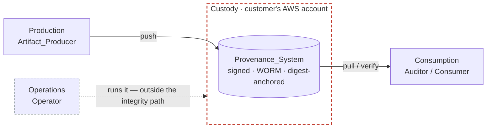
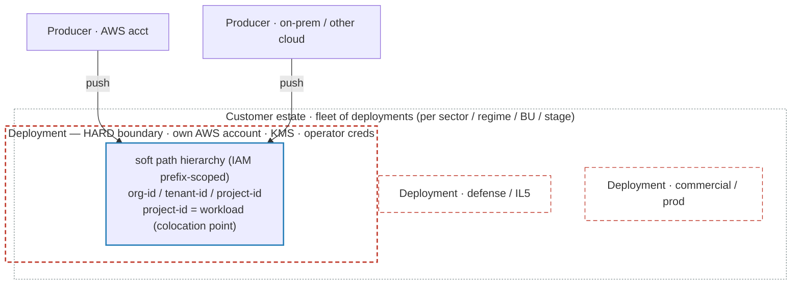

# ADR-0019: Actor model — four axes, integrity independent of the operator

## Status

Accepted (2026-06-23)

## Context

The `access-control` spec names three IAM principals — Artifact_Producer, auditor, and the dedicated alias-mover. It never states the **actor model** behind them: which actors exist, how they relate, and what each is trusted (and not trusted) to do.

Two gaps follow from that omission:

1. **The operator is unmodeled.** Nobody's compliance team runs this system. Every deployment has an operator — an internal platform/SRE org, a managed-service provider (MSP), a systems integrator, or a vendor managed offering. The spec models who *produces* and who *reads* artifacts, but not who *runs the store*. As of this decision that operator is implicit in the CDK deploy role / account admin, and effectively unscoped.

2. **The deployment-modes framing conflates independent axes.** As of this decision, `deployment-modes` offers a binary: Customer_Hosted (single-account, "customer-operated") versus a deferred Service_Hosted (multi-account, vendor-operated, multi-tenant). That binary folds four orthogonal concerns onto one switch:

   1. who custodies the artifacts
   2. who operates the control plane
   3. how many of the customer's accounts one deployment ingests from
   4. whether tenants are pooled.

   The fallout: `access-control`'s as-built path `{appName}-artifact-{regionCode}-{stage}/{account-id}/{project-id}` (ACCESS-002) carries an `{account-id}` segment justified by the wrong rationale (a vendor tenant key). **This is the rejected as-built scheme, not the target — [§5](#5-tenancy-is-real-and-two-level) replaces it**, the `{account-id}` segment most of all.

**The market this serves.** The customers whose compliance burden justifies Cairn operate large AWS estates — tens to thousands of accounts. A single regulated workload spans multiple accounts. One customer runs a **fleet** of Cairn deployments, sharded along workload boundaries: regulatory region/regime, business unit, sector (public / commercial / defense-intelligence), and stage (prod / non-prod).

For the defense/intelligence end of that segment, vendor-owned infrastructure that holds the customer's audit artifacts is a procurement non-starter (FedRAMP High / IL5-6 / air-gap / sovereignty). It is not merely unattractive.

**Scope of this record.** This ADR records the standing architectural stance. It changes **no** Requirement. Downstream `/opsx:propose` changes carry the Requirement-level moves that realign the specs (WHY in each change's `design.md`, WHAT in its spec deltas). Per the ADR boundary in `AGENTS.md`, the scope-unbounded standing decision lives here. The per-Requirement edits do not.

## Decision

**Cairn has four orthogonal actor axes — Production, Custody, Operations, Consumption — each a distinct principal with its own trust posture and cardinality.**

**The load-bearing invariant: artifact integrity is guaranteed independent of the operator.** Operational control does not confer the ability to forge or tamper undetectably. Custody is fixed in the customer's own AWS accounts, and the store is AWS-resident. The operator is agnostic. Producers and consumers may run anywhere (multi-cloud, on-prem, hybrid). Vendor-custody SaaS is retired.

### 1. The four axes and their trust postures

| Axis | Principal | Trusted to | NOT trusted to |
|------|-----------|------------|----------------|
| **Production** | Artifact_Producer | be the source-of-record for an attestation (its identity is part of the artifact) | be *correct* — its claims are auditable, never assumed true |
| **Custody** | the account owner | hold and preserve artifacts, bounded by WORM even against itself | — |
| **Operations** | the operator (platform team / MSP / vendor-managed) | deploy, run, maintain the control plane | forge or tamper undetectably, or move aliases by virtue of operating |
| **Consumption** | auditor / consumer | read and *evaluate* artifacts (establish truth) | write — read-only per ACCESS-003 |

The operator runs the store but sits *outside* the integrity path (dashed below). Custody is the customer's AWS account — the boundary the artifacts never cross. Producers and consumers may run anywhere. Only Custody and Operations are AWS-bound.



The four axes sit on two planes — the standard control/data split:

1. **Data plane** — Production, Custody, Consumption: who creates an artifact, who holds it, who reads it. The artifact is the payload.
2. **Control plane** — Operations: who deploys, configures, and runs the substrate.

This asymmetry is intentional, with one deliberate twist. In the conventional split the control plane *programs and governs* the data plane. Cairn withholds that authority on the integrity dimension. The operator runs the data plane and keeps it available, but it cannot forge or tamper with the artifacts it carries. Integrity is anchored *in* the data plane — the Manifest_Digest, signature, and WORM_Receipt — not conferred by the control plane ([§2](#2-integrity-is-independent-of-the-operator)).

The axes are nonetheless genuinely orthogonal, not a partition with one odd member. The outlier differs by cut. On the plane cut it is Operations (control vs data). On a who-vs-where cut it is Custody (a location/ownership dimension, with no persona, unlike the producer / auditor / operator).

### 2. Integrity is independent of the operator

The operator is **untrusted for integrity by construction.**

Cairn's machinery consists of:

1. digest-anchored verification
2. signing
3. WORM
4. ACCESS-005's rule that a consumer SHALL NOT need to trust that the registry enforced a boundary.

This machinery ensures that a principal with full deploy and admin rights still cannot make a verifying consumer accept an artifact that does not hash, sign, and WORM-receipt correctly. Integrity rests on the Manifest_Digest, not on trusting whoever runs the system.

This dissolves the "self-hosted vs vendor-hosted" question for the Operations axis. Who operates Cairn is a delivery and commercial decision, not a trust decision — no operator, internal or external, sits in the integrity path.

### 3. Custody is fixed; operations is agnostic; vendor-custody SaaS is retired

1. **Custody MUST stay in the customer's own accounts.** The data plane — artifacts, KMS keys, CloudTrail — never leaves the customer's trust boundary. This is the sovereignty/residency guarantee the regulated segment requires.
2. **Operations MAY be performed by any operator** without changing the trust model. That operator can be an internal platform team, MSP, SI, or a vendor managed service deploying *into the customer's accounts*.
3. **Vendor-custody SaaS is out of scope.** The model where custody moves to vendor-owned accounts (previously labeled "Service_Hosted") is retired as a *custody* concept. "Vendor-operated, customer-custodied" remains the expected delivery model. Custody and operations are independent axes. The specs must keep them distinct.

### 4. The Producer is source-of-record, not source-of-truth

Cairn guarantees **what** was attested, **when**, **unchanged**, and **by whom** — integrity, non-repudiation, tamper-evidence, WORM. It does **not** guarantee the attestation is *true*. Establishing truth is the Consumption axis's job.

This boundary is load-bearing. Conflating "the attestation was preserved faithfully" with "the attestation is correct" would misrepresent the product's guarantee.

A corollary: the Producer's identity is itself load-bearing. The signing / non-repudiation machinery proves attestor provenance. For example, it proves that an independent third-party assessor, not the first-party product team, produced an assessment. That proof is what gives the artifact its regulatory weight.

### 5. Tenancy is real and two-level

A single customer's estate is itself multi-tenant. Sectors (public / commercial / defense-intelligence), regulatory regimes, and business units are isolation domains that must not bleed into one another. Tenancy is central to the model, not incidental.

Tenancy lives at two levels. Map each isolation requirement to a boundary of appropriate strength.



**Level 1 — hard boundary = the deployment.** Separate stack, accounts, KMS keys, custody account, and operator credentials, sharded along the Production-axis dimensions (sector / regime / BU / stage). This is an AWS account/stack boundary — strong enough that no single account-admin spans, e.g., defense and commercial. The isolation that *must not* fail rides here. Defense-vs-commercial separation belongs on this boundary, never on a path segment inside a shared store.

**Level 2 — soft sub-tenant scoping = a logical path hierarchy `{org-id}/{tenant-id}/{project-id}`.** All three segments are mandatory and always present, so there is exactly one path shape (no per-segment branching). `org-id` groups tenants. `tenant-id` groups projects. `project-id` is the workload / compliance subject.

The `org-id` **segment** is mandatory from day one. It is an immutable, allocate-once id assigned at onboarding. The org-grouping **feature** (org-scoped roles and cross-tenant queries) is deferred. When that feature is off (the default), the customer has exactly one real org, and all its tenants belong to it. Enabling the feature later is additive (new orgs for new tenants). It needs no path or IAM migration, precisely because the segment was always present.

The two stores enforce this hierarchy differently:

1. **ECR scopes by path prefix.** A repository name embeds the full slash-delimited path, and IAM resource-ARN wildcards match across `/`. A policy grants at `repository/{namespace}/{org-id}/*`, `…/{tenant-id}/*`, or an exact repo. `ecr:CreateRepository` is constrained the same way.
2. **DynamoDB does not** (verified against AWS docs). `dynamodb:LeadingKeys` matches the partition key by *exact* value, not prefix, and a `Query` takes a single exact partition-key value. So the IAM isolation unit must *be* the partition key, and the sub-hierarchy lives in the sort key for `begins_with` queries. `Scan` must be denied (it bypasses `LeadingKeys`).

Level 2 is genuine isolation, with two limits:

1. It is bounded by that one deployment's account-admin / operator blast radius.
2. Per ACCESS-005, an alias-*tag* write within a repository cannot be IAM-conditioned.

So Level 2 is the wrong boundary for hard cross-sector isolation, and the right boundary for intra-tenant fan-in and project scoping.

**Operative constraints on the path segments** (ECR repository names):

1. Names cap at 256 chars over a restricted charset (lowercase alphanumeric with `-` `_` `.` separators and `/` for nesting).
2. Per-account repository count is quota-bound. With the length cap, this bounds how deep and wide the hierarchy can grow.
3. Names are **immutable** — there is no rename API. Each segment MUST be a stable, opaque, allocate-once identifier: never reused, never renamed. Human-friendly or mutable labels live in a control-plane identity registry (the display-name note below). They never live in the name, never in the signed claim, and never in ECR resource tags. Any reorganization is a re-push migration to new repos, not a rename.

**Example** — rejected as-built vs. target. (The concrete ID encoding is `artifact-ingestion` grammar detail. What is load-bearing here is *stable, opaque, immutable* segments.)

```
# rejected as-built (Context §2): producer AWS account baked into the path
cairnproofs4af-artifact-cmh-prod/123456789012/payments-api

# target (this ADR): logical, opaque, immutable hierarchy — org-id always present; project may be a ULID or an immutable slug
cairnproofs4af-artifact-cmh-prod/org-01arz3ndektsv4rrffq69g5fav/tnt-01bx5zzkbkactav9wevgemmvrz/prj-01g65z755afwycf3yxc1rt8vq8
cairnproofs4af-artifact-cmh-prod/org-01arz3ndektsv4rrffq69g5fav/tnt-01bx5zzkbkactav9wevgemmvrz/prj-payments-api
```

The producing workload may span AWS account `123456789012`, another cloud, and on-prem. All three push to the same `prj-…` repo (colocation), and each artifact records its own producing principal as provenance. Display labels — "Acme Federal" / "Defense BU" / "Payments API" — live in a **control-plane identity registry**, where they stay mutable. That registry is a DynamoDB table keyed by opaque id, and it also records the tenant→org parentage. Display labels **never** live in ECR resource tags (console-visible, so they would accidentally leak names to operators). They also **never** live in the signed claim (which carries opaque ids only). A rename is a single-item registry update. Only re-parenting a tenant to a different org is a re-push.

**The producer's identity is not a path segment.** The path groups by *compliance subject* (the workload). A tenant may produce that workload from many environments — multiple AWS accounts, other clouds, or on-prem. Encoding the producing identity in the path would fragment one workload across sibling prefixes and break colocation.

Provenance is recorded elsewhere, and unforgeably:

1. per artifact (claim / Config_Blob / annotations)
2. in the signature
3. in the CloudTrail principal ARN the producer authenticated as (off-AWS producers federate in via IAM Roles Anywhere or OIDC web-identity).

A path prefix would add nothing.

So the segment historically modeled as `account-id` is a **logical `tenant-id`**, not an AWS account. The `Account_ID` glossary term must be retired or redefined to the logical-tenant meaning. It previously denoted a vendor-assigned namespace — an artifact of the vendor-pooled model this ADR also retires.

Two things are rejected, never tenancy itself:

1. **Vendor-custodied tenancy** — custody stays with the customer.
2. **Producer-account-as-organization-key** — it fragments multi-account workloads and is redundant with the signature.

Producer-from-product-account → custody-in-a-central-audit-account is the canonical artifact-escrow topology. Producer/custodian separation is a separation-of-duties control. The team whose product is under scrutiny does not control the account that retains the artifacts. WORM enforces no-delete even if it does.

### 6. The fleet is the operational surface

Sharding originates on the Production axis. Regime, BU, sector, and stage are properties of the workload, i.e. the Producer. The axes therefore have different cardinalities:

1. Many **Producers** — per product / account.
2. Fewer **custody** domains — per sector / regime, driven by residency and isolation.
3. Fewer **operators** still — one platform team or MSP runs the fleet.
4. **Consumers** scoped per regime / sector.

One customer running many consistent Cairn deployments is the norm, not the exception.

### 7. Producers and consumers are location-agnostic

The Production and Consumption axes are not AWS-bound. Any client that can ORAS push/pull or use the Cairn SDK / CLI is a producer or consumer. Multi-cloud, on-prem, and hybrid workloads are therefore supported by construction, not as a special case. Artifacts are produced wherever the workload runs and consumed wherever the auditor sits.

The Custody and Operations axes are AWS-resident. The Provenance_System — ECR, S3, DynamoDB, AWS Signer — runs in AWS, and its data plane stays in the customer's own AWS accounts ([§3](#3-custody-is-fixed-operations-is-agnostic-vendor-custody-saas-is-retired)). So the four axes split on locality: **Custody and Operations are in AWS. Production and Consumption may be anywhere.**

An off-AWS producer or consumer still authenticates through an AWS principal — preferably federated via IAM Roles Anywhere or OIDC web-identity rather than long-lived keys. The IAM path scoping ([§5](#5-tenancy-is-real-and-two-level)), CloudTrail provenance, and signature checks hold regardless of where the client runs. The federating AWS principal is the auth bridge, not the producer's home.

## Consequences

**Positive**

1. The "self vs vendor hosted" debate is settled on the right axis. Custody is fixed in customer accounts, and operations is free to vary. Integrity holds regardless of either — a stronger statement than "self-hosted."
2. A single actor model now explains questions that previously had ad-hoc answers. The path-hierarchy rationale, the unmodeled operator, the retirement of Service_Hosted-as-custody, and the fleet design all follow from the four axes and their trust postures.
3. The producer's source-of-record-but-not-truth boundary is stated once. This protects the product against the "we vouch for the attestation's correctness" misread.
4. Producer/custodian separation is recognized as a separation-of-duties control, which argues *for* the multi-account fan-in topology rather than treating it as incidental complexity.
5. Multi-cloud, on-prem, and hybrid producers and consumers are supported by construction. Production and Consumption are location-agnostic, while only Custody and Operations are AWS-resident. No per-environment integration is implied.

**Negative**

1. **An operator-role Requirement hole is now exposed.** As of this decision the Operator is unmodeled and effectively unscoped. Closing it is a downstream `/opsx:propose` change against `access-control`. That change brings a first-class, least-privilege operator role. The role does not auto-carry the alias-mover grant, and WORM and least-privilege bound its delete/DoS/read blast radius.
2. **`deployment-modes` must be realigned** to separate custody from operations and to retire Service_Hosted as a custody concept. That realignment is a downstream change carrying the WHAT, with this ADR as the WHY.
3. **ACCESS-002's path must be re-modeled** as the logical hierarchy `{org-id}/{tenant-id}/{project-id}`. All segments are mandatory, with one uniform path shape. The path is IAM-scopable via ECR resource-ARN prefix wildcards. The producing identity moves out of the path into per-artifact provenance (claim + CloudTrail + signature). The segment formerly named `account-id` becomes a logical `tenant-id`. The `Account_ID` glossary term and the `artifact-ingestion` path grammar reconcile accordingly. The OpenSpec flow carries this re-model and the `accountId`→`tenantId` claim reconciliation.
4. **The model is a stance, not yet normative.** Encoding it into the specs is downstream work. In the interim, its obligations (custody distinct from operations, operator outside the integrity path) rest on review discipline, not `openspec validate`.
5. **The axes need formalizing as vocabulary and personas.**
   - `openspec/personas/personas.md` is the home for the axis↔persona association: Production↔producer personas, Consumption↔auditor/reviewer personas, Operations↔operator personas. Custody maps to account-ownership, not a persona.
   - That reconciliation landed. The personas doc now opens with the four axes, marks operators untrusted-for-integrity, and uses `{tenant-id}/{project-id}` paths.
   - The glossary terms are reconciled through the OpenSpec flow. The glossary is a flow-injected spec input, so terms land with the Requirements that use them, not via this record-only ADR. (`control plane` and `data plane` are the exception. They are cross-cutting actor-model framing rather than per-Requirement terms, so they are defined directly against this ADR as their authority.)
6. **ECR and metadata-index isolation are not symmetric** (verified against AWS docs).
   - ECR gives true hierarchical prefix scoping via resource-ARN wildcards.
   - DynamoDB does not. `dynamodb:LeadingKeys` is exact-match on the partition key, and `Query` takes a single partition-key value.
   - So the metadata-index key schema must put the IAM isolation unit at the partition key, the queryable sub-hierarchy at the sort key (`begins_with`), and deny `Scan`.
   - A principal scoped above partition-key granularity (e.g. an org spanning many tenants) cannot reach its subtree in one `Query`. That needs a GSI or per-partition iteration.
   - The `access-control` / `metadata-index` Requirement work must encode this, not paper over it.

## Alternatives considered

1. **Keep the Customer_Hosted / Service_Hosted binary.** Rejected: it folds four orthogonal axes onto one switch, mislabels the topology, and attaches a vendor-tenancy rationale to a path segment whose real use is intra-customer fan-in.
2. **Go vendor-custody SaaS (run "Service_Hosted" everywhere) for operational uniformity.** Rejected: it inverts the trust model, fails procurement for the defense/intelligence segment outright, and requires *building* the deferred multi-account isolation while deleting the working mode. That is more work for a weaker product.
3. **Treat "who operates Cairn" as a trust decision.** Rejected: integrity is digest-anchored and operator-independent, so the operator is not in the integrity path. Operations is a delivery/commercial choice, not a trust boundary.
4. **Leave the operator modeled implicitly as account admin.** Rejected: an unscoped operator is a real least-privilege and separation-of-duties gap. The actor model requires a first-class, bounded principal.
5. **Encode the producer's AWS account as the path's grouping segment.** Rejected: a workload spanning multiple producer accounts would fragment across sibling prefixes, breaking colocation. Also, the signature and CloudTrail already prove the producing principal unforgeably. Provenance belongs in per-artifact metadata, not the organization key. The path groups by compliance subject.

## References

- `AGENTS.md`, sections "docs/ is engineering reference, not spec" (ADR boundary) and "Conventions / single source of truth".
- `openspec/specs/access-control/spec.md` — ACCESS-002 (producer project scoping), ACCESS-003 (read-only auditor), ACCESS-005 (alias-movement boundary; integrity not resting on the IAM boundary).
- `openspec/specs/deployment-modes/spec.md` — the deployment-topology capability this ADR reframes (custody distinct from operations).
- `openspec/specs/signing/spec.md` and `openspec/specs/worm-archive/spec.md` — the digest-anchored, non-repudiation, and WORM machinery that makes integrity operator-independent.
- `openspec/personas/personas.md` — the human-actor doc the axis↔persona association lands in (and that this ADR obsoletes in part).
- This ADR's Requirement-level moves land through the OpenSpec flow: the operator role, the custody/operations split, the `{org-id}/{tenant-id}/{project-id}` re-model, metadata-index tenant isolation, and the `accountId`→`tenantId` claim reconciliation.
- ADR-0018 (format-agnostic foundation) — precedent for an ADR recording a cross-cutting stance whose per-Requirement moves land via a separate opsx change.
- AWS docs (verification basis for [§5](#5-tenancy-is-real-and-two-level)'s DynamoDB constraint): DynamoDB fine-grained access control / `dynamodb:LeadingKeys` — https://docs.aws.amazon.com/amazondynamodb/latest/developerguide/specifying-conditions.html ; the `Query` single-partition-key constraint — https://docs.aws.amazon.com/amazondynamodb/latest/developerguide/Query.html
