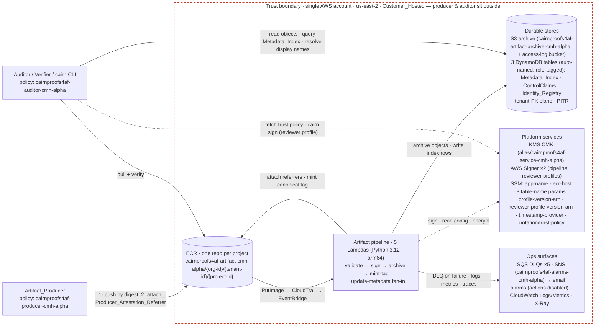
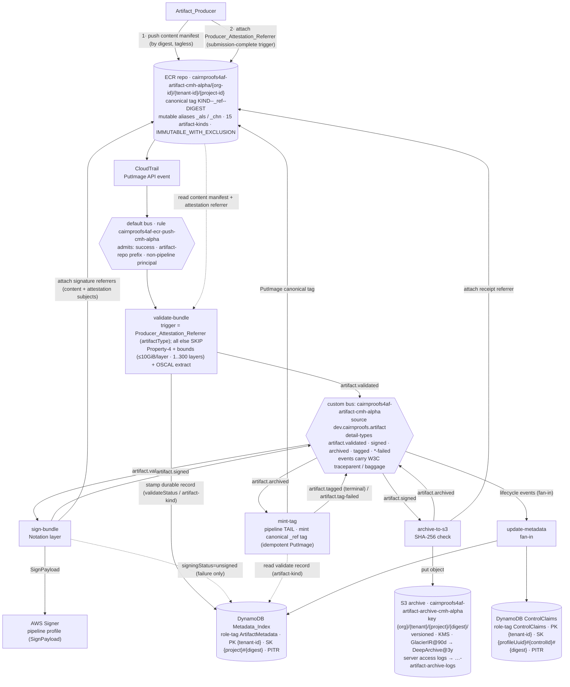
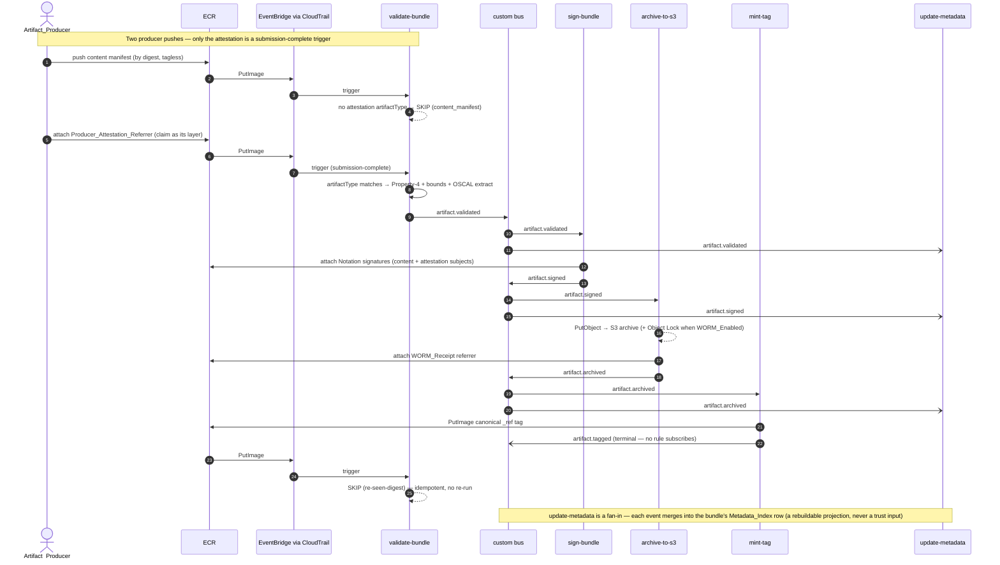
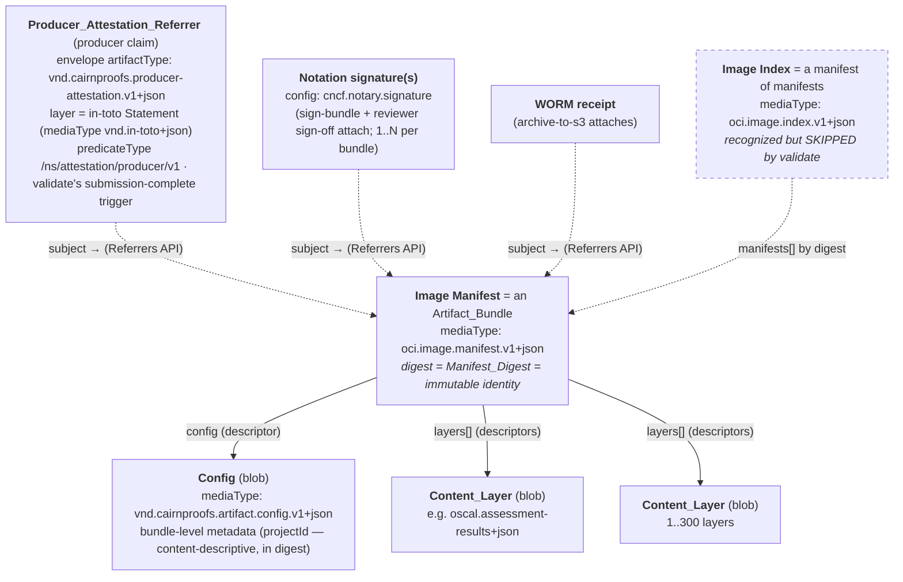

# Cairn Proofs — as-deployed architecture

_Last updated: 2026-06-25_

Current-state diagrams of the single deployed stack, derived from the CDK app ([cdk/lib/artifact-store-stack.ts](../cdk/lib/artifact-store-stack.ts) + [cdk/lib/constructs/](../cdk/lib/constructs), composed through the one naming helper [cdk/lib/naming.ts](../cdk/lib/naming.ts)). It captures what is provisioned today; for canonical requirements and the intended steady state see [openspec/specs/](../openspec/specs). Change history lives in the [CHANGELOG](../CHANGELOG.md).

- **Stack:** `cairnproofs4af-cmh-alpha`
- **`appName`:** `cairnproofs4af` (`cairnproofs` + the frozen 3-char token `4af` from [cdk/app-config.json](../cdk/app-config.json)). Every physical resource name is `{appName}-{resource}-{qualifier}`; Signer profiles underscore the whole form, and the stack itself is the 2-segment `{appName}-{qualifier}` exception.
- **Region / stage:** `us-east-2` (cmh) / `alpha` — qualifier `cmh-alpha`. The region is sourced from the operator's `CAIRN_ALPHA_REGION`; `regionCode` is derived from the committed [region-codes.ts](../cdk/lib/region-codes.ts) registry (`us-east-2` → `cmh`).
- **Mode:** Customer_Hosted, single account, one region, one stage, seeded for a single org/tenant/project (`mvp-org` / `mvp-tenant` / `mvp-project`).
- **`isProd`:** `false` — stateful resources are DESTROY + auto-empty so `cdk destroy` orphans nothing. The teardown gate is decoupled from WORM; production sets `isProd=true` (RETAIN, no auto-empty).
- **`WORM_Enabled`:** `false` (no S3 Object Lock — irreversible if later enabled at bucket creation). `WORM_Enabled=true` is rejected at synth unless `isProd=true`.

**The happy path:** a producer pushes a content manifest to ECR by digest (tagless), then attaches a `Producer_Attestation_Referrer` carrying its compliance claim — that attach is the submission-complete trigger. ECR → CloudTrail → EventBridge fans the push to `validate-bundle`, which promotes only the attestation referrer (everything else is a benign skip) through a five-stage pipeline — **validate → sign → archive → mint-tag**, with `update-metadata` as a fan-in. Identity is the content-addressed `Manifest_Digest`; the DynamoDB index is a rebuildable projection, and a `cairn verify` verdict re-derives from the ECR artifact + OCI referrers + trust policy alone, never the index.

Capitalized terms (`Manifest_Digest`, `Config_Blob`, `Producer_Attestation_Referrer`, `Artifact_Bundle`, `WORM_Receipt`, …) are defined in the [glossary](../openspec/GLOSSARY.md).

## System context

_Who sits inside the trust boundary, the pipeline as a single unit, and the platform and ops surfaces it depends on. Drill into the pipeline in the next diagram; the causal order of one push is in [§A single push](#a-single-push-end-to-end)._

## Pipeline and data flow

_Static wiring of the five-stage pipeline and the side effect each stage performs against ECR, S3, the data-plane DynamoDB tables, and AWS Signer. The default-bus rule is an admission boundary (fact 7); the custom bus routes progression; only `update-metadata` is a fan-in._

_Cross-cutting wiring is uniform, not topological, so it's kept out of both diagrams: every store is encrypted by the one service KMS CMK (fact 13); every Lambda has its own SQS DLQ feeding the alarm set (fact 15); and every stage emits CloudWatch Logs (`/aws/lambda/cairnproofs4af-*-cmh-alpha`), EMF metrics (`CairnProofs/cmh-alpha`), and X-Ray spans (fact 14). Per-Lambda memory/timeout and retention windows are tuning values — read them from [cdk/lib/constructs/lambda-functions.ts](../cdk/lib/constructs/lambda-functions.ts) and the per-resource constructs in the same directory._

## A single push, end to end

The pipeline diagram above shows static wiring; this shows the *causal* order of one push — including the two-push producer handshake and the inverted trigger that a static diagram can't convey.

## Key as-deployed facts

Facts 1–5 are the load-bearing invariants — the trust and identity model a reader should leave with. Facts 6–15 record topology and configuration.

### Fact 1 — `validate-bundle` promotes only the Producer_Attestation_Referrer (inverted trigger, design D5)

Identity and claim are split. The content manifest and its [Config_Blob](../libs/oci/cairn_oci/config_blob.py) carry only content-descriptive metadata. The producer's compliance claim travels in a separately-attached, signable [Producer_Attestation_Referrer](../libs/oci/cairn_oci/producer_attestation.py) (OCI envelope `artifactType: application/vnd.cairnproofs.producer-attestation.v1+json`).

That referrer's single layer holds a standard **in-toto Statement** (layer `mediaType: application/vnd.in-toto+json`): `_type` `https://in-toto.io/Statement/v1`, a single-element `subject` binding the content `Manifest_Digest`, `predicateType` `https://cairnproofs.dev/ns/attestation/producer/v1` (naming convention in [ADR-0015](adr/0015-ns-rooted-uri-namespace-for-cairn-minted-identifiers.md)), and the producer claim fields (`artifactKind`, `controls`, `catalogOrProfileUuid`, `assessmentPeriod`, `assessor`, `assessmentId`, `supersedes`, …) as the `predicate`.

The handler fires on every qualifying push but promotes to Property-4 validation only a manifest carrying the attestation `artifactType` over a content-manifest `subject`. Every other push — bare content manifest, signature, empty config, image index, subject-less or already-seen — is a benign `ValidationSkipped` no-op, never a failure: it emits the `SkipReason`-dimensioned `ValidationSkipped` count, never the `Failure` metric or an `artifact.validation-failed` event.

`read_claim_from_statement` reads the claim from the referrer's in-toto layer (asserting the Cairn `predicateType` and a single-element `subject`), never reconstructing it from the content manifest. Validate also runs a dual-subject consistency check confirming the Statement's own subject agrees with the OCI envelope `subject`; the envelope `subject` remains the sole anti-hijack authority. See [§Inverted ingestion trigger](#inverted-ingestion-trigger-validate-promotes-only-the-producer_attestation_referrer) for the full skip-reason taxonomy.

### Fact 2 — Verification is index-independent; the index is a rebuildable projection

A [cairn verify](../cli/cairn_cli/verify.py) verdict re-derives from the ECR artifact, its OCI signature referrers, and the trust policy alone — it constructs only `ssm` + `ecr` clients, never a DynamoDB client, and never reads the `Metadata_Index`. The signed subject is the OCI `Manifest_Digest` over the stored bytes (a Merkle commitment to every layer), so verification is byte-exact with no canonicalization step. The `Metadata_Index` is a rebuildable projection, not a trust input.

### Fact 3 — Identity is the content-addressed `Manifest_Digest`; tags are pipeline-minted addresses

Producers push **by digest (tagless)**. Once the artifact is durable, `mint-tag` mints the single canonical tag form `{artifact-kind}--_ref--{digest}`, reading only the `artifact-kind` from the durable digest-keyed record that `validate-bundle` stamped on the `Metadata_Index` table (the `digest` segment is the Manifest_Digest prefix; `mint-tag` never re-reads producer free text).

The canonical tag carries no producer free text and no content-type branch, so it cannot misrepresent a multi-file bundle. Every validated artifact is tagged — there is no "untagged / digest-only" outcome. Human-friendly naming rides the mutable alias forms instead: `{artifact-kind}--_als--{name}` (named alias) and `{artifact-kind}--_chn--{channel}` (channel pointer).

Repos are created `IMMUTABLE_WITH_EXCLUSION`: the canonical `_ref` tag cannot be overwritten, and only the reserved `*--_als--*` / `*--_chn--*` namespace is mutable. A verdict is never keyed on a mutable alias. An ECR lifecycle rule reaps untagged manifests after 90 days (INGEST-027). That window dwarfs the validate→sign→archive→mint latency during which a new content manifest is legitimately untagged, so an in-flight bundle never ages out before `mint-tag` applies its canonical tag.

### Fact 4 — Derived identities are deterministic

`validate-bundle` builds the OSCAL back-matter resource (and other Derived_Identities) with [uuid5(CAIRN_NAMESPACE, manifest_digest)](../libs/oci/cairn_oci/identity.py), anchored on a frozen namespace (`uuid5(NAMESPACE_DNS, "cairnproofs.dev")`) so the `Metadata_Index` stays rebuildable from ECR + S3 alone (metadata-index [META-012]). The OSCAL root document's own uuid is preserved separately in `document-ids[]`. The resource rides each lifecycle event as the `artifactResourceReference` field.

### Fact 5 — WORM is opt-in, and off here; teardown is a separate gate

The S3 archive bucket is versioned + KMS-CMK + lifecycle-tiered (Glacier IR @90d → Deep Archive @3y) but has no Object Lock. Object Lock must be enabled at bucket creation and cannot be added later — production requires `WORM_Enabled=true`. Teardown-readiness is governed by the **separate** `isProd` gate ([removal-policy.ts](../cdk/lib/constructs/removal-policy.ts)): `isProd=false` makes every stateful resource DESTROY + auto-empty (clean `cdk destroy` on this disposable alpha); `isProd=true` makes them RETAIN. A stack-wide `ProductionTeardownGuard` aspect fails synth if any stateful resource is ever deletable on an `isProd=true` stack, and the stack rejects `WORM_Enabled=true` unless `isProd=true` (an Object-Lock bucket cannot be auto-emptied).

### Fact 6 — The pipeline is five stages

`validate → sign → archive → mint-tag`, with `update-metadata` as a fan-in. `mint-tag` is the **tail**, triggered by `artifact.archived`, so a mint failure leaves an *archived-but-untagged* (recoverable) artifact rather than a tagged-but-unarchived one. It emits `artifact.tagged` on success (a terminal event — no rule subscribes to it) and `artifact.tag-failed` on failure.

`update-metadata` subscribes to `artifact.validated`, `artifact.signed`, `artifact.signing-failed`, `artifact.archived`, and `artifact.archive-failed` — **not** `artifact.validation-failed` (no `Metadata_Index` row exists yet for that).

The five Lambdas are arm64 Python 3.12 with per-stage memory/timeout: `validate-bundle` (1024 MB / 5 min), `sign-bundle` (1024 MB / 3 min, Notation layer mounted), `archive-to-s3` (2048 MB / 10 min, sized for blob-stream throughput), `update-metadata` (512 MB / 2 min), `mint-tag` (512 MB / 2 min).

### Fact 7 — Ingress is event-driven, not synchronous

ECR `PutImage` → CloudTrail → EventBridge *default* bus rule (`cairnproofs4af-ecr-push-cmh-alpha`) → `validate-bundle`. The CloudTrail path, not the ECR-native event, carries `userIdentity` for the `authenticatedPushPrincipal` field.

The rule is an admission boundary, not a pass-everything subscription. It matches only successful pushes (`errorCode` absent), this deployment's artifact repos (`requestParameters.repositoryName` prefix `cairnproofs4af-artifact-cmh-alpha/`), and principals whose `userIdentity.arn` is `anything-but` a wildcard list of this deployment's own `sign-bundle` / `archive-to-s3` / `mint-tag` role-sessions — so the pipeline's own referrer and tag pushes never self-trigger validation. `validate-bundle` and `update-metadata` are absent from the exclusion list.

The in-handler classifier (fact 1) remains the authoritative, fail-closed gate for whatever reaches the Lambda. The rule filter is a strictly-upstream, fail-safe optimization keyed on always-present fields.

### Fact 8 — One ECR repo per project under an actor-model tenancy hierarchy

Artifacts live at the uniform three-segment logical hierarchy `cairnproofs4af-artifact-cmh-alpha/{org-id}/{tenant-id}/{project-id}` — exactly one path shape, all three segments mandatory, each a stable, opaque, immutable, allocate-once id. `{tenant-id}` is a **logical** tenant, never an AWS account; the producing identity (the account, cloud, or host a bundle is pushed from) is recorded per-artifact through the signed claim, the CloudTrail push principal, and the signature — never a path segment. The alpha is seeded for a single org/tenant/project (`mvp-org` / `mvp-tenant` / `mvp-project`) at deploy.

The artifact-kind vocabulary (15 canonical values — 8 OSCAL document roles + 7 non-OSCAL document roles, design D1) lives only in [libs/oci/cairn_oci/categories.py](../libs/oci/cairn_oci/categories.py); CDK no longer mirrors it. The ECR namespace, the Notation trust-policy registry scope, and the pipeline IAM ARN patterns all derive from the one `Naming.artifactNamespace` (`cairnproofs4af-artifact-cmh-alpha`) — there is no independent literal interpolation (T-01/M-1).

### Fact 9 — Data-plane wire identifiers use the `cairnproofs` scheme

Manifest annotation keys and the EventBridge `source` use the dotted `dev.cairnproofs.artifact` namespace. The content manifest's sole Cairn identity annotation suffix is `dev.cairnproofs.artifact.project-id` (`org.opencontainers.image.created` is also present but pinned to a fixed epoch sentinel so it carries no ambient state and keeps the digest reproducible); the producer claim fields, including `artifact-kind`, `controls`, and `assessment-period`, ride in the Producer_Attestation_Referrer's in-toto Statement, not as manifest annotations. The EventBridge `source` is `dev.cairnproofs.artifact` with `artifact.<verb>` detail-types.

Media types use `application/vnd.cairnproofs.*`: `vnd.cairnproofs.artifact.{config,resource,worm-receipt}.*` (the `resource` media type carries the universal evidence-reference referrer) and `vnd.cairnproofs.producer-attestation.v1+json` (the Producer_Attestation_Referrer's OCI envelope `artifactType`). The producer claim it carries is a standard in-toto Statement (layer `mediaType: application/vnd.in-toto+json`, `predicateType: https://cairnproofs.dev/ns/attestation/producer/v1`).

The DynamoDB projection attribute is `artifactResourceReference`, and ECR repos sit under the `cairnproofs4af-artifact-cmh-alpha/` prefix. AWS resource names (the `cairnproofs4af-artifact-cmh-alpha` bus, the `cairnproofs4af-*-cmh-alpha` rule names) are physical-name strings, not wire identifiers, and follow the `{appName}-{resource}-{qualifier}` convention instead.

### Fact 10 — Two signing subjects, two profiles, one trust policy

`sign-bundle` signs **two independent subjects** per submission — the content manifest and the separately-attached Producer_Attestation_Referrer — each as its own digest-keyed `cncf.notary.signature` referrer. The promotion gate is **both**: a half-signed content-only submission never advances, and a failure on either subject fails the whole invocation. Each subject's signing is independently idempotent — a re-seen subject digest reuses its existing signature rather than re-signing, and the invocation short-circuits only when both are already signed.

Two AWS Signer profiles share the `Notation-OCI-SHA384-ECDSA` platform (5-year signature validity): `cairnproofs4af_artifact_pipeline_signing_cmh_alpha` (used by `sign-bundle`) and `cairnproofs4af_artifact_reviewer_signoff_cmh_alpha` (used by an independent human Attesting Reviewer via `cairn sign`, distinct from the read-only auditors who never sign). Both profiles produce `cncf.notary.signature` referrers, so a manifest carries 1..N signatures.

The rendered Notation trust policy at SSM `/cairnproofs4af/alpha/notation/trust-policy` is a single strict policy whose `trustedIdentities` pin both profile version ARNs (never a wildcard, never two policies over the same registry scope). The reviewer sign-off authorization is a distinct sign-only managed policy (`cairnproofs4af-reviewer-signoff-cmh-alpha`, scoped to the reviewer profile ARN) kept off the read-only auditor policy. The signing pipeline's TimestampProvider is `system-clock` (SSM `/cairnproofs4af/alpha/signing/timestamp-provider`).

### Fact 11 — Three DynamoDB tables: two rebuildable projections plus one control-plane registry

The data plane is two **rebuildable** projection tables; the third is **canonical** control-plane state. All three are auto-named (no fixed `tableName`, so a future key-schema change replaces cleanly), labeled with a `cairn:resource` role tag, on-demand billing, PITR enabled, and CMK-encrypted. Their resolved physical names are published to SSM for out-of-stack consumers (`tables/metadata`, `tables/control-claims`, `tables/identity-registry`).

1. **Metadata_Index** (role tag `ArtifactMetadata`) — one row per Artifact_Bundle. PK `pk` = `{tenant-id}`; SK `sk` = `{project-id}#{manifest-digest}` (project-scoped listing via `begins_with`).
2. **ControlClaims** (role tag `ControlClaims`) — the (catalog/profile, control) → bundle relationship; a bundle *citing* a control is a producer-claim fact. PK `pk` = `{tenant-id}`; SK `sk` = `{catalogOrProfileUuid}#{controlId}#{manifest-digest}` (the catalog/profile UUID segment disambiguates the OSCAL token-id name clash).
3. **Identity_Registry** ([identity-registry.ts](../cdk/lib/constructs/identity-registry.ts), role tag `IdentityRegistry`) — control-plane resolution of an opaque `{org-id}`/`{tenant-id}`/`{project-id}` to its human display name plus the tenant→org parentage. PK `id` = the opaque coordinate. Display names live only here, never on the ECR/S3 path or the signed claim; losing it costs only display-name resolution, never identity or verifiability. Seeded at deploy for the single org/tenant/project via idempotent (`attribute_not_exists(id)`) `AwsCustomResource` PutItems; the `cairn` CLI/TUI read it to resolve names at query time.

The two data-plane tables share a single **tenant-PK plane**: `{tenant-id}` is always the partition key, scoped exact-match by `dynamodb:LeadingKeys` (never a partition-key prefix). No LSI sits on this plane, and any future GSI MUST itself lead with `{tenant-id}` so the same `LeadingKeys` binding holds; no GSI ships today.

### Fact 12 — Six IAM policy templates ship as reusable, unattached building blocks

[iam-roles.ts](../cdk/lib/constructs/iam-roles.ts) ships six templates:

1. `cairnproofs4af-producer-cmh-alpha` — ECR push into the project repo (bare project-repo ARN; one repo per project, no `/*` sub-repo form).
2. `cairnproofs4af-alias-mover-cmh-alpha` — a distinct alias-movement boundary (`ecr:PutImage` + `ecr:BatchGetImage` to repoint `_als`/`_chn` tags), separate from push and sign so holding producer or signer rights does not by that fact confer alias movement.
3. `cairnproofs4af-auditor-cmh-alpha` — read-only: ECR pull, S3 archive read, and `Metadata_Index` query (`Query`/`GetItem`/`BatchGetItem`, no `Scan`).
4. `cairnproofs4af-operator-cmh-alpha` — the least-privilege control-plane operator: ALLOW the describe/list/get + config + observability surface to provision and run the substrate, with an explicit DENY guardrail (no manifest/alias write, no sign, no image/repo/table delete, no archive-object mutate/delete, no data-plane item write, no evidence-plaintext `kms:Decrypt`, no key disable/destroy). Untrusted for integrity by construction.
5. `cairnproofs4af-reviewer-signoff-cmh-alpha` — the distinct sign-only grant of fact 10.
6. `cairnproofs4af-trust-policy-write-protect-cmh-alpha` — an explicit DENY on `ssm:PutParameter`/`ssm:LabelParameterVersion`/`ssm:DeleteParameter` against the trust-policy SSM parameter, attached to non-deploy principals so the verification policy cannot be silently substituted.

The auditor policy's DynamoDB grant is scoped to the `Metadata_Index` table alone (plus its `/index/*`). No template grants the `ControlClaims` table — its only runtime principal is `update-metadata` (read+write). The `Identity_Registry` is written only by the deploy-time seed custom resource and read out-of-band by the CLI/TUI; no Lambda execution role touches it. Per-Lambda execution roles are not templated here; each is provisioned next to its Lambda at least privilege.

### Fact 13 — One service KMS CMK

[encryption.ts](../cdk/lib/constructs/encryption.ts) (`alias/cairnproofs4af-service-cmh-alpha`) encrypts ECR, S3, all three DynamoDB tables, and the SQS DLQs, with key rotation enabled. Lambda access is gated by `kms:ViaService` conditions. (The SNS alarm topic is not CMK-encrypted.)

### Fact 14 — Tracing is one X-Ray trace per push

Every Lambda runs the AWS-managed ADOT collector-only arm64 layer (`aws-otel-collector-arm64-ver-0-117-0:1`, publisher account `901920570463`) alongside `Tracing.ACTIVE`; the observability lib does manual OTEL instrumentation (no Python auto-instrument wrapper). Propagators are `tracecontext,baggage,xray`, `OTEL_SERVICE_NAME` is `cairnproofs4af-service-cmh-alpha`, and each emitted pipeline event carries W3C `traceparent`/`baggage`, so the whole validate→sign→archive→mint→metadata fan stitches into a single X-Ray trace and each log line's `traceId` correlates to the X-Ray-console trace.

`BotocoreInstrumentor` is wired into the same manual bootstrap, so every in-pipeline boto3 call (DynamoDB, S3, KMS, EventBridge) emits a child span under the active handler span, tagged with the AWS service/operation and marked error/fault on a failed or throttled call. DEFAULT config only, so subsegments carry service/operation metadata and never request/response body content. Metrics are emitted via EMF (no `cloudwatch:PutMetricData` grant) under the `CairnProofs/cmh-alpha` namespace.

### Fact 15 — Two failure surfaces

Business-logic `artifact.validation-failed` / `artifact.signing-failed` / `artifact.archive-failed` events route straight to SNS (three EventBridge→SNS rules). `mint-tag`'s `artifact.tag-failed` has no SNS rule, so a mint failure surfaces only via the mint-tag DLQ. Lambda async-invoke failures land in per-Lambda SQS DLQs (14-day retention, KMS-encrypted).

The CloudWatch alarm surface is three design-independent groups that watch AWS-managed metrics:

1. a DLQ-depth alarm per queue (`AWS/SQS::ApproximateNumberOfMessagesVisible`);
2. a `DeadLetterErrors` alarm per pipeline Lambda (`AWS/Lambda::DeadLetterErrors`, which catches the DLQ-write IAM/KMS regression that leaves depth at 0);
3. an archive-to-s3 duration-envelope alarm (`AWS/Lambda::Duration` MAXIMUM > 8 min = 480 000 ms, `cairnproofs4af-archive-to-s3-duration-cmh-alpha`).

All three keep evaluating and stay console-visible, but their SNS actions are gated on the effective posture `isProd || alarmActionsEnabled` (the `Alarms` construct's `actionsEnabled`). On this deployment both inputs are false — `isProd=false` and the `alarmActionsEnabled` prop is unset (the bin entrypoint never passes it) — so the alarms publish no SNS notification; a production stack (`isProd=true`) enables them automatically, and a non-production stack can opt in via `alarmActionsEnabled` without any re-wire. `validate-bundle` additionally writes permanent validation rejections to its own DLQ **in-band** at classification time (failure reason and failed criteria in the message body, via an explicit `sqs:SendMessage` grant scoped to the validate DLQ), so a permanent rejection is not subjected to async-invoke retry. Transient failures still reach a DLQ via async-invoke retry exhaustion.

## Client tooling (not part of the deployed stack)

The `cairn` CLI ([cli/cairn_cli/](../cli/cairn_cli)) provides `push` / `pull` / `verify` / `query` / `alias` / `sign` / `config` plus a read-only operator TUI (`cairn tui`). It is a client tool, not stack infrastructure; it appears in the diagram on the producer (push-by-digest), auditor (read), and Attesting-Reviewer (`cairn sign` sign-off) paths.

## OCI object model (artifact primitives the store uses)

Everything above moves OCI artifacts through ECR. The store is built on a small set of OCI primitives; this is the structural model the pipeline assumes.

The five primitives in play:

| Primitive | What it is | Where the store uses it |
| --- | --- | --- |
| **Blob** | Opaque bytes named by their own `sha256` digest (content-addressed). | Every Content_Layer and the Config blob. [cairn_oci/digest.py](../libs/oci/cairn_oci/digest.py). |
| **Descriptor** | A typed pointer `{ mediaType, digest, size, … }`. | [manifest.py](../libs/oci/cairn_oci/manifest.py)`:Descriptor` — the glue in every manifest. |
| **Image Manifest** | One artifact: a `config` descriptor + `layers[]`. Its own digest is the immutable identity. | This **is** an Artifact_Bundle. [manifest.py](../libs/oci/cairn_oci/manifest.py)`:OciManifest`. |
| **Config** | A blob whose `mediaType` says *what the artifact is*. | `vnd.cairnproofs.artifact.config.v1+json` (a bundle); the store also recognizes `cncf.notary.signature` and `oci.empty.v1+json` as pipeline-internal. |
| **Subject + Referrers** | A manifest naming another manifest as its `subject`; the registry indexes it so "what refers to X?" is answerable without changing X. | The producer Producer_Attestation_Referrer (the claim carrier and validate's trigger), Notation signatures, and WORM receipts; the TUI reads them via `ecr:ListImageReferrers`. |

The **Image Index** ("a manifest of manifests") is the one primitive the store recognizes but does not use as a first-class object — see the next section.

## Inverted ingestion trigger (validate promotes only the Producer_Attestation_Referrer)

`validate-bundle` fires on every qualifying ECR push, then discriminates in-handler on the triggering manifest's top-level `artifactType`. Only a manifest whose `artifactType` is the Producer_Attestation_Referrer media type (`application/vnd.cairnproofs.producer-attestation.v1+json`) over a content-manifest `subject` is **promoted** to Property-4 validation. Every other push — a bare content manifest, a Notation signature, an OCI empty config, an image index, a subject-less attestation, or an already-seen digest — **stops** with a `SkipReason`-dimensioned `ValidationSkipped` metric and returns cleanly. A skip is a **benign no-op, not a failure**: it raises no failure event and writes no DLQ entry, so it neither emits a `Failure` metric nor produces an `artifact.validation-failed` event (a promoted validation emits `Success` or `Failure`; a skip emits only `ValidationSkipped`). (The handler reuses `cairn_oci.classify_pipeline_internal` for the `image_index` / `notary_signature` / `oci_empty` shapes and falls back to handler-local reasons — `content_manifest`, `not_attestation`, `attestation_missing_subject`, `re-seen-digest` — for the rest.)

**Why the trigger is inverted.** Identity and claim are split: the content manifest and its Config_Blob carry only content-descriptive metadata, while the producer's compliance claim travels in a separately-attached, independently-signable Producer_Attestation_Referrer. `cairn push` therefore pushes the content manifest first, then attaches the Producer_Attestation_Referrer over it; that referrer's `PutImage` is the **submission-complete** signal, so a content-only push that never receives its attestation is an incomplete submission and is never promoted. Keying promotion on the attestation `artifactType` also closes the self-trigger loop. ECR's Referrers API attaches signatures and receipts as their own manifests, each firing its own `PutImage` → CloudTrail → `validate-bundle` event. But the store's own plumbing pushes (signatures, receipts, the image index, even the content manifest itself) all lack the attestation `artifactType` and fall into the skip path rather than re-entering validation as producer evidence.
