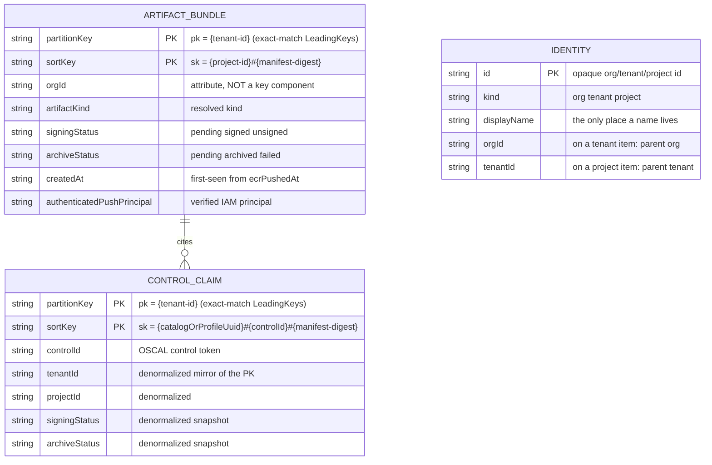
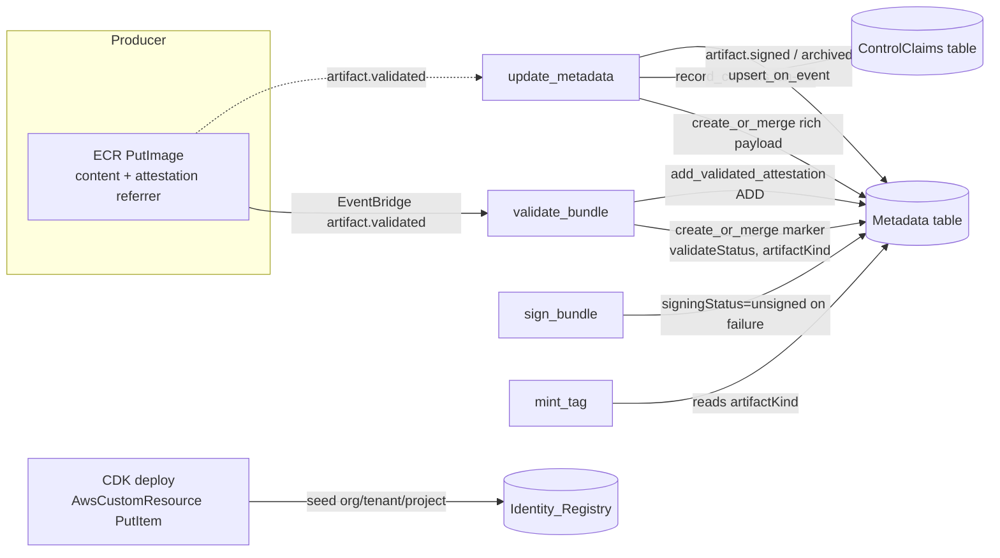

# Data Model — DynamoDB Tables

Describes the database tables **as implemented in the CDK app today** — the single deployed stack (`cairnproofs4af-cmh-alpha`, Customer_Hosted, `us-east-2`, alpha, `WORM_Enabled=false`, single org/tenant/project). Canonical *behavioral* requirements live in the [metadata-index spec](../openspec/specs/metadata-index/spec.md), [producer-claims spec](../openspec/specs/producer-claims/spec.md), and [identity-registry spec](../openspec/specs/identity-registry/spec.md). This doc records the physical schema, derived from the CDK constructs (`cdk/lib/constructs/{metadata-table,control-claims-table,identity-registry}.ts`), the `libs/metadata` access library, and the pipeline Lambdas that write the rows.

## Scope

The persistence layer is **three DynamoDB tables** (no RDS/Aurora/other databases in the CDK app). All three are defined under `cdk/lib/constructs/` and instantiated in `cdk/lib/artifact-store-stack.ts`:

| Construct | File | Stack member | Rebuildable? |
|---|---|---|---|
| `MetadataTable` | `cdk/lib/constructs/metadata-table.ts` | `metadataTable` | Yes — projection of ECR + S3 |
| `ControlClaimsTable` | `cdk/lib/constructs/control-claims-table.ts` | `controlClaimsTable` | Yes — projection of the signed referrers |
| `IdentityRegistry` | `cdk/lib/constructs/identity-registry.ts` | `identityRegistry` | **No** — canonical mutable control-plane state |

Two of the three are the rebuildable **Metadata_Index** projection (Metadata + ControlClaims): a regenerable index over the authoritative sources (ECR content-addressed manifests + S3 archive + the signed referrers). Neither is a source of truth, and `cairn verify` never reads them (see README [Why verification is independent of the index](../README.md#why-verification-is-independent-of-the-index)).

The third — **Identity_Registry** — is different in kind: it is *canonical, mutable control-plane state* (opaque-id → display-name resolution plus tenant→org parentage), not a projection. Losing it costs only display-name resolution, never artifact identity, discoverability, or verifiability.

## Physical configuration (all three tables)

All three tables share identical infrastructure settings:

| Property | Value | Source |
|---|---|---|
| Billing mode | `PAY_PER_REQUEST` (on-demand) | `BillingMode.PAY_PER_REQUEST` |
| Point-in-time recovery | Enabled | `pointInTimeRecoverySpecification.pointInTimeRecoveryEnabled: true` |
| Encryption at rest | KMS customer-managed key (service CMK) | `TableEncryption.CUSTOMER_MANAGED`, `encryptionKey: encryption.serviceKey` |
| Removal policy | `RETAIN` when `isProd`, else `DESTROY` | `statefulRemovalPolicy(isProd)` (T-03/M-5) |
| Local Secondary Indexes | **None** — prohibited on a tenant-PK plane | an LSI would pin a tenant's whole item collection to one partition |
| Global secondary indexes | **None ship today** | when added, a GSI MUST itself lead with `{tenant-id}` so `dynamodb:LeadingKeys` tenant scoping binds the GSI query ([META-001] item 4) |

### Physical table names — auto-named, role-tagged, SSM-published

The tables are **auto-named** — no explicit `tableName` is set — so a future key-schema change replaces a table cleanly instead of colliding on a fixed physical name. Each table is instead:

1. **Tagged** with the logical role under the `cairn:resource` tag key (`RESOURCE_ROLE_TAG`, defined in `metadata-table.ts`), discoverable via the console / Tag Editor / `list-tags-of-resource`:
   - Metadata: `cairn:resource = ArtifactMetadata`
   - ControlClaims: `cairn:resource = ControlClaims`
   - Identity_Registry: `cairn:resource = IdentityRegistry`
2. **Published to SSM** at deterministic parameter paths (the stable identifier is the SSM parameter *name*, not the physical table name) so out-of-stack consumers (`cairn` CLI, TUI) discover the resolved physical name without reconstructing it:
   - `naming.ssmPath(stage, 'tables/metadata')`
   - `naming.ssmPath(stage, 'tables/control-claims')`
   - `naming.ssmPath(stage, 'tables/identity-registry')`

> [!NOTE]
> CloudFormation generates each physical name; consumers resolve it via the `cairn:resource` tag plus the SSM parameter, never by composing it from a fixed naming scheme.

## Entity-relationship overview

The Metadata and ControlClaims tables model a one-to-many relationship by the bundle's `manifestDigest`:

- **Metadata table** — one row per Artifact_Bundle, partitioned by **tenant**. Holds the full per-bundle system-bounded state.
- **ControlClaims table** — one row per `(catalog-or-profile, control, bundle)` triple. The `manifestDigest` is the join key back to the Metadata table row, but the denormalized columns satisfy auditor queries without that dereference.
- **Identity_Registry** — separate control-plane table, joined at read time (by the CLI/TUI/consumer) to resolve opaque ids to display names. The pipeline Lambdas neither read nor write it; the deploy seeds it.

---

## Table 1 — Metadata (Artifact_Bundle index)

**One row per bundle.** Construct: `MetadataTable`. Access facade: `cairn_metadata.access.MetadataIndex` (`libs/metadata`).

### Key schema (tenant-PK plane, design D.6 / [META-001])

| Element | Attribute | Type | Composition | Source |
|---|---|---|---|---|
| Partition key | `pk` | String | `{tenant-id}` — the isolation boundary, scoped **exact-match** via `dynamodb:LeadingKeys` (NOT a prefix) | `cairn_metadata/keys.py` `partition_key` |
| Sort key | `sk` | String | `{project-id}#{manifest-digest}` (digest must start `sha256:`) | `cairn_metadata/keys.py` `sort_key` |

A project listing is a `begins_with('{project-id}#')` sort-key condition under the tenant partition (`sort_key_prefix`); the random `{manifest-digest}` suffix spreads writes across the sort-key range. `{org-id}` is **NOT** a key component — it rides as a plain attribute on the record ([META-001] item 5). The facade exposes no unscoped `Scan` path; every read supplies an exact-match `{tenant-id}` partition key.

> [!NOTE]
> **Tenancy model.** `{tenant-id}` is the partition key uniformly; no `accountId`-prefixed partition variant exists. The table declares only attribute *names* (`pk`/`sk`) and *types* — `libs/metadata` owns the tenant-id and sub-hierarchy semantics, and the `metadata-table.ts` construct doc-comment matches the keys module.

### Data dictionary

Attributes are written across pipeline stages (DynamoDB is schemaless; these are the application-level fields). "Write-once" fields use per-attribute `if_not_exists` merges; "mutable" fields advance under an event-timestamp guard (`updatedAt`).

| Attribute | Type | Written by | Write semantics | Description |
|---|---|---|---|---|
| `pk` | S | key helper | key | Partition key = `{tenant-id}` (see [Key schema](#key-schema-tenant-pk-plane-design-d6--meta-001)). |
| `sk` | S | key helper | key | Sort key = `{project-id}#{manifest-digest}`. |
| `manifestDigest` | S | update_metadata | write-once | Canonical content-addressed bundle id (`sha256:...`), [INGEST-026]. |
| `attestationDigest` | S | update_metadata | write-once | Digest of the Producer_Attestation_Referrer manifest. |
| `validateStatus` | S | validate_bundle | write-once marker | `validated` once validate has recorded coordinates (re-tag short-circuit key). |
| `artifactKind` | S | validate_bundle | write-once marker | Resolved canonical artifact kind; read by mint_tag to compose the canonical tag (threat T-02). |
| `repositoryName` | S | update_metadata | write-once | ECR repository name (project evidence repo). |
| `registryId` | S | update_metadata | write-once | ECR registry (account) id. |
| `region` | S | update_metadata | write-once | AWS region of the push. |
| `orgId` | S | update_metadata | write-once | Opaque org id — leading segment of the `{org-id}/{tenant-id}/{project-id}` hierarchy. A **record attribute, never a key component** ([META-001] item 5). |
| `tenantId` | S | update_metadata | write-once | Opaque tenant id — the partition-key isolation source (mirrored into `pk`). |
| `projectId` | S | update_metadata | write-once | Opaque project id — the sort-key sub-hierarchy source. |
| `oscalReferences` | M/L | update_metadata | write-once | OSCAL evidence references extracted from the Config_Blob. |
| `manifestAnnotations` | M | update_metadata | write-once | OCI manifest annotation map (defaults `{}`). |
| `ecrPushedAt` | S | update_metadata | write-once | AWS-set push timestamp (EventBridge eventTime), [PIPELINE-009]. Contemporaneous; producer cannot manipulate. |
| `temporalConsistencyWarning` | BOOL | update_metadata | write-once | True if content last-modified is not strictly after `ecrPushedAt`. |
| `authenticatedPushPrincipal` | M | update_metadata | write-once | Full AWS-verified `userIdentity` of the pusher, [PIPELINE-010] (Attributable). |
| `layers` | L | update_metadata | write-once | OCI layer descriptors of the bundle. |
| `artifactResourceReference` | S/M | update_metadata | write-once | Reference to the stored artifact resource. |
| `validatedAttestationDigests` | SS | validate_bundle | idempotent `ADD` | String Set of accepted Producer_Attestation_Referrer digests over this content (pair-wise dedup unit). |
| `createdAt` | S | update_metadata | write-once (single-owner) | First-seen time = `ecrPushedAt` (falls back to envelope time). |
| `updatedAt` | S | update_metadata | mutable (guard baseline) | Last-mutation time; seeds + advances the event-timestamp guard. |
| `validatedAt` | S | update_metadata | write-once | `artifact.validated` envelope time. |
| `signingStatus` | S | update_metadata / sign_bundle | mutable | `pending` → `signed` (on `artifact.signed`) or `unsigned` (on signing failure). System-set status filter dimension. |
| `signatureDigest` | S | update_metadata | mutable | Content signature referrer digest (on `artifact.signed`). |
| `attestationSignatureDigest` | S | update_metadata | mutable | Attestation signature referrer digest (omitted when single-signature). |
| `signedAt` | S | update_metadata | mutable | Signing timestamp. |
| `signingProfileArn` | S | update_metadata | mutable | AWS Signer profile ARN used. |
| `timestampProvider` | S | update_metadata | mutable | `system-clock` or `rfc3161` timestamp strategy. |
| `signingError` | S | update_metadata / sign_bundle | mutable | Failure detail when `signingStatus=unsigned`. |
| `archiveStatus` | S | update_metadata | mutable | `pending` → `archived` (on `artifact.archived`) or `failed`. System-set status filter dimension. |
| `s3Bucket` | S | update_metadata | mutable | Archive bucket name (on `artifact.archived`). |
| `s3KeyPrefix` | S | update_metadata | mutable | S3 key prefix of the archived bundle. |
| `wormReceiptDigest` | S | update_metadata | mutable | Digest of the WORM_Receipt referrer. |
| `wormEnabled` | BOOL | update_metadata | mutable | Whether Object Lock applied (per-deployment `WORM_Enabled`). |
| `archivedAt` | S | update_metadata | mutable | Archive timestamp. |
| `archiveError` | S | update_metadata | mutable | Failure summary when `archiveStatus=failed`. |
| `archiveFailureDetail` | M | update_metadata | mutable | `{computedDigest, expectedDigest, artifact}` on archive-integrity failure. |

Type codes: S=String, BOOL=Boolean, SS=String Set, L=List, M=Map.

> [!NOTE]
> `wormStatus` is a recognized system-set status *filter* dimension (see [Access patterns](#access-patterns)), but no current handler writes it onto the Metadata row; it appears only as a denormalized snapshot on the ControlClaims rows. The status-filter allow-list still admits it for forward compatibility.

### Access patterns

| Pattern | Spec | Operation | Key condition |
|---|---|---|---|
| Get one bundle | — | `GetItem` (`get_record`) | `pk = {tenant-id}`, `sk = {project-id}#{digest}` |
| List bundles for a project | [META-004] | `Query` (`query_by_project`/`iterate_by_project`) | `pk = {tenant-id}` AND `begins_with(sk, '{project-id}#')` |
| List by project filtered on status | [META-001.03] | `Query` + in-partition `FilterExpression` | as above, filter ∈ `{signingStatus, archiveStatus, wormStatus}` only |

The facade rejects a `status_filter` naming any non-system attribute (e.g. a producer claim like `assessor`) **before** any DynamoDB call ([META-001.02]) — the index is queryable only by system-bounded dimensions. Pagination is 100-item pages ([META-009/010]).

### Write semantics

- `create_on_validated` / `create_or_merge` — initial row at validate time; per-attribute `if_not_exists` merge converges the validate-marker row and the update_metadata rich payload regardless of create order (row-completeness invariant, design D1/D2).
- `update_on_event` / `upsert_on_event` — signed/archived transitions guarded by event timestamp (`#ts < :event_ts`) so retried/out-of-order EventBridge events cannot clobber newer state ([META-007.02]). The upsert variant tolerates a post-validated event landing before `artifact.validated`.
- `add_validated_attestation` — idempotent String-Set `ADD` of attestation digests (keyed on the content digest).

---

## Table 2 — ControlClaims (control-claims projection)

**One row per `(catalogOrProfileUuid, controlId, manifestDigest)` triple.** Construct: `ControlClaimsTable`. Access facade: `cairn_metadata.control_claims.ControlClaims`. Producer-claims projection [PCLAIM-001].

> [!NOTE]
> **Naming.** The construct and facade are `ControlClaimsTable` / `cairn_metadata.control_claims.ControlClaims` (`control_claims.py`), but the Lambda env var is `CONTROLS_TABLE_NAME` and the `LambdaFunctions` construct prop is `controlsTable` (wired from `this.controlClaimsTable.table`).

### Key schema (tenant-PK plane, [PCLAIM-001] / [META-001])

| Element | Attribute | Type | Composition | Source |
|---|---|---|---|---|
| Partition key | `pk` | String | `{tenant-id}` — the isolation boundary, scoped **exact-match** via `dynamodb:LeadingKeys` (NOT a prefix) | `control_claims.py` `record_controls` |
| Sort key | `sk` | String | `{catalogOrProfileUuid}#{controlId}#{manifestDigest}` | `control_claims.py` `record_controls` |

A `(catalog/profile, control)` listing is a `begins_with('{catalogOrProfileUuid}#{controlId}#')` sort-key condition under the tenant partition (`query_by_control`); the trailing `#` is load-bearing (it stops `ac-2` from prefix-matching `ac-20`), and the random `{manifestDigest}` suffix spreads a heavily-cited control across the sort-key range rather than a hot partition key. The leading `catalogOrProfileUuid` SK segment prevents the OSCAL token-id clash: `ac-2` in NIST 800-53 rev5 is a different token from `ac-2` in another catalog (OSCAL `TokenDatatype` IDs are unique only within their containing document). The construct declares only generic `pk`/`sk` names and types, so the key composition lives in `control_claims.py`, not the CloudFormation table definition; it is the same tenant-PK plane the Metadata table uses, so `dynamodb:LeadingKeys` tenant scoping binds a control-scoped query exact-match.

### Data dictionary

Key attributes plus denormalized columns copied from the Metadata row so an auditor query needs no follow-up `GetItem`. Reserved keys (`pk`, `sk`, `tenantId`, `catalogOrProfileUuid`, `controlId`, `manifestDigest`) are always set by `record_controls` and cannot be overridden through the `denormalized` payload; the rest come from `denormalized` (None values dropped).

| Attribute | Type | Kind | Description |
|---|---|---|---|
| `pk` | S | key | `{tenant-id}` — exact-match partition key (`LeadingKeys` isolation boundary). |
| `sk` | S | key | `{catalogOrProfileUuid}#{controlId}#{manifestDigest}` (the `manifestDigest` segment joins back to the Metadata row). |
| `catalogOrProfileUuid` | S | identity | Producer-declared OSCAL Catalog or Profile UUID. |
| `controlId` | S | identity | OSCAL control token id (e.g. `ac-2`). |
| `manifestDigest` | S | identity | Bundle content digest. |
| `orgId` | S | denormalized | Opaque org id of the citing bundle. |
| `tenantId` | S | denormalized | Opaque tenant id of the citing bundle (mirrors the `pk`). |
| `projectId` | S | denormalized | Opaque project id of the citing bundle. |
| `artifactKind` | S | denormalized | Resolved artifact kind (from attestation). |
| `ecrRepoPath` | S | denormalized | ECR repository name of the bundle (from `repositoryName`). |
| `signingStatus` | S | denormalized snapshot | Pipeline-set status at fan-out time (`pending` pre-sign). |
| `archiveStatus` | S | denormalized snapshot | Pipeline-set status at fan-out time (`pending` pre-archive). |
| `wormStatus` | S | denormalized snapshot | Pipeline-set status at fan-out time (`pending` pre-archive). |
| `createdAt` | S | denormalized | Bundle first-seen time. |

### Access patterns

| Pattern | Spec | Operation | Key condition |
|---|---|---|---|
| List every bundle citing a control under a catalog/profile within a tenant | [PCLAIM-001] | `Query` (`query_by_control`) | `pk = {tenant-id}` (exact-match) `AND begins_with(sk, '{catalogOrProfileUuid}#{controlId}#')` |

### Write semantics

- `record_controls` fans out one row per unique control via `Table.batch_writer` (auto-chunks into 25-item `BatchWriteItem`, retries `UnprocessedItems`). Empty control list → zero rows (no-op). Idempotent: re-delivering the same `artifact.validated` event re-writes identical rows.

> [!NOTE]
> **Design note — why a relationship table, not a GSI.** A GSI-by-control projects *all* attributes and conflates two distinct access patterns on one row. A dedicated relationship table keeps the auditor "list bundles citing control X" query a single `Query` with exactly the denormalized columns it needs.

---

## Table 3 — Identity_Registry (control-plane id → display name)

**One row per opaque identity coordinate.** Construct: `IdentityRegistry`. Access facade: `cairn_metadata.registry.IdentityRegistry`. Capability: [`identity-registry`](../openspec/specs/identity-registry/spec.md) [IDREG-001].

This is **canonical, mutable control-plane state** — DISTINCT from the rebuildable Metadata_Index projection. It resolves the opaque `{org-id}`/`{tenant-id}`/`{project-id}` coordinates (carried throughout the ECR/S3 path, the signed claim, and the index) to human display names, and records each tenant's `{org-id}` parentage. **Display names live ONLY here** — never in the ECR/S3 path, the signed producer claim, or an ECR resource tag. Per-bundle records carry only the opaque coordinates; consumers resolve a display name by JOINING against this registry at read time, so a rename is a single-item write rather than an N-row rewrite ([IDREG-001.01]).

### Key schema

| Element | Attribute | Type | Composition |
|---|---|---|---|
| Partition key | `id` | String | the opaque `{org-id}` / `{tenant-id}` / `{project-id}` |

The opaque ids are globally-unique tokens, so the bare `id` is a sufficient key (no sort key).

### Data dictionary

| Attribute | Type | Description |
|---|---|---|
| `id` | S | The opaque identifier (partition key). |
| `kind` | S | `org` \| `tenant` \| `project`. |
| `displayName` | S | The human-readable name (the only place it lives). |
| `orgId` | S | Present on a `tenant` item: its parent `{org-id}` ([IDREG-001] item 2). |
| `tenantId` | S | Present on a `project` item: its parent `{tenant-id}` (set by the deploy seed). |

### Access patterns (facade)

| Pattern | Operation | Notes |
|---|---|---|
| Resolve one id → display name | `GetItem` (`get_display_name`) | None when unknown |
| Batch-resolve ids → display names | `BatchGetItem` (`resolve_display_names`) | the read-time join; chunks at 100, drains `UnprocessedKeys` |
| Resolve a tenant's org | `GetItem` (`get_tenant_org`) | reads `orgId` |
| Register an org/tenant/project | `PutItem` (`put_org`/`put_tenant`/`put_project`) | control-plane mutation |
| Rename | `UpdateItem` (`set_display_name`) | single-item write, `attribute_exists(id)` guard ([IDREG-001.01]) |

### Population — deploy-seeded (alpha scope)

The table is seeded at deploy for the single org/tenant/project via three serialized `AwsCustomResource` `PutItem` calls in `identity-registry.ts`. Each seed is a **conditional** `PutItem` (`attribute_not_exists(id)`, `ConditionalCheckFailedException` ignored) so a redeploy is idempotent and never clobbers an operator's later display-name rename. The seed values come from the stack props `orgId` / `tenantId` / `projectId` and optional `*DisplayName` props (defaulting the display name to the opaque id). The custom-resource role is granted `dynamodb:PutItem` on this table plus the CMK envelope-key actions via `kms:ViaService = dynamodb.<region>.amazonaws.com`. No pipeline Lambda writes this table today.

---

## Lambda → table access matrix

From `cdk/lib/constructs/lambda-functions.ts` (IAM grants + env vars):

| Lambda | Metadata table | ControlClaims table | Identity_Registry | Env vars |
|---|---|---|---|---|
| `validate_bundle` | read+write (`grantReadWriteData`) | — | — | `METADATA_TABLE_NAME` |
| `sign_bundle` | write (`grantWriteData`) | — | — | `METADATA_TABLE_NAME` |
| `update_metadata` | read+write (`grantReadWriteData`) | read+write (`grantReadWriteData`) | — | `METADATA_TABLE_NAME`, `CONTROLS_TABLE_NAME` |
| `mint_tag` | read (`dynamodb:GetItem` only, custom policy statement) | — | — | `METADATA_TABLE_NAME` |

`update_metadata` is the only Lambda granted on ControlClaims. **No pipeline Lambda is granted on the Identity_Registry** — it is deploy-seeded only and read by the CLI/TUI/consumers at read-time join.

The auditor/query IAM role (`iam-roles.ts`, sid `DdbQueryMetadata`) is granted `dynamodb:Query`/`GetItem`/`BatchGetItem`/`DescribeTable` on the **Metadata table only** (and its `/index/*` for any future GSI); `dynamodb:Scan` is intentionally absent. Tenant isolation is DynamoDB-native: the `{tenant-id}` partition key is scoped exact-match by `dynamodb:LeadingKeys` (NOT a prefix), and project scope is a sort-key `begins_with` within the auditor's tenant partition ([ACCESS-003], [ACCESS-003.03]). The auditor role does **not** currently grant access to the ControlClaims or Identity_Registry tables.

---

## Provenance

- Table infrastructure (`cdk/lib/constructs/`): [`metadata-table.ts`](../cdk/lib/constructs/metadata-table.ts), [`control-claims-table.ts`](../cdk/lib/constructs/control-claims-table.ts), [`identity-registry.ts`](../cdk/lib/constructs/identity-registry.ts); [`cdk/lib/artifact-store-stack.ts`](../cdk/lib/artifact-store-stack.ts)
- Naming / SSM publishing: [`cdk/lib/naming.ts`](../cdk/lib/naming.ts), [`cdk/lib/artifact-store-stack.ts`](../cdk/lib/artifact-store-stack.ts) (the `*TableNameParam` StringParameters)
- Access library (`libs/metadata/cairn_metadata/`): [`keys.py`](../libs/metadata/cairn_metadata/keys.py), [`access.py`](../libs/metadata/cairn_metadata/access.py), [`control_claims.py`](../libs/metadata/cairn_metadata/control_claims.py), [`registry.py`](../libs/metadata/cairn_metadata/registry.py), [`conditional.py`](../libs/metadata/cairn_metadata/conditional.py), [`pagination.py`](../libs/metadata/cairn_metadata/pagination.py)
- Write paths (each `lambdas/<name>/.../handler.py`): [`validate_bundle`](../lambdas/validate_bundle), [`sign_bundle`](../lambdas/sign_bundle), [`update_metadata`](../lambdas/update_metadata), [`mint_tag`](../lambdas/mint_tag), [`archive_to_s3`](../lambdas/archive_to_s3)
- Canonical behavior: [`metadata-index`](../openspec/specs/metadata-index/spec.md), [`producer-claims`](../openspec/specs/producer-claims/spec.md), [`identity-registry`](../openspec/specs/identity-registry/spec.md)

<!-- Reference-link definitions: bracketed spec IDs ([CAP-NNN]) resolve to their canonical
     requirement/scenario anchors. Anchors computed with github-slugger; keep in sync if a
     referenced spec heading is renamed. -->

[META-001]: ../openspec/specs/metadata-index/spec.md#requirement-meta-001-queryable-artifact-index-by-core-dimensions
[META-001.02]: ../openspec/specs/metadata-index/spec.md#scenario-meta-00102-invalid-query-parameter-is-rejected
[META-001.03]: ../openspec/specs/metadata-index/spec.md#scenario-meta-00103-core-query-by-project-filtered-on-a-system-bounded-status
[META-004]: ../openspec/specs/metadata-index/spec.md#requirement-meta-004-list-all-bundles-for-a-project
[META-007.02]: ../openspec/specs/metadata-index/spec.md#scenario-meta-00702-stale-update-is-rejected-via-event-timestamp-guard
[META-009/010]: ../openspec/specs/metadata-index/spec.md#requirement-meta-009-pagination-with-maximum-page-size
[PCLAIM-001]: ../openspec/specs/producer-claims/spec.md#requirement-pclaim-001-control-coverage-projection--list-all-bundles-for-a-control-across-projects-within-a-tenant
[IDREG-001]: ../openspec/specs/identity-registry/spec.md#requirement-idreg-001-control-plane-identity-registry-for-opaque-id-display-name-resolution
[IDREG-001.01]: ../openspec/specs/identity-registry/spec.md#scenario-idreg-00101-a-rename-is-a-single-item-registry-write-not-an-index-rewrite
[INGEST-026]: ../openspec/specs/artifact-ingestion/spec.md#requirement-ingest-026-manifest_digest-as-canonical-identifier
[PIPELINE-009]: ../openspec/specs/processing-pipeline/spec.md#requirement-pipeline-009-authenticated-ecr-push-timestamp-captured-and-temporal-consistency-enforced
[PIPELINE-010]: ../openspec/specs/processing-pipeline/spec.md#requirement-pipeline-010-authenticated-push-principal-captured-from-eventbridge-useridentity
[ACCESS-003]: ../openspec/specs/access-control/spec.md#requirement-access-003-read-only-auditor-access-scope
[ACCESS-003.03]: ../openspec/specs/access-control/spec.md#scenario-access-00303-tenant-partition-is-exact-match-scoped-and-unscoped-scan-is-denied
