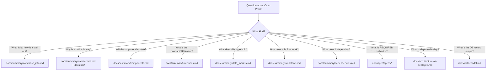
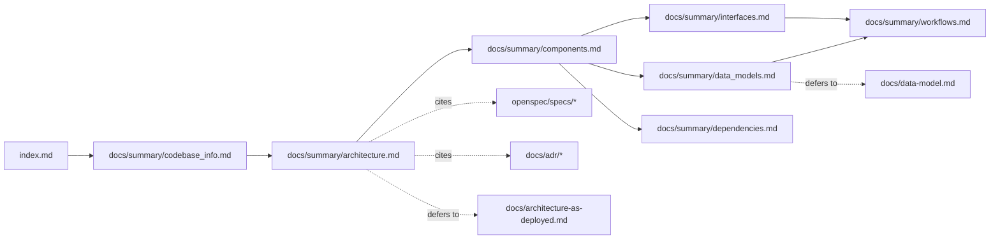

# Cairn Proofs — documentation knowledge base index

> Generated: 2026-07-01 by the codebase-summary SOP. This index is the primary
> context file for AI assistants working on Cairn Proofs. It describes each
> generated document, when to consult it, and how the set relates to the
> project's canonical sources.

## How AI assistants should use this knowledge base

1. **Start here.** This index carries enough metadata to route most questions to
   the right document without loading every file.
2. **Load the specific document** whose summary matches the question, then dive
   into the codebase only if the document points you to specific modules.
3. **Respect the source-of-truth hierarchy.** These generated docs are *derived
   reference*. When they disagree with a canonical source, the canonical source
   wins:
   - **Behavioral contracts** → `openspec/specs/<capability>/spec.md` (18 capabilities).
   - **As-deployed infrastructure** → `docs/architecture-as-deployed.md`.
   - **Persisted DynamoDB record schema** → `docs/data-model.md`.
   - **Agent code-change workflow & conventions** → `AGENTS.md`.
   - **Human onboarding / build-test-deploy** → `README.md`, `DEVELOPING.md`.
   - **Architecturally-significant decisions** → `docs/adr/`.
4. **Do not treat these docs as spec.** Never cite a generated doc as the reason
   a behavior is required; cite the spec. Use these docs to navigate and orient.
5. **Prefer reading real config over trusting prose for volatile facts** (exact
   versions, task names): `mise.toml`, `pyproject.toml`, `cdk/package.json`.

## Document catalog

| Document | Read it when you need… | Key contents |
|---|---|---|
| `docs/summary/codebase_info.md` | A fast orientation: languages, workspace layout, dependency direction | Runtime/language table, top-level layout Mermaid, workspace member table, dependency-direction graph |
| `docs/summary/architecture.md` | To understand system design and the "why" behind the structure | System overview diagram, core principles (operator-independent integrity, index-free verification, content addressing, projection-not-source), design-pattern table, pipeline state machine |
| `docs/summary/components.md` | To find which component owns a responsibility, or which module to edit | Component map, per-Lambda responsibilities, per-library module breakdown, CLI subcommands, read-only TUI, CDK constructs |
| `docs/summary/interfaces.md` | To understand contracts between parts: events, CLI, DB access, config | EventBridge event/detail-type contract, trace propagation, producer ingestion contract, CLI surface table, DynamoDB access paths, SSM parameters, OCI referrer graph |
| `docs/summary/data_models.md` | To understand code-level types, enums, and model relationships | pydantic/dataclass models per library, signing status classDiagram, closed vocabularies. Defers persisted schema to `docs/data-model.md` |
| `docs/summary/workflows.md` | To follow an end-to-end flow step by step | Sequence diagrams: producer push, five-stage pipeline, index-free verify, failure/DLQ, idempotency table, deploy, spec-driven code-change workflow |
| `docs/summary/dependencies.md` | To understand external dependencies and toolchain | Dependency-layer graph, runtime/dev/test deps, mise toolchain and gates, AWS service dependencies, dependency conventions |
| `docs/summary/review_notes.md` | To see known gaps and inconsistencies in this documentation set | Consistency findings, completeness gaps, recommendations |

## Question → document routing

## Relationships between documents

## Example queries and where they resolve

| Query | Primary doc | Supporting |
|---|---|---|
| "How does a bundle move from push to a canonical tag?" | `docs/summary/workflows.md` §2 | `docs/summary/interfaces.md` (events), `docs/summary/components.md` (Lambdas) |
| "Why doesn't verify read DynamoDB?" | `docs/summary/architecture.md` (index-free verification) | `openspec/specs/artifact-verifiability/spec.md` |
| "Where is bundle validation implemented?" | `docs/summary/components.md` (validate_bundle, `libs/validation`) | `docs/summary/data_models.md` (ValidationResult) |
| "What fields are in the metadata record?" | `docs/data-model.md` (canonical) | `docs/summary/data_models.md` (facades) |
| "What are the EventBridge detail types?" | `docs/summary/interfaces.md` | `libs/observability/keys.py` |
| "What signs an artifact and with which profile?" | `docs/summary/components.md` (sign_bundle, `libs/signing`) | `docs/summary/data_models.md` (SigningProfile), `openspec/specs/signing/spec.md` |
| "What are the required manifest annotations?" | `docs/summary/interfaces.md` (ingestion contract) | `openspec/specs/artifact-ingestion/spec.md` |
| "How do I run the pre-merge checks?" | `AGENTS.md` / `DEVELOPING.md` | `docs/summary/dependencies.md` (gates) |

## Capabilities (canonical spec index)

The system's required behavior is specified across 18 capabilities under
`openspec/specs/`: `artifact-ingestion`, `signing`, `worm-archive`,
`metadata-index`, `producer-claims`, `identity-registry`, `processing-pipeline`,
`oscal-interop`, `access-control`, `retention-lifecycle`, `runtime-slos`,
`encryption`, `observability`, `deployment-modes`, `platform-constraints`,
`artifact-tui`, `toolchain`, `artifact-verifiability`. Read a capability's
`## Purpose` first, then its `### Requirement:` blocks.

## Maintenance

Regenerate this set by re-running the codebase-summary SOP against the repo
root. This index lives at `docs/index.md`; the rest of the generated set lives
under `docs/summary/`. The consolidated `AGENTS.md` preserves its
`## Custom Instructions` section verbatim across regenerations; everything else
in `AGENTS.md` is regenerated. Volatile facts (versions, task lists) are
intentionally kept out of the consolidated file — read the pin files instead.
