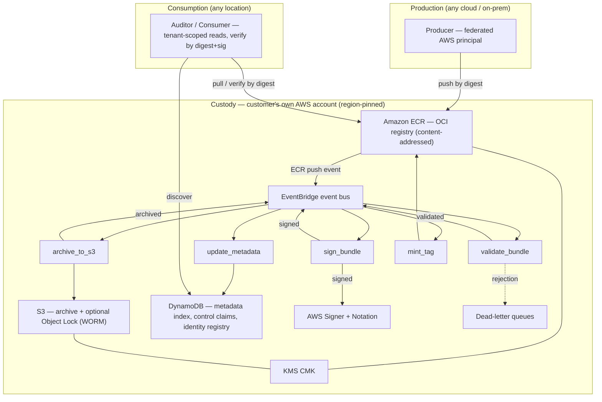
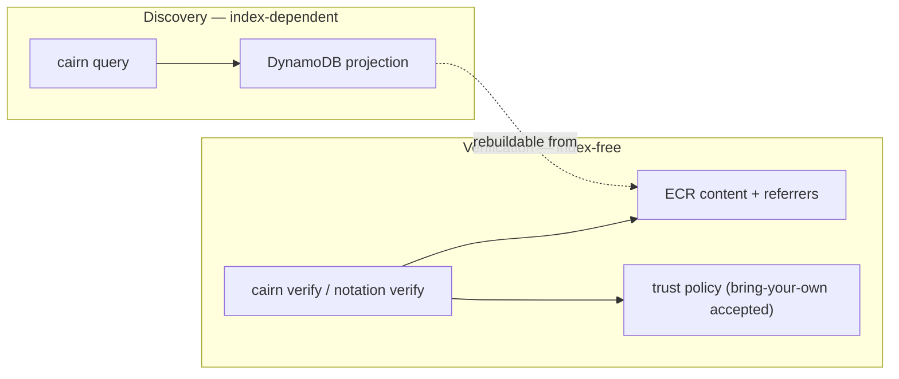
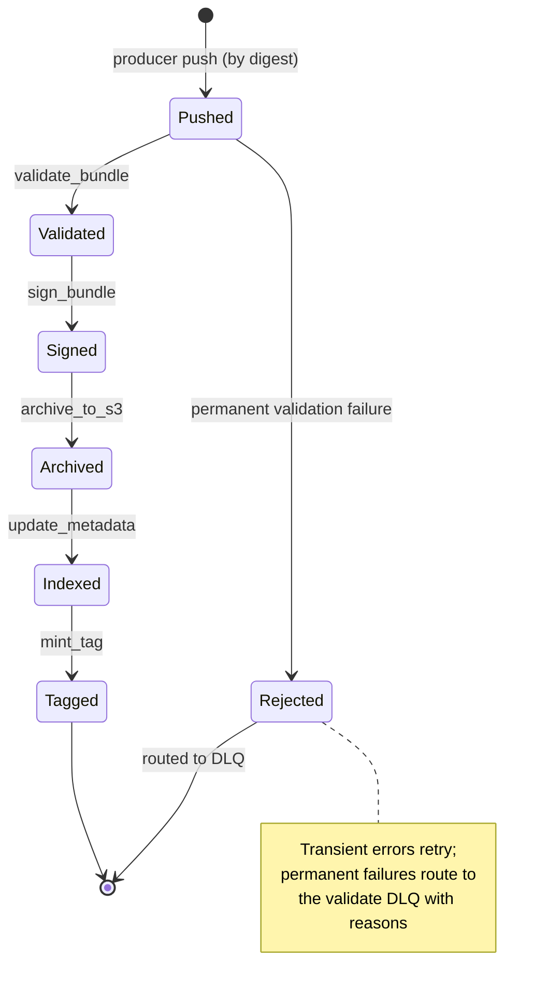

# Architecture — Cairn Proofs

> Generated: 2026-07-01 by the codebase-summary SOP. Derived reference, not
> canonical. Canonical behavior: `openspec/specs/`. As-deployed infrastructure:
> `docs/architecture-as-deployed.md`. Architecturally-significant decisions:
> `docs/adr/`.

## System overview

Cairn Proofs is an event-driven, content-addressable evidence store built on
AWS. A producer pushes an OCI bundle to Amazon ECR; the push emits an
EventBridge event that drives a five-stage Lambda pipeline. Each stage does one
job, emits its own domain event, and hands off to the next stage through the
event bus. The authoritative artifacts are the content-addressed bytes in ECR
and S3; DynamoDB holds only a rebuildable projection used for discovery.

## Architectural principles

### Integrity is independent of the operator

The load-bearing invariant (see ADR-0019): artifact integrity is guaranteed
independent of whoever runs the substrate. Integrity is anchored in the data
plane — the content-addressed digest, the Notation signature, and the WORM
receipt — never conferred by the operator. The operator is a least-privilege
principal, untrusted for integrity by construction.

### Verification never touches the index

`cairn verify` (and a bare `notation verify`) re-derive authenticity,
integrity, and the WORM verdict from the stored artifact alone: content-addressed
bytes in ECR, signatures and the WORM receipt attached as OCI referrers, and a
trust policy. DynamoDB is never read on the verify path. Discovery uses the
index; verification does not. This decouples the evidence's verifiable lifespan
(up to 99 years) from the disposable, rebuildable index.

### Content addressing end to end

Artifacts are addressed by SHA-256 digest. ECR tags are immutable. S3 versioning
is always on. The manifest digest is computed over raw bytes with no JSON
canonicalization, so equal bytes yield equal digests and any byte change yields
a new digest.

### Projection, not source of truth

The DynamoDB metadata index is explicitly rebuildable from ECR + S3. Because it
can be regenerated from the artifacts, it cannot also be the root of trust for
them (see ADR-0020, the metadata-index / core-projection boundary).

## Design patterns

| Pattern | Where | Purpose |
|---|---|---|
| Event-driven choreography | EventBridge + 5 Lambdas | Each stage reacts to the prior stage's domain event; no central orchestrator |
| Single-responsibility handler | one Lambda per package | One handler per pipeline stage; Lambda code never imports `aws-cdk-lib` |
| Adapter | `libs/oscal` over `oscal-bindings` | Thin adapter isolates the OSCAL SDK behind a stable internal surface |
| Facade | `libs/metadata` (`MetadataIndex`, `IdentityRegistry`, `ControlClaims`) | Encapsulate DynamoDB access behind intention-revealing methods |
| Read-only capability object | `cli/cairn_cli/tui/_readonly_client.py` | Wraps boto3 to expose only allow-listed read operations; mutators are unreachable |
| Fail-closed validation | `libs/validation`, `libs/oci` | Malformed input is rejected, never tolerated; every failed criterion is reported |
| Idempotency via content address | pipeline stages | Re-delivered events short-circuit on existing digest / receipt / signature |
| Conditional writes | `libs/metadata/conditional.py` | DynamoDB conditional expressions prevent stale overwrites and duplicate creates |

## Pipeline as a state machine

Each transition is triggered by a domain event on the bus (`validated`,
`signed`, `archived`, `tagged`) or a failure event (`validation_failed`,
`signing_failed`, `archive_failed`, `tag_failed`). `update_metadata` consumes
both success and failure events to keep the index current. See `workflows.md`
for the full sequence and `interfaces.md` for event contracts.

## Deployment topology

The deployed stack today is Customer_Hosted, single-account, one region
(CMH / `us-east-2`), one stage (alpha), `WORM_Enabled=false`. Region pinning is
enforced at provisioning via the `{regionCode}-{stage}` deployment qualifier.
The four-axis actor model (Production, Custody, Operations, Consumption) is
detailed in ADR-0019 and `README.md`. The as-deployed infrastructure diagram is
`docs/architecture-as-deployed.md`.

## Cross-cutting concerns

- **Observability:** `libs/observability` extracts W3C/X-Ray trace context,
  propagates OpenTelemetry baggage across the event bus, emits structured JSON
  logs and EMF metrics. Per-invocation state lives in `contextvars` / OTEL
  baggage, never module-level mutable state (required for parallel-safe tests).
- **Encryption:** TLS in transit; KMS CMK at rest for ECR, S3, and DynamoDB;
  signing keys custodied in AWS Signer's HSM.
- **Access control:** IAM-scoped operations; producers scoped to their project
  path; auditors read-only; the operator is least-privilege with no
  alias-movement grant. See `openspec/specs/access-control/spec.md`.
