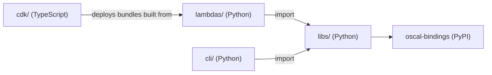

# Codebase information — Cairn Proofs

> Generated: 2026-07-01 by the codebase-summary SOP. This is derived engineering
> reference, not canonical spec. Canonical behavior lives in `openspec/specs/`;
> the as-deployed infrastructure lives in `docs/architecture-as-deployed.md`.
> When this document and a spec disagree, the spec wins.

## Purpose

Cairn Proofs is a tamper-evident storage system for audit evidence and the
artifacts around it. It targets the ALCOA+ data-integrity properties and the
union of NIST 800-53 (AU family) and ISO 27002 (5.x) controls. Artifacts are
organized under a uniform `{org-id}/{tenant-id}/{project-id}` logical tenant
hierarchy and stored on Amazon ECR (OCI registry), signed with AWS Signer +
Notation, archived to S3 with optional Object Lock, and indexed in DynamoDB.
An EventBridge-driven Lambda pipeline moves each pushed bundle through
validation, signing, archival, metadata indexing, and tag minting.

## Languages and runtimes

| Concern | Technology | Pin |
|---|---|---|
| Infrastructure | TypeScript CDK | Node 26, TypeScript ~5.9, aws-cdk-lib ^2.170 |
| Lambdas, shared libraries, CLI | Python | 3.12 (`>=3.12,<3.13`) |
| Python packaging | uv workspace | members: `cli`, `lambdas/*`, `libs/*` |
| Toolchain manager | mise | pins every runtime and tool in `mise.toml` |

The two-language split is deliberate: CDK uses TypeScript for the richer L2
constructs; runtime code uses Python for OSCAL parsing and the boto3 ecosystem.
The two sides interface only through JSON event payloads at the Lambda boundary.

## Supported and unsupported analysis surfaces

- **Fully analyzed (Python):** the five Lambda handlers, the six shared
  libraries, the CLI, and their unit/property/integration tests.
- **Fully analyzed (TypeScript):** the CDK app, its per-resource constructs, and
  the CDK jest tests.
- **Bash:** build, deploy, and layer scripts are described by role, not
  line-by-line.
- **Out of scope for deep symbol analysis:** the `oscal-bindings` PyPI
  package, vendored `node_modules`, and generated
  `lambda-bundles/`.

## Top-level layout

```mermaid
graph TD
    ROOT["Cairn Proofs repo"]

    ROOT --> CDK["cdk/ — TypeScript CDK app (one stack)"]
    ROOT --> LAM["lambdas/ — 5 pipeline Lambda packages"]
    ROOT --> LIB["libs/ — 6 shared Python libraries"]
    ROOT --> CLI["cli/ — cairn CLI + read-only TUI"]
    ROOT --> LAYER["lambda-layers/notation/ — Notation arm64 layer build"]
    ROOT --> SPEC["openspec/ — spec source of truth + tools"]
    ROOT --> DOCS["docs/ — engineering reference (ADRs, backlog, this set)"]
    ROOT --> RUN["runbooks/ — operational docs"]
    ROOT --> TEST["tests/ — unit, property, integration"]

    CDK --> CDKC["lib/constructs/ — per-resource L2/L3 constructs"]
    LAM --> L1["validate_bundle"]
    LAM --> L2["sign_bundle"]
    LAM --> L3["archive_to_s3"]
    LAM --> L4["update_metadata"]
    LAM --> L5["mint_tag"]
    LIB --> LB1["oci"]
    LIB --> LB2["validation"]
    LIB --> LB3["oscal"]
    LIB --> LB4["metadata"]
    LIB --> LB5["signing"]
    LIB --> LB6["observability"]
    CLI --> CLIT["cairn_cli/tui/ — read-only operator TUI"]
```

## Dependency direction

Dependencies flow one way. `libs/` never imports from `lambdas/` or `cdk/`.

## Workspace members

| Path | Package | Role |
|---|---|---|
| `cli/` | `cairn-cli` | `cairn` CLI (push/pull/verify/query/sign/alias/config) + `cairn tui` |
| `lambdas/validate_bundle/` | `cairn-lambda-validate-bundle` | Property-4 bundle validation, identity cross-check |
| `lambdas/sign_bundle/` | `cairn-lambda-sign-bundle` | Notation + AWS Signer signing of content and attestation |
| `lambdas/archive_to_s3/` | `cairn-lambda-archive-to-s3` | S3 archival, WORM receipt, integrity verify-and-abort |
| `lambdas/update_metadata/` | `cairn-lambda-update-metadata` | DynamoDB index + control-claims fan-out |
| `lambdas/mint_tag/` | `cairn-lambda-mint-tag` | Canonical ECR tag minting |
| `libs/oci/` | `cairn-oci` | OCI manifest, config blob, digests, tag grammar, producer attestation |
| `libs/validation/` | `cairn-validation` | Bundle validation rules, principal extraction, identity cross-check |
| `libs/oscal/` | `cairn-oscal` | OSCAL adapter over the bindings SDK; control/metadata extraction |
| `libs/metadata/` | `cairn-metadata` | DynamoDB facades: metadata index, identity registry, control claims |
| `libs/signing/` | `cairn-signing` | Notation CLI wrapper, signing status aggregation, timestamp provider |
| `libs/observability/` | `cairn-observability` | Trace context, structured JSON logging, EMF metrics |

## Where to read next

- System architecture and design patterns: `architecture.md`
- Component responsibilities: `components.md`
- Event contracts, CLI, and integration points: `interfaces.md`
- Data structures and models: `data_models.md`
- Pipeline and key flows: `workflows.md`
- External dependencies: `dependencies.md`
- Documentation index and AI-assistant guidance: `../index.md`
