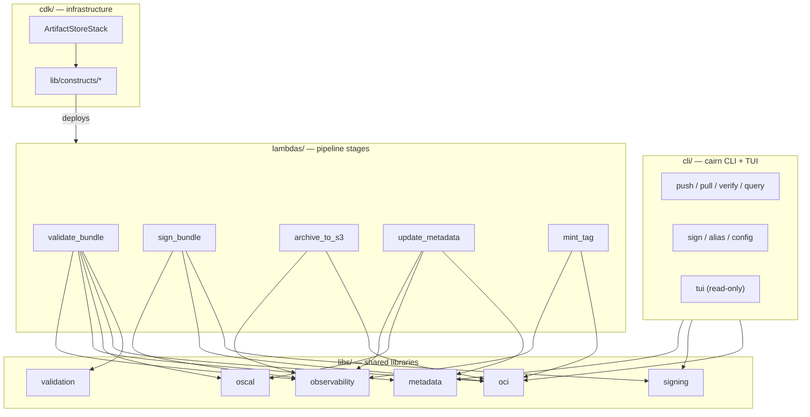
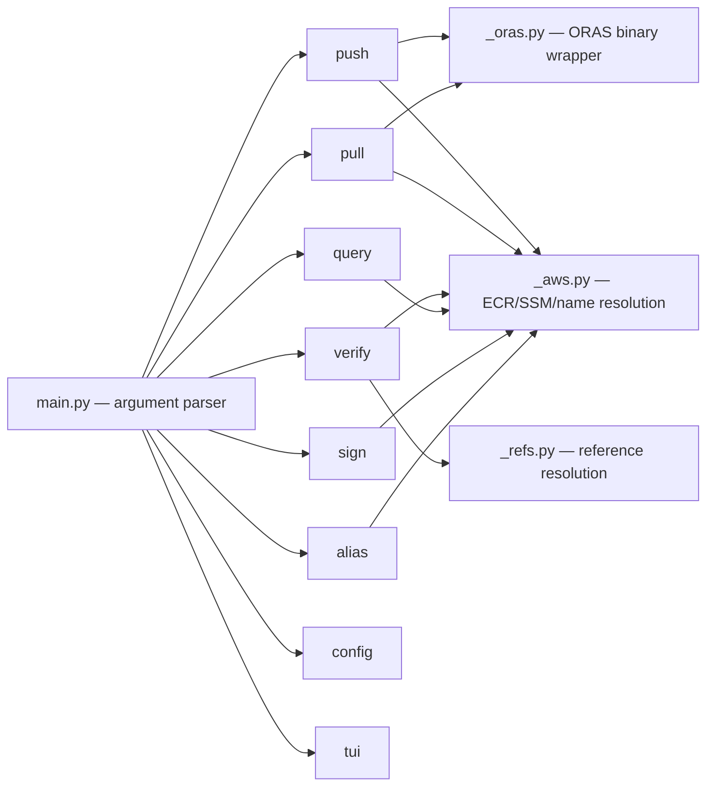

# Components — Cairn Proofs

> Generated: 2026-07-01 by the codebase-summary SOP. Derived reference. Canonical
> behavior: `openspec/specs/`. See `codebase_info.md` for the workspace map and
> `architecture.md` for how these components compose.

## Component map

## Pipeline Lambdas (`lambdas/`)

Each package holds exactly one handler (`handler.py` with `lambda_handler`),
plus small modules for event emission (`events.py`) and any AWS client wrappers.
Lambda code never imports `aws-cdk-lib`.

### validate_bundle
The producer-facing gate and the pipeline entry point. Parses the ECR push
event, extracts the AWS-verified push principal, reads the producer attestation
(in-toto statement), and runs Property-4 bundle validation: manifest
annotations, layer titles, layer count and size bounds, config-blob media type,
artifact-kind vocabulary, control-ID and catalog/profile-UUID well-formedness.
Cross-checks the producer claim's `{org-id}/{tenant-id}/{project-id}` triple
against the IAM-enforced ECR repository path. Runs a temporal consistency check
on OSCAL layers. Emits `validated` or `validation_failed`; permanent failures
route to the DLQ with bounded failure criteria. Records coordinates for
idempotent short-circuit on re-delivery. (`handler.py` is the largest handler.)

### sign_bundle
Signs the content manifest and the producer-attestation referrer using AWS
Signer + Notation. Reads the timestamp provider from SSM (only `system-clock`
supported today; `rfc3161` is rejected). Polls for the signature referrer to
propagate. Short-circuits when both signatures already exist (idempotent).
Emits `signed` (carrying the attestation forward) or `signing_failed`; classifies
Notation stderr as transient (reraise, retry) vs permanent (mark unsigned).

### archive_to_s3
Fetches the manifest, config, layers, and attestation from ECR and writes them
to S3 under a uniform digest-terminal key prefix. Verifies each blob's digest
and declared-vs-true size before writing (integrity verify-and-abort). Attaches
a WORM receipt referrer and, when a resource reference is present, a resource
referrer. When `WORM_Enabled=true`, writes Object Lock Compliance headers.
Idempotent on existing S3 objects + receipt. Emits `archived` or `archive_failed`.

### update_metadata
The only writer to DynamoDB. Consumes every pipeline event — success and
failure — and applies conditional, timestamp-guarded updates so stale or
duplicate events cannot regress state. Merges the rich validated payload onto
any marker row, records the identity triple and `ecrPushedAt`-derived
`createdAt`, projects signature status, and fans out one control-claims row per
cited control. Never persists raw producer-claim attributes on the index record.

### mint_tag
Mints the canonical, immutable ECR tag from the stored record's grammar
authority. Fails closed on tag collision (distinct digest under same tag) and on
unvalidated or missing records. Idempotent no-op on an already-tagged digest.
Emits `tagged` or `tag_failed`.

## Shared libraries (`libs/`)

### oci — `cairn_oci`
The OCI and content-addressing core.
- `digest.py` — SHA-256 compute/parse/verify; `IntegrityError`, `SizeIntegrityError`.
- `manifest.py` — `OciManifest`, `Descriptor` (pydantic, alias-aware).
- `config_blob.py` — `ConfigBlob`, `OscalReferences`, pipeline-internal classification.
- `producer_attestation.py` — `ProducerAttestationReferrer`, in-toto statement build/read, subject-digest matching, identity triple.
- `categories.py` — the tag grammar: canonical ref tags, named/channel alias tags, artifact-kind vocabulary, reserved-token registry. The largest lib module.
- `annotations.py` — `CairnAnnotations` (required/optional manifest annotation keys).
- `identity.py`, `periods.py`, `controls.py` — deterministic resource UUIDs, assessment-period resolution, control-ID grammar and family derivation.

### validation — `cairn_validation`
- `bundle.py` — `validate_bundle`, `validate_claim`, `ValidationResult`, per-criterion checks, `BundleValidationFailure`.
- `principal.py` — `extract_authenticated_push_principal`, `AuthenticatedPushPrincipal`.
- `crosscheck.py` — identity-triple cross-check against the repository path.

### oscal — `cairn_oscal`
Thin adapter over the `oscal-bindings` PyPI package.
- `dispatch.py` — `parse_oscal_layer`, `is_supported_version` (1.x only).
- `extraction.py` — `OscalLayerMetadata`, control-reference extraction from SSPs and Assessment Results (deduped, sorted).
- `reference.py` — `make_artifact_reference` (ECR + S3 rlinks with matching digests).
- `errors.py` — `OscalExtractionError`.

### metadata — `cairn_metadata`
DynamoDB facades and key discipline.
- `access.py` — `MetadataIndex` (tenant-at-partition-key, project/status-scoped queries, event-driven upserts).
- `registry.py` — `IdentityRegistry` (opaque-id → display-name, tenant→org parentage).
- `control_claims.py` — `ControlClaims` (query-by-control, fan-out).
- `conditional.py` — timestamp-guarded conditional writes; `ConditionalUpdateFailed`.
- `keys.py` — partition/sort key construction; `pagination.py` — `PageIterator`, `Page`, opaque tokens.

### signing — `cairn_signing`
- `notation.py` — Notation CLI wrapper: `sign_artifact`, `sign_off`, `verify_artifact`; `NotationCommandError`.
- `status.py` — signing status model and aggregation: `BundleTrust`, `SignatureRole`, `SigningStatus`, `BundleTrustVerdict`, projection labels.
- `profile.py` — `SigningProfile` (pipeline + reviewer profiles).
- `timestamp_provider.py` — `TimestampProvider`, SSM read; `UnsupportedTimestampProvider`.

### observability — `cairn_observability`
- `scope.py` — `observability_scope`, `TraceContext`, inject/extract W3C + X-Ray trace context and OTEL baggage.
- `log.py` — `StructuredJsonFormatter`, root-logger configuration, OTEL log hook.
- `metrics.py` — EMF metric namespace + stage default dimension.
- `tracing.py` — tracer/exporter configuration.
- `keys.py` — `ObservabilityKeys` (field/baggage/event-type vocabularies).

## CLI (`cli/cairn_cli`)

- `push` / `pull` — bundle transfer via the ORAS binary; pull verifies signatures and layer titles.
- `verify` — index-free signature + trust verification; resolves aliases to digests; brings-your-own trust policy supported.
- `query` — tenant-scoped discovery by project or by control (reads DynamoDB).
- `sign` — independent reviewer sign-off referrer via the reviewer profile.
- `alias` / `config` — alias tag management (with move-audit) and target coordinate resolution.
- `tui` — read-only operator TUI (see below).

## Read-only TUI (`cli/cairn_cli/tui`)

An operator TUI that lists bundles, shows lifecycle/cross-reference detail,
navigates OCI referrers, and surfaces DLQ health. Its defining property is
render safety and read-only enforcement:
- `_readonly_client.py` — `ReadOnlyAwsClient` wraps boto3 to expose only
  allow-listed read operations (query, get_item, describe, head, list referrers);
  mutators and `scan` are structurally unreachable.
- `_sources.py` — `ArtifactSources` composes reads into bundle/referrer/DLQ views.
- `_render_safety.py` — `render_safe` neutralizes hostile content so it renders
  inert (no control-byte or markup injection).
- `app.py` — the Textual application and its data-table rendering.

## Infrastructure (`cdk/`)

One stack, `ArtifactStoreStack` (`cdk/lib/artifact-store-stack.ts`), composed
from per-resource constructs under `cdk/lib/constructs/`: `encryption`,
`repositories`, `archive`, `metadata-table`, `control-claims-table`,
`identity-registry`, `dead-letter-queues`, `event-bus`, `log-groups`, `alarms`,
`notifications`, `signing`, `iam-roles`, `lambda-functions`, and
`removal-policy`. Naming and region resolution live in `naming.ts` and
`region-codes.ts`. See `docs/architecture-as-deployed.md` for the deployed view.
