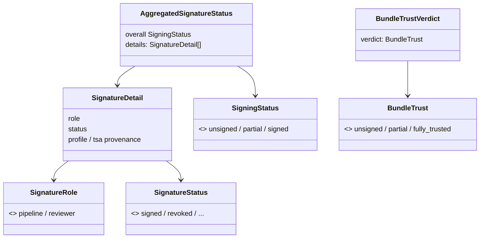

# Data models — Cairn Proofs

> Generated: 2026-07-01 by the codebase-summary SOP. Derived reference. This
> document covers the **code-level** data structures (pydantic models,
> dataclasses, enums). The **persisted DynamoDB record schema** has a canonical
> home at `docs/data-model.md` — consult that for item shapes, keys, and
> attributes. Canonical behavior: `openspec/specs/`.

## Model landscape

```mermaid
graph TB
    subgraph OCI["libs/oci — content & addressing"]
        OM["OciManifest / Descriptor"]
        CB["ConfigBlob / OscalReferences"]
        PA["ProducerAttestationReferrer"]
        DG["digest: IntegrityError / SizeIntegrityError"]
        TG["ParsedTag / ArtifactLocator (tag grammar)"]
        AN["CairnAnnotations"]
    end
    subgraph VAL["libs/validation"]
        VR["ValidationResult / BundleValidationFailure"]
        AP["AuthenticatedPushPrincipal"]
    end
    subgraph OSC["libs/oscal"]
        OLM["OscalLayerMetadata"]
    end
    subgraph SIG["libs/signing"]
        BT["BundleTrust / BundleTrustVerdict"]
        SS["SigningStatus / SignatureStatus / SignatureRole"]
        AG["AggregatedSignatureStatus / SignatureDetail"]
        SP["SigningProfile"]
        TP["TimestampProvider"]
    end
    subgraph META["libs/metadata"]
        MI["MetadataIndex"]
        IR["IdentityRegistry"]
        CC["ControlClaims"]
        PG["Page / PageIterator"]
    end

    PA -->|subject digest matches| OM
    CB -->|references| OLM
    VR -->|produced by| OM
    MI -->|projects| BT
```

## Content and addressing (`libs/oci`)

### OciManifest / Descriptor (`manifest.py`)
Pydantic models of the OCI image manifest and its descriptors. Alias-aware
(camelCase JSON ↔ snake_case fields, `populate_by_name`), tolerate extra keys per
the OCI spec, and require `config`, `digest`, and `size` where the spec does.

### Digest primitives (`digest.py`)
`compute_sha256_digest` (bytes or streaming), `parse_digest`, `format_digest`,
`verify_digest`. Digests are computed over raw bytes with no JSON
canonicalization — equal bytes yield equal digests. `IntegrityError` on digest
mismatch carries both values; `SizeIntegrityError` carries the chokepoint fields
for declared-vs-true size mismatches.

### ConfigBlob / OscalReferences (`config_blob.py`)
The config blob a producer supplies. Requires `project_id`; tolerates stale
`bundle_type` and declared OSCAL schema version as extra fields (never modeled as
authority). `classify_pipeline_internal` distinguishes producer bundles from
pipeline-internal artifacts. `SkipReason` enumerates why an artifact is skipped.

### ProducerAttestationReferrer (`producer_attestation.py`)
The in-toto statement a producer attaches. Carries the identity triple and claim
fields (controls, catalog/profile UUID, assessment period, assessor). Allows
vendor extras. `build_producer_statement` / `read_claim_from_statement` are the
build/read boundary; `subject_digest_matches` binds the statement to the content
digest. `InvalidStatementError` on malformed input. Display names never appear
here — only opaque ids.

### Tag grammar (`categories.py`)
The largest OCI module. Defines canonical ref tags, named and channel alias tags,
the frozen artifact-kind vocabulary (15 canonical values plus a resolvable alias
map), and a reserved-token registry as the single extension point. Types:
`ArtifactLocator`, `ParsedTag`, `ReservedForm`, `ArtifactLocation`; errors
`InvalidTagError`, `InvalidIdError`, `InvalidArtifactKindError`. Fail-closed:
unknown or malformed tokens raise rather than resolve.

### CairnAnnotations (`annotations.py`)
The required vs optional manifest annotation key sets (disjoint). Uses the
`cairnproofs` artifact namespace. `artifactKind` and `control-family` are
deliberately not manifest annotations.

## Validation (`libs/validation`)

### ValidationResult / BundleValidationFailure (`bundle.py`)
`ValidationResult.ok` is false when any criterion fails; `raise_for_errors`
raises `BundleValidationFailure` whose message concatenates every failed
criterion code and field — all failures are reported, not just the first.

### AuthenticatedPushPrincipal (`principal.py`)
The AWS-verified push identity extracted from the EventBridge `userIdentity`
block. Captures IAM user ARNs verbatim and picks the session-issuer username for
assumed roles; normalizes the MFA flag to bool. Raises when ARN or type is
missing — producer-asserted identity is never substituted (the ALCOA+
"Attributable" guarantee).

## OSCAL (`libs/oscal`)

### OscalLayerMetadata (`extraction.py`)
Per-layer extraction: document version (distinct from schema version),
`last_modified` / `published`, assessment period, and deduped-sorted control
references from SSP implemented-requirements and Assessment Results selections.
An `include_all` marker is sticky when an AR selects all controls.

## Signing (`libs/signing/status.py`)

The signing status model aggregates per-signature results into a bundle verdict.

- Aggregation is pure and order-independent; it never mutates its input.
- Two-signature trust (pipeline + reviewer) yields `fully_trusted` only when
  both required roles are satisfied by valid signatures; one valid + one revoked
  or one role is `partial`; none is `unsigned`.
- A revoked signature never satisfies its role; an unknown-role signature never
  satisfies a required role.
- Projection labels map an index-projected status to a display verdict
  (`signed` → fully-trusted, `pending` → partial, `unsigned`/absent → unsigned).

### SigningProfile (`profile.py`) and TimestampProvider (`timestamp_provider.py`)
Frozen `SigningProfile` with `pipeline` and `reviewer` factories (profile names
match the spec). `TimestampProvider` is an enum; the SSM read accepts
`system-clock` and rejects `rfc3161` with `UnsupportedTimestampProvider`.

## Metadata facades (`libs/metadata`)

`MetadataIndex`, `IdentityRegistry`, and `ControlClaims` are DynamoDB facades,
not data records. Key discipline (`keys.py`): the partition key is the whole
tenant id (never a prefix); the sort key begins with a project prefix then the
manifest digest. Conditional writes (`conditional.py`) are timestamp-guarded so
an older event cannot overwrite newer state and a duplicate create fails after
the first. Pagination (`pagination.py`) yields every record exactly once across
pages via opaque, validated tokens. For the persisted attribute layout, see
`docs/data-model.md`.

## Enumerations and closed vocabularies

| Vocabulary | Defined in | Values |
|---|---|---|
| `eventType` (success) | `observability/keys.py` | validated, signed, archived, metadata-updated |
| `eventType` (failure) | `observability/keys.py` | validation-failed, signing-failed, archive-failed |
| `status` | `observability/keys.py` | success, failure, error |
| artifact kinds | `oci/categories.py` | 15 frozen canonical values (+ alias map) |
| signature roles | `signing/status.py` | pipeline, reviewer |
| bundle trust | `signing/status.py` | unsigned, partial, fully-trusted |
| timestamp provider | `signing/timestamp_provider.py` | system-clock (rfc3161 rejected) |
