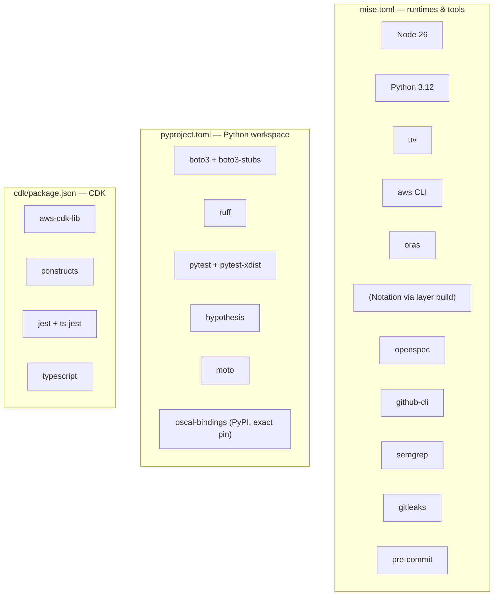
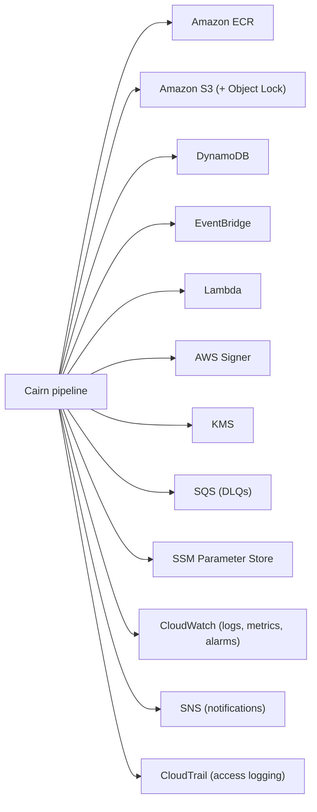

# Dependencies — Cairn Proofs

> Generated: 2026-07-01 by the codebase-summary SOP. Derived reference. The
> authoritative pins live in `mise.toml` (toolchain), `pyproject.toml` (Python
> workspace), `cdk/package.json` (CDK). Versions below are recorded for
> orientation; treat the pin files as the source of truth.

## Dependency layers

## Runtime dependencies (production code)

| Dependency | Used by | Purpose |
|---|---|---|
| `boto3` | Lambdas, CLI, TUI | AWS SDK — ECR, S3, DynamoDB, EventBridge, SQS, SSM, Signer |
| `oscal-bindings` | `libs/oscal` | OSCAL pydantic v2 models + document facade; `libs/oscal` is a thin adapter over it |
| OpenTelemetry / ADOT (via layer) | `libs/observability` | Trace context, baggage propagation, span export |
| Notation CLI + AWS Signer plugin | `sign_bundle`, `libs/signing`, CLI | Cryptographic signing and verification (arm64 layer, built with SHA-256 + GPG verification) |
| ORAS binary | `cli/cairn_cli/_oras.py` | OCI registry transfer (push/pull/attach) from the CLI |
| pydantic (via bindings + models) | `libs/oci`, `libs/oscal` | Model validation and alias-aware (de)serialization |

`oscal-bindings` is published on PyPI from
`github.com/cairn-proofs/oscal-bindings-python` and pinned exactly in
`libs/oscal/pyproject.toml`. Its models are strict (`extra='forbid'`), so a pin
bump changes which OSCAL documents the validate path accepts.

## Development and test dependencies

| Dependency | Purpose |
|---|---|
| `ruff` | The single Python linter + formatter. Lint rule set: `E,F,I,W,B,S,UP,RUF` — note `S` is flake8-bandit (SAST-equivalent), so security linting stays inside ruff |
| `pytest` + `pytest-xdist` | Test runner; parallel by default (`-n auto` via root `addopts`). Tests must be parallel-safe |
| `hypothesis` | Property-based tests under `tests/property/` (e.g. digest determinism, validation biconditionals) |
| `moto` | Mocks AWS services in unit tests |
| `boto3-stubs` | Typed boto3 stubs for the services used (`s3,ecr,dynamodb,events,sqs,iam,kms,signer,sns,ssm,cloudwatch,lambda`) |
| `jest` + `ts-jest` | CDK unit tests under `cdk/test/` |
| `typescript` | CDK app language |

## Toolchain and gates (mise-managed)

| Tool | Role in the project |
|---|---|
| `uv` | Python workspace sync and Lambda cross-install (arm64 wheels) |
| `aws` CLI | Deploy scripts, CloudTrail preflight, operator queries |
| `oras` | CLI registry transfer |
| `openspec` | Spec validation (`--specs --strict`) and change-state inspection |
| `semgrep` | SAST over Python + TypeScript, offline against vendored rules (`tools/semgrep/rules/`) |
| `gitleaks` | Secret detection — staged diff at commit, full history in `check` |
| `pre-commit` | Git-hook formatting/linting/validation |
| `github-cli` | Backlog → GitHub issue sync tooling |

## AWS service dependencies (deployed system)

The platform is AWS-only by design (`openspec/specs/platform-constraints/spec.md`):
ECR as the OCI registry, AWS Signer for signing, S3 Object Lock Compliance for
WORM. Clients (producers, consumers) may run anywhere and authenticate through a
federated AWS principal — the AWS-only constraint binds the store, not its
clients.

## Dependency management conventions

- Add new project tools to `mise.toml` (broad backend coverage: `npm:`,
  `pipx:`, `aqua`, `ubi`, `aws-cli`) rather than per-machine `brew`/`curl`.
- New `libs/` packages are added to both the workspace members and the dev
  group in `pyproject.toml` so `uv sync` installs them editable.
- CDK forbids CloudFormation Exports; cross-stack values flow through SSM.
- macOS contributors need `brew install flock` (Apple doesn't ship it; mise has
  no backend) for the build scripts' concurrency locking.
