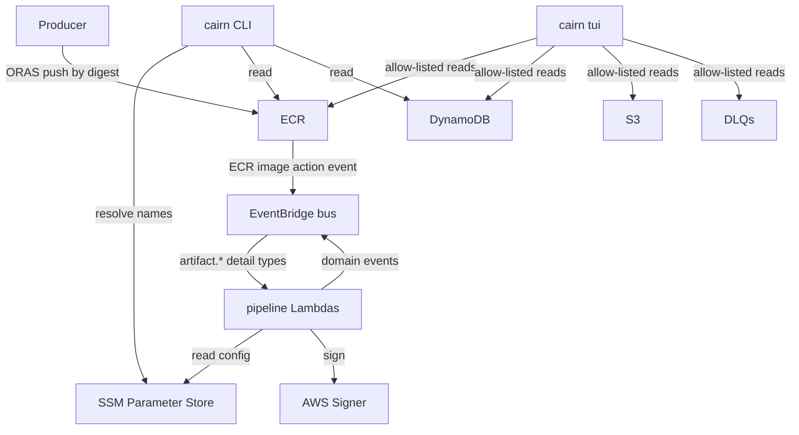
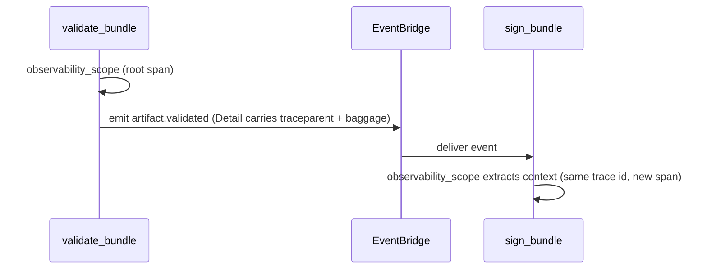
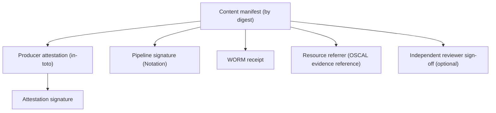

# Interfaces — Cairn Proofs

> Generated: 2026-07-01 by the codebase-summary SOP. Derived reference. Canonical
> behavior: `openspec/specs/` (notably `processing-pipeline`, `observability`,
> `access-control`). Event-type and field vocabularies are pinned in
> `libs/observability/cairn_observability/keys.py`.

## Integration surfaces

## EventBridge event bus (the pipeline backbone)

All pipeline events share one custom bus (name injected as `EVENT_BUS_NAME`) and
one source, `dev.cairnproofs.artifact`, so a single rule pattern matches the
whole namespace. Each stage emits a success or failure event; the detail type
follows the convention `artifact.<event>`. Confirmed example: `validate_bundle`
emits `artifact.validated` and `artifact.validation-failed`.

| Stage | Success emit helper | Failure emit helper |
|---|---|---|
| validate_bundle | `emit_validated` | `emit_validation_failed` |
| sign_bundle | `emit_signed` | `emit_signing_failed` |
| archive_to_s3 | `emit_archived` | `emit_archive_failed` |
| mint_tag | `emit_tagged` | `emit_tag_failed` |
| update_metadata | (terminal consumer — writes DynamoDB, emits no bundle event) | — |

Closed `eventType` log vocabulary (`ObservabilityKeys`): success =
`validated`, `signed`, `archived`, `metadata-updated`; failure =
`validation-failed`, `signing-failed`, `archive-failed`. Status vocabulary =
`success`, `failure`, `error`.

### Event delivery guarantees

- **No silent drops.** `put_events` returns HTTP 200 with `FailedEntryCount>0`
  rather than raising; the shared `emit` helper checks that count and raises
  `EventEmitError` so a dropped event becomes a Lambda failure.
- **Detail is not mutated.** Trace context is injected into a shallow copy of
  `detail`; the caller's dict is untouched.
- **Bounded payloads.** `validate_bundle` enforces a detail byte ceiling and
  caps/bounds failure criteria so a `validation-failed` event stays within
  EventBridge limits.

### Trace propagation contract

Every emit injects the live W3C trace context (`traceparent`) and an
allow-listed subset of OpenTelemetry baggage as flat keys under `Detail`. The
next stage extracts them via `observability_scope`, so one root trace spans the
whole pipeline. Baggage keys outside `ALLOWED_BAGGAGE_KEYS` are dropped at the
producer boundary and at formatter time — an untrusted producer cannot inject
arbitrary log fields. X-Ray native headers are adopted over W3C when present.

## Producer ingestion contract

A producer pushes an OCI bundle by digest to its ECR repository at the uniform
path `{artifact-namespace}/{org-id}/{tenant-id}/{project-id}`. The bundle must
carry the required manifest annotations, layer titles, a config blob with the
correct media type, and a producer-attestation referrer (an in-toto statement)
whose subject digest matches the content manifest. The claimed identity triple
must exactly match the IAM-enforced repository path. Full constraints:
`openspec/specs/artifact-ingestion/spec.md` and `producer-claims`.

## CLI surface (`cairn`)

| Command | Purpose | Reads index? |
|---|---|---|
| `cairn push` | Push a bundle (content manifest + attestation referrer) via ORAS | No |
| `cairn pull` | Pull a bundle by reference; verify signatures and layer titles | No |
| `cairn verify` | Re-derive signature + trust verdict from stored bytes | No (index-free) |
| `cairn query` | Discover bundles by project or by control | Yes (DynamoDB) |
| `cairn sign` | Attach an independent reviewer sign-off referrer | No |
| `cairn alias` | Set/move named or channel alias tags (move is audited) | Reads ECR |
| `cairn config` | Resolve and persist the target `{org}/{tenant}/{project}` | No |
| `cairn tui` | Launch the read-only operator TUI | Reads only |

Reference forms accepted by `verify`/`pull` are resolved by `_refs.py`
(`resolve_reference`): short and long forms, by-digest and by-tag, with alias
resolution to a canonical digest. `verify` anchors its verdict on the resolved
digest, never on a mutable alias.

## DynamoDB access paths (read via CLI/TUI, written only by update_metadata)

| Table facade | Partition key | Access paths |
|---|---|---|
| `MetadataIndex` | tenant id (whole, not a prefix) | query by project, filter by WORM status, get by manifest digest, paginated |
| `ControlClaims` | (control-scoped) | query by control id |
| `IdentityRegistry` | opaque id | resolve opaque id → display name, tenant → org parentage |

No unscoped `scan` and no LSI on the metadata plane — queries are always
tenant-and-project scoped. Pagination uses opaque round-tripping tokens
(`PageIterator` / `paginate_query`) that are validated before use.

## SSM Parameter Store (cross-stack + CLI/Lambda config)

The project prohibits CloudFormation Exports; producers write SSM parameters and
consumers read them. Resolved by the CLI (`cli/cairn_cli/_aws.py`) and Lambdas,
these include: the app-name discovery parameter, ECR registry host, metadata /
control-claims / identity-registry table names, the pipeline and reviewer signer
profile ARNs, the trust policy, and the timestamp-provider selection. The CLI
falls back to name derivation (`name_for`) when a parameter is absent.

## Signing interface

`libs/signing/notation.py` wraps the Notation CLI (arm64 layer) + the AWS Signer
plugin. `sign_artifact` (pipeline profile) and `sign_off` (reviewer profile)
produce OCI signature referrers; `verify_artifact` runs `notation verify`
against a trust policy. Only the `system-clock` timestamp provider is accepted
today; `rfc3161` is rejected (`UnsupportedTimestampProvider`). Signing status is
aggregated per profile into a `BundleTrust` verdict (see `data_models.md`).

## OCI referrer graph

A content manifest accretes referrers, each independently verifiable:

