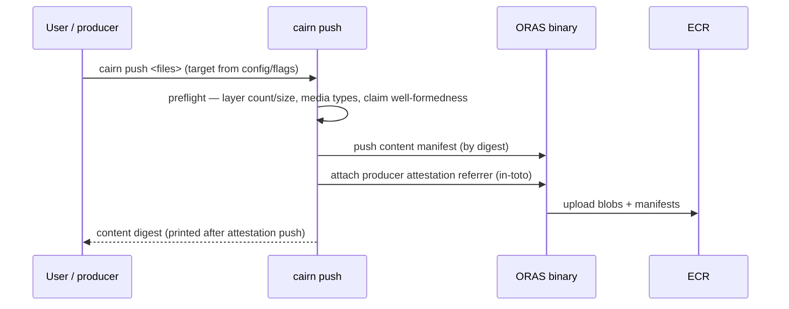
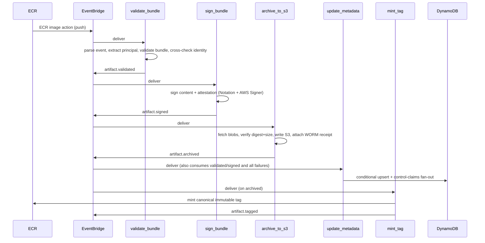
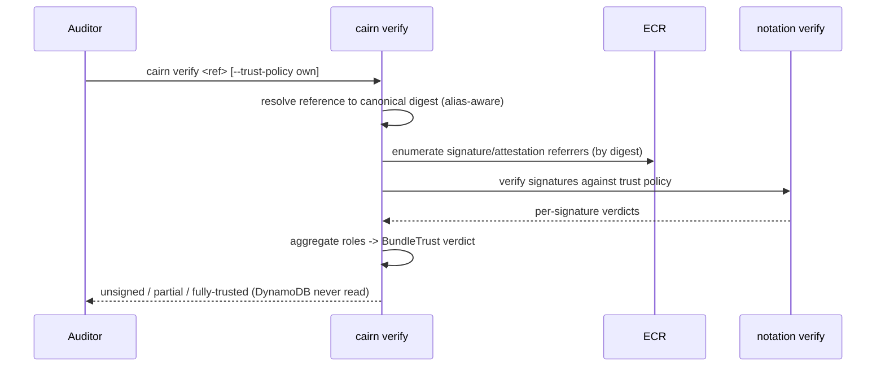
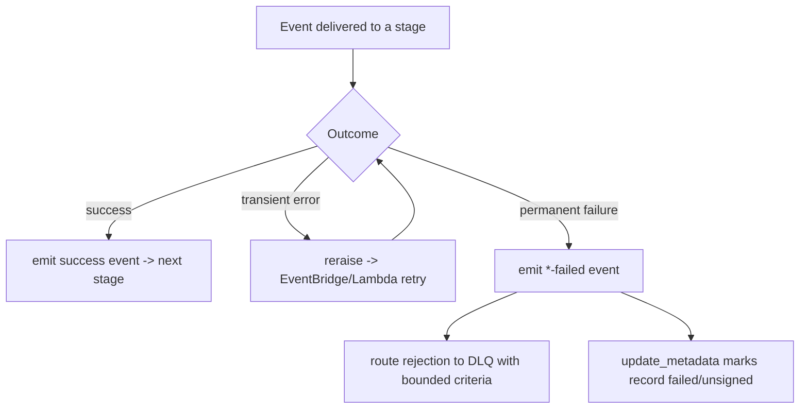
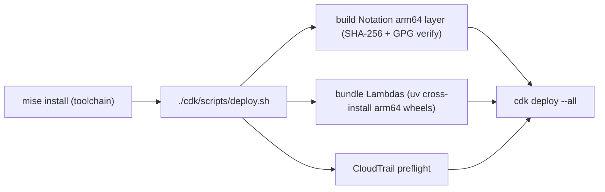
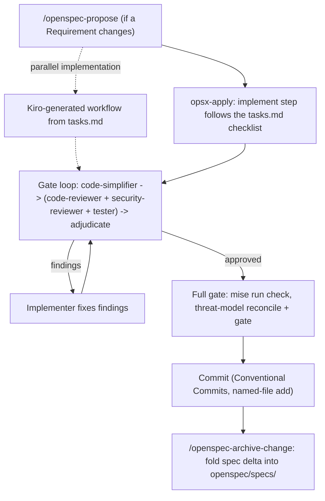

# Workflows — Cairn Proofs

> Generated: 2026-07-01 by the codebase-summary SOP. Derived reference. Canonical
> behavior: `openspec/specs/processing-pipeline/spec.md` and related capabilities.
> The contributor workflow of record is `DEVELOPING.md`; the agent code-change
> workflow is `AGENTS.md`.

## 1. Producer push

The CLI does no client-side tag composition; the canonical tag is minted later
by the pipeline. The attestation referrer's subject is the content digest and
carries the producer claim.

## 2. The five-stage pipeline

`update_metadata` subscribes to every event — success and failure — so the index
tracks the current lifecycle state regardless of where a bundle is in the
pipeline.

## 3. Verify (index-free)

The verdict anchors on the resolved digest, never a mutable alias. A skeptical
auditor can supply their own trust policy or run a bare `notation verify` and
reach the same verdict without trusting anything the operator ships.

## 4. Failure handling, retry, and DLQ

- **Transient vs permanent** is classified per stage (e.g. `sign_bundle`
  classifies Notation stderr; a zero-returncode anomaly is treated as transient,
  safer to retry). Transient errors reraise and rely on retry; permanent
  failures emit a failure event and stop.
- **DLQ payloads are bounded** — `validate_bundle` caps and truncates failure
  criteria and enforces a detail byte ceiling so the rejection message fits.
- **Failure events thread the identity triple** so `update_metadata` can mark the
  correct record failed even on the failure path.

## 5. Idempotency

Every stage is safe under event re-delivery, keyed on the content address:

| Stage | Short-circuit condition |
|---|---|
| validate_bundle | terminal row already recorded for this attestation/digest |
| sign_bundle | both content and attestation signatures already exist |
| archive_to_s3 | S3 objects present and WORM receipt referrer present |
| update_metadata | conditional, timestamp-guarded write — stale/duplicate is a no-op |
| mint_tag | digest already carries its canonical tag |

Content pushed twice yields one bundle; trivially distinct content is not
over-collapsed (verified by the dedup/drift integration tests).

## 6. Deploy

Account and region come from the mise-loaded root `.env`
(`CAIRN_ALPHA_ACCOUNT` / `CAIRN_ALPHA_REGION`). The deploy path requires no
container daemon — Lambda bundling is a pure `uv` cross-install. See
`runbooks/deploy-alpha.md` and `runbooks/notation-layer.md`.

## 7. Spec-driven code-change workflow

Changes flow through OpenSpec. Requirement changes go through the `/openspec-propose`, apply, and `/openspec-archive-change` flows. On Kiro, the saved `opsx-apply` workflow runs the apply: one implement step works through the `tasks.md` checklist, then one simplify, review, and test gate loop runs on the change's uncommitted changes, then the full gate runs `mise run check`. For parallel implementation, Kiro generates a workflow for the change from its `tasks.md`; nothing in the repository schedules it.

The authoritative, detailed description of this workflow lives in `AGENTS.md`
("Code-change workflow"); this diagram is a summary. `mise run check` is the
pre-merge gate (ruff lint + format-check, pytest under `-n auto`, `openspec
validate --specs --strict`, spec-id lint, CDK typecheck + jest, semgrep,
gitleaks).
