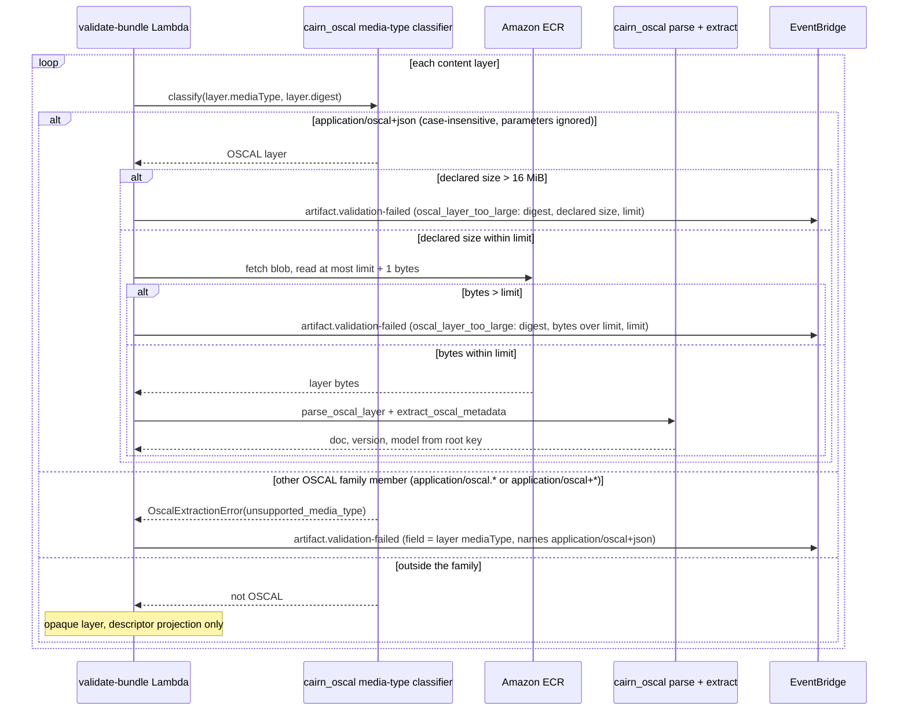

## Context

The validate stage classifies each content layer by its media type. Today it uses one test in `lambdas/validate_bundle/cairn_lambda_validate_bundle/handler.py`: `layer.media_type.startswith("application/oscal.")` (`_OSCAL_MEDIA_PREFIX`). A layer that passes the test goes through `cairn_oscal.parse_oscal_layer` and `cairn_oscal.extract_oscal_metadata`. Every other layer is opaque content. The [proposal](proposal.md#why) gives the problem: the NIST type `application/oscal+json` fails the test, so the pipeline stores a NIST-typed OSCAL layer as opaque content with no error.

Facts that this design depends on:

1. The OSCAL model is already content-derived. `OscalDoc.from_json` selects the root model from the document root key. `extract_oscal_metadata` maps the parsed body type to `OscalDocType`, which covers all 8 GA models, `mapping-collection` included. The media type takes no part in that choice.
2. The test is case-sensitive. A layer typed `APPLICATION/OSCAL.CATALOG+JSON` is opaque content today.
3. The CLI (`cli/cairn_cli/_media_type.py`, `OSCAL_ROOT_TO_MEDIA`) emits per-model types. It uses the short forms `application/oscal.ssp+json` and `application/oscal.poam+json`, and it has no `mapping-collection` entry. The CLI does not depend on `cairn-oscal`.
4. The OSCAL failure event in the handler always sets `field` to `layer[<digest>].metadata.oscal-version`, for every `OscalExtractionError`.
5. The artifact-kind cross-check against the OSCAL model does not exist. The `remove-kind-for-crosscheck` change removed its last code. Issue #101 acceptance criterion 6 therefore needs no code. One stale comment in `libs/oci/cairn_oci/categories.py` still names the cross-check.
6. `MAX_OSCAL_LAYER_BYTES` (64 MiB, `libs/oscal/cairn_oscal/dispatch.py`) is checked inside `parse_oscal_layer`, after `fetch_blob` has read the full blob into memory. `fetch_blob` (`lambdas/validate_bundle/cairn_lambda_validate_bundle/ecr_client.py`) streams up to the 10 GiB per-artifact limit and raises the transient `EcrFetchError` above it, so Lambda retries. The limit is stated only in code and code comments. No spec, runbook, or producer document states it.
7. Parse memory, measured on 2026-11-06 with `parse_oscal_layer` on macOS: the NIST SP 800-53 rev5 catalog (10.0 MiB, the largest known OSCAL document) peaked at 171 MiB RSS. A synthetic catalog of minimal controls peaked at 479 MiB at 8 MiB, 872 MiB at 16 MiB, and 3,030 MiB at 60 MiB. The validate Lambda has 1,024 MB. oscal-bindings limits JSON depth (200) and integer digits (4,300). It has no object-count or memory limit.
8. Only `validate_bundle` branches on the layer media type. `update_metadata` keys on the `oscal` sub-object of each layer entry. `cairn verify`, signing, archive, and tag minting do not read the layer media type. Config_Blob `oscalReferences` handling does not depend on layer media types.

## Goals / Non-Goals

**Goals:**

1. Send every `application/oscal+json` layer through OSCAL parsing and the version gate.
2. Reject every other member of the OSCAL media-type family as a permanent validation failure that names `application/oscal+json`.
3. Make `cairn push` emit `application/oscal+json` for all 8 GA models.
4. Keep one definition of the OSCAL media type, owned by the oscal-interop module.
5. Make an oversized OSCAL layer a permanent validation failure with an actionable message, not an out-of-memory stop.

**Non-Goals:**

1. Accept OSCAL XML or YAML layers. The pipeline stays JSON-only.
2. Register any `application/oscal+*` name with IANA.
3. Rename the Cairn-minted media types (Config_Blob, producer attestation, resource referrer).
4. Re-validate or re-tag stored bundles.

## Architecture

Diagrams: N/A for the architecture view. The change adds no component, data store, queue, or IAM boundary. A new module in `libs/oscal/` replaces a prefix test in the validate Lambda.

## Sequence

Today the loop has two branches. A layer that starts with `application/oscal.` is fetched in full and goes to the SDK. Every other layer, `application/oscal+json` included, is opaque. The new flow adds the media-type rejection branch, moves the NIST type into the SDK branch, and checks the size limit before and during the fetch.

## Decisions

1. **The only OSCAL layer media type is `application/oscal+json`.** This is the NIST recommendation, and it matches the `rlink` media types inside OSCAL documents. The model comes from content, which the pipeline already does (Context fact 1).
   - Alternative: keep the per-model form. Rejected. It is against the NIST recommendation, and it keeps the silent-failure path for NIST-typed layers.
   - Alternative: accept both forms. Rejected. Two accepted spellings for one content type is a second trigger to maintain. It also allows a media type that disagrees with the document root key.
2. **Reject the other OSCAL family members. Do not keep a legacy alias.** Issue #101 open question 1 asked for this decision. Rejection is fail-closed, and the alpha deployment is disposable. Stored bundles are immutable and nothing re-validates them. An alias window has no current user to serve. The rejection also covers `application/oscal+xml` and `application/oscal+yaml`. Today those types are opaque, so this is a new rejection. The oscal-interop Purpose says that a declared-OSCAL bundle that cannot be processed as OSCAL is rejected. An OSCAL XML layer is that case.
3. **Family membership and the match.** A media type is in the family when its essence (type and subtype, before any `;`) starts with `application/oscal.` or `application/oscal+`. The classifier lowercases the essence and strips whitespace. It ignores parameters, so `application/oscal+json; charset=utf-8` is an OSCAL layer. RFC 6838 makes type and subtype names case-insensitive. A case-sensitive match would let `APPLICATION/OSCAL.CATALOG+JSON` bypass the rejection as opaque content, which is the silent-failure class that this change removes. A lookalike such as `application/oscal-catalog+json` is outside the family and stays opaque. The handler records the layer media type verbatim in the layer entry. Only the classification uses the normalized form.
4. **The taxonomy lives in `cairn_oscal`.** Add `libs/oscal/cairn_oscal/media_type.py` with:
   1. `OSCAL_JSON_MEDIA_TYPE: Final = "application/oscal+json"`;
   2. `is_oscal_layer(media_type: str, *, layer_digest: str) -> bool`, which returns `True` for `application/oscal+json`, returns `False` outside the family, and raises `OscalExtractionError(error_kind="unsupported_media_type", layer_digest=...)` for any other family member. `layer_digest` is required and has no default, so every rejection names its layer.

   **The rejection message.** The declared media type is producer-controlled text. The message carries it only as a bounded, escaped value: the first 256 characters, rendered with `ascii()` so control, format, and non-ASCII characters show as escapes, plus the original length when the value is truncated. The message labels the value as producer-declared. The rest of the message is fixed text that names `application/oscal+json` as the required type. Example: `layer sha256:… declares OSCAL media type (producer-declared) 'application/oscal.catalog+json'; the required OSCAL media type is application/oscal+json`.

   Add `"unsupported_media_type"` and `"oscal_layer_too_large"` (Decision 9) to `OscalErrorKind` in `libs/oscal/cairn_oscal/errors.py`. Export both names from `cairn_oscal/__init__.py`. The handler calls `is_oscal_layer` in place of the prefix test, before `fetch_blob`, so a rejected layer is never fetched. Reason: oscal-interop owns the family (ADR-0018 Decision 2), and `libs/oscal/` is that module's code.

   **The failure-event field.** The existing `except OscalExtractionError` block emits the failure event. It chooses `field` from a table keyed by `error_kind`:

   | `error_kind` | `field` |
   |---|---|
   | `unsupported_media_type` | `layer[<digest>].mediaType` |
   | `oscal_layer_too_large` | `layer[<digest>].size` |
   | `parse_failure`, `unsupported_doc_type` | `layer[<digest>]` |
   | `missing_schema_version`, `unsupported_version` | `layer[<digest>].metadata.oscal-version` |

   Today every kind gets `layer[<digest>].metadata.oscal-version`, which misleads for a parse failure. The handler also passes `layer_digest` to `extract_oscal_metadata`, so an `unsupported_doc_type` error names its layer.
   - Alternative: keep the test inline in the handler. Rejected. It splits the taxonomy between the spec owner and the Lambda.
5. **The CLI keeps its own literal, pinned by a test.** `cli/cairn_cli/_media_type.py` replaces `OSCAL_ROOT_TO_MEDIA` with `OSCAL_ROOT_KEYS: Final[frozenset[str]]` (the 8 GA root keys) and `OSCAL_JSON_MEDIA_TYPE = "application/oscal+json"`. The sniffer returns that type for any root key in the set. The sniffer also handles two valid OSCAL JSON forms that it misses today. It decodes the head with `utf-8-sig`, so a leading byte-order mark is removed. It skips one leading `"$schema"` member before the root-key test, and its parse fallback accepts a top-level object whose keys are one OSCAL root key and an optional `"$schema"`. Without this, such a file is tagged `application/json` and stored as opaque content with no error. A unit test in `tests/unit/cairn_cli/test_media_type.py` asserts that the CLI literal equals `cairn_oscal.OSCAL_JSON_MEDIA_TYPE` and that `OSCAL_ROOT_KEYS` equals `set(typing.get_args(cairn_oscal.OscalDocType))`. The test keeps one source of truth without a runtime dependency.
   - Alternative: add `cairn-oscal` to the CLI dependencies. Rejected. It brings `oscal-bindings` and its generated models into the CLI install for one string constant.
6. **ADR-0018 stays unchanged.** Its Decision 2 says "OSCAL claims `application/oscal.*`". The decision is that an interop module owns a media-type family, and that decision still stands. The glob is an illustration. An ADR in force is never edited. A replacement ADR would delete ADR-0018, but ADR-0019 and ADR-0020 cite ADR-0018 by number, and those ADRs cannot be edited either. Issue #101 acceptance criterion 5 lists `docs/`. This design treats ADR-0018 as the one exception and records the exception here. The user can choose a superseding ADR instead (see [Open Questions](#open-questions)).
7. **The oscal-interop Purpose is edited outside the delta.** The `## Purpose` of `openspec/specs/oscal-interop/spec.md` says the module owns "the `application/oscal.*` media-type family" and lists "the OSCAL media-type taxonomy (`application/oscal.{model}+json`)". `openspec archive` keeps an existing Purpose unchanged, so a delta cannot carry this edit. The implementer cannot write to `openspec/specs/`. The session that runs `/openspec-archive-change` edits the two Purpose lines right after the delta merge, in the archive commit. The new text names "the OSCAL media-type family (`application/oscal.*` and `application/oscal+*`)" and the taxonomy "`application/oscal+json` for every OSCAL JSON layer".
8. **OSCAL-002 no longer claims that the media type drives "OSCAL UUID annotation handling".** Config_Blob `oscalReferences` handling ([OSCAL-006](../../specs/oscal-interop/spec.md#requirement-oscal-006-oscal-uuid-references-in-config_blob)) does not read layer media types (Context fact 8). The delta lists the per-OSCAL-layer temporal-consistency check in its place, because that check runs only on OSCAL layers.

9. **The OSCAL layer size limit is a deployment setting with a 16 MiB default, checked before and during the fetch.** The spec states that the limit exists, that a deployment can set it, and what its error reports. It does not state a value. The user chose the 16 MiB default. It gives 60% headroom over the largest known OSCAL document (Context fact 7). A dense synthetic document at 16 MiB peaked at 872 MiB in the measurement, and two such layers in sequence peaked at 870 MiB through the handler's per-layer helper. That leaves too little of a 1,024 MB Lambda for the Python runtime and the ADOT collector. The validate Lambda memory therefore goes to 1,769 MB, the size at which Lambda allocates one full vCPU, which also speeds the single-threaded parse. The cost per millisecond of a validate run rises by about 73%.

   **The setting.** It follows the `retentionPeriodDays` pattern in `cdk/bin/artifact-store.ts`:
   1. `cdk --context maxOscalLayerBytes=N` is read with `numberContext` and passed to `ArtifactStoreStack` as the optional prop `maxOscalLayerBytes`.
   2. The stack checks at synth time that `N` is a whole number from 1 to `MAX_ARTIFACT_SIZE_BYTES` (10 GiB). An out-of-range value fails the synth with a message that names the context key and the range.
   3. When the prop is set, `cdk/lib/constructs/lambda-functions.ts` sets the validate-bundle environment variable `MAX_OSCAL_LAYER_BYTES`. When the prop is not set, the variable is absent.
   4. The handler reads the variable once at import, a permitted read-only module constant. When it is absent, the handler uses `cairn_oscal.DEFAULT_MAX_OSCAL_LAYER_BYTES` (`16 * 1024 * 1024`). When it is present but is not a whole number of 1 or more, the handler raises at import. Every invocation then fails loudly, and the Lambda never runs with a silent fallback.
   5. The default lives in one place, `cairn_oscal`. The CDK code holds no copy of it.

   A deployment that raises the limit must also give the validate Lambda enough memory. `runbooks/troubleshooting.md` states the measured peaks for dense input: 479 MiB at 8 MiB, 872 MiB at 16 MiB, and 3,030 MiB at 60 MiB. This change does not make the Lambda memory a setting.

   **The checks.** There are three, and each one gives the same error kind, `oscal_layer_too_large`:
   1. Before the fetch, the handler compares the descriptor `size` with the limit. A layer over the limit is never fetched.
   2. `fetch_blob` gets a keyword argument `max_bytes`. For an OSCAL layer the handler passes the limit. `fetch_blob` stops reading at `max_bytes + 1` bytes and raises a new permanent error, `BlobSizeLimitExceeded`, which the handler converts to `OscalExtractionError(error_kind="oscal_layer_too_large")`. This catches a descriptor that understates the size. Without `max_bytes`, `fetch_blob` keeps its 10 GiB transient limit for other callers.
   3. `parse_oscal_layer` gets a keyword argument `max_bytes`, default `DEFAULT_MAX_OSCAL_LAYER_BYTES`, and the handler passes the deployment limit. The library reads no environment variable. The function keeps its `len(blob)` check as defense in depth. Its error kind changes from `parse_failure` to `oscal_layer_too_large`.

   `MAX_OSCAL_LAYER_BYTES` in `cairn_oscal` is renamed `DEFAULT_MAX_OSCAL_LAYER_BYTES` and becomes `16 * 1024 * 1024`. Its docstring records the measurement and the reason for the value.

   **Error messages.** Each `oscal_layer_too_large` message names the layer digest, the declared size or the fact that the bytes are longer than the limit, the limit that applies in bytes and in MiB, and the fact that the limit applies to each OSCAL layer. Example: `OSCAL layer sha256:… declares 20,971,520 bytes (20.0 MiB), above the per-layer OSCAL limit of 16,777,216 bytes (16.0 MiB) for this deployment`. The failure event `field` is `layer[<digest>].size`.

   **No CLI check before upload.** The CLI cannot know the limit of the deployment it pushes to without a new read path and new producer IAM permissions. A check against the default would give wrong answers for a deployment that changed the limit. The pipeline error is the producer's signal, and it states the limit that applies.

   **Documentation.** The spec states no value. The default and the setting are documented in these places:
   1. the `DEFAULT_MAX_OSCAL_LAYER_BYTES` docstring;
   2. `cli/README.md`, on the "Constraints" line, for producers: the per-layer OSCAL limit, its default, and that the deployment can change it;
   3. `runbooks/troubleshooting.md`, for operators: the new error kinds, the `maxOscalLayerBytes` context key, and the memory rate;
   4. `runbooks/deploy-alpha.md`, next to `retentionPeriodDays`: the context key, the default, the bounds, and the memory caveat;
   5. `docs/architecture-as-deployed.md`, in the validate-bundle bounds label.

   The code comment in `ecr_client.py` that says the OSCAL cap is 64 MiB changes to refer to the setting.
   - Alternative: keep 1,024 MB and lower the default to 12 MiB (estimated peak about 650 MiB). Not chosen. It leaves only 20% headroom over the largest known OSCAL document.
   - Alternative: an object-count limit in oscal-bindings, set per call. Deferred. It needs a counting pre-pass upstream. A byte limit already bounds the worst-case memory of one parse. Revisit it if a real document needs more than 16 MiB.

   **One OSCAL layer in memory at a time.** In today's loop, `blob` and `doc` are loop locals. The previous layer's parsed document stays alive while the next layer is fetched and parsed. A review measurement showed two dense 15.9 MiB layers in sequence peaking at 1,185 MiB RSS. The handler moves the per-layer OSCAL work into a helper that returns only the version and the extracted metadata, so the bytes and the parsed document are released before the next layer starts. This makes the per-layer limit a per-invocation memory bound.

   **Byte-order mark.** `parse_oscal_layer` removes one leading UTF-8 byte-order mark from its input before `OscalDoc.from_json`. RFC 8259 section 8.1 permits a parser to ignore it. Today the parser rejects such a document as `parse_failure`. The stored bytes and the digest do not change. Without this, the CLI sniffer fix in Decision 5 would turn a byte-order-mark file from silent opaque storage into a guaranteed parse failure.

## Risks / Trade-offs

1. [A producer that uses `oras` or the direct API with a per-model type gets a permanent failure after deploy.] → The failure event names `application/oscal+json` as the required type. `runbooks/troubleshooting.md` documents the new `errorKind`. The alpha deployment has no external producers.
2. [A user with an older `cairn` CLI pushes per-model types and fails.] → The same actionable error. The CLI and the Lambdas ship from one repository and one release.
3. [A producer that types OSCAL as `application/json` still gets no OSCAL validation.] → This is unchanged, and it is the intended behavior of [OSCAL-002.02](../../specs/oscal-interop/spec.md#scenario-oscal-00202-non-oscal-media-type-bypasses-oscal-handling). The pipeline does not sniff opaque content.
4. [The CLI literal drifts from the library constant.] → The pin test in Decision 5 fails on drift.
5. [A real OSCAL document larger than the default limit is rejected.] → The error states the size and the limit that applies. The operator raises the limit with `maxOscalLayerBytes`, and gives the Lambda more memory if needed (Decision 9).
6. [An operator raises the limit without raising the Lambda memory.] → The runbook states the measured memory rate next to the setting. The synth check limits the value only to the per-artifact maximum, so this risk stays with the operator.
7. [The 870 MiB measurement is macOS RSS, not the Lambda arm64 runtime, and the handler and the ADOT collector extension share the 1,769 MB.] → A `slow` test parses two dense layers at the default limit in sequence through the handler's per-layer helper in a subprocess, and asserts the subprocess peak RSS (`ru_maxrss`, bytes on macOS and KiB on Linux) against a budget of 1,400 MiB. The budget leaves about 287 MiB for the runtime and the extension. `RLIMIT_AS` is not used: macOS does not enforce it, and on Linux it limits address space, not resident memory. Before archive, one deployed validate invocation with a limit-sized dense layer records `Max Memory Used` from the Lambda REPORT line.
8. [Nothing bounds the total OSCAL work in one bundle. A bundle can hold 300 layers, each within the limit, and the validate Lambda has a 5-minute timeout. Such a bundle can time out, and after the async retries the event reaches the Lambda DLQ with no in-band rejection record.] → Accepted for this change by the user. The risk exists today at 64 MiB per layer. A per-bundle bound is deferred to a follow-up in the private threat-model repository.

## Migration Plan

1. Deploy with `./cdk/scripts/deploy.sh`. The change has no data migration. Its one infrastructure delta is the optional `MAX_OSCAL_LAYER_BYTES` environment variable, which is absent unless the deployment sets `maxOscalLayerBytes`.
   The validate Lambda memory also changes, from 1,024 MB to 1,769 MB (Decision 9).
2. Rollback: redeploy the previous commit. Bundles that the new code rejected stay in their DLQ, and the producer can push them again after the rollback.
3. At archive: the archive session edits the oscal-interop `## Purpose` right after the delta merge (Decision 7). The module owns "the OSCAL media-type family (`application/oscal.*` and `application/oscal+*`)", and the taxonomy item reads "`application/oscal+json` for every OSCAL JSON layer". The archive also closes #101.

## Open Questions

1. ADR-0018 treatment (Decision 6). The default is to leave it unchanged. The other option is a new ADR that restates ADR-0018 with the new family wording, the deletion of ADR-0018, and an accepted break of the ADR-0018 citations in ADR-0019 and ADR-0020.
