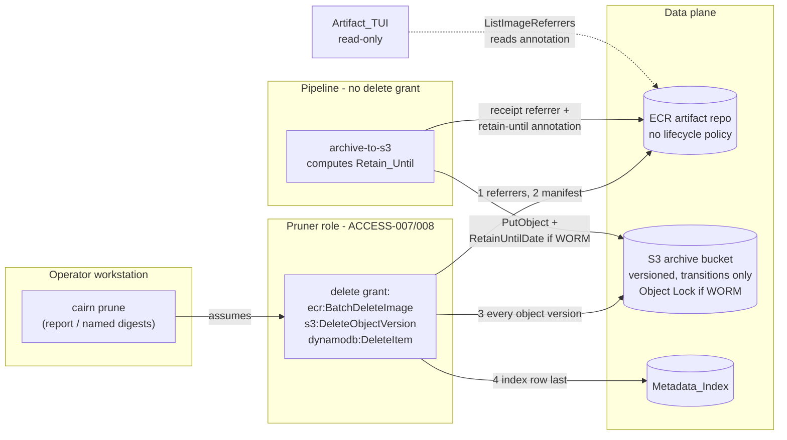
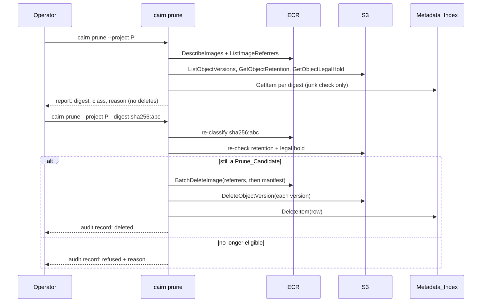
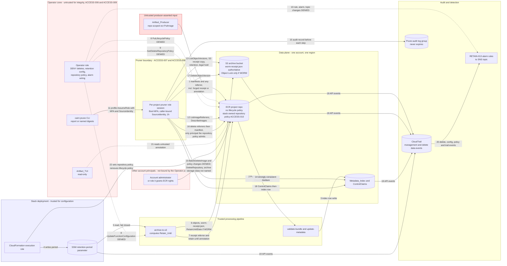

## Context

This change formalizes #51. The motivation is in the [proposal's Why section](proposal.md#why). The relevant current state:

1. `cdk/lib/constructs/repositories.ts` attaches one ECR lifecycle rule: expire images with `TagStatus.UNTAGGED` older than 90 days. The code comment says WORM_Receipt gating is "enforced upstream". Nothing upstream enforces it.
2. Every referrer the pipeline writes is untagged. `archive_to_s3/ecr_client.py` `put_referrer_artifact` calls `put_image` with no tag for the WORM_Receipt and the resource referrer. Notation v1.3.2 pushes the signature untagged, plus a tagged `sha256-<subject>` image index, because `--force-referrers-tag` defaults to `true` in Notation 1.x. That index is currently the only thing that keeps signatures out of reach of the lifecycle rule. ECR does not expire an image that a manifest list references.
3. On 2026-11-01, a lifecycle preview against alpha (`cairnproofs4af-artifact-cmh-alpha/mvp-org/mvp-tenant/mvp-project`, test rule: untagged and older than 1 day) expired nothing. The repository held 14 orphaned integration-test signatures, each pinned by its fallback index, and no WORM_Receipt older than 24 hours. So it remains unverified whether ECR reaps an untagged referrer whose subject is still present. This design does not depend on the answer.
4. `archive_to_s3/handler.py` reads `WORM_RETENTION_YEARS` (default 7, not set by CDK) and applies `ObjectLockRetainUntilDate` only when `WORM_ENABLED=true`. It computes the date with `datetime.replace(year=...)`, which raises on 29 February. The receipt records `archivedAt` but no retention end.
5. The archive bucket has transition rules and no expiration rule. The Operator policy in `iam-roles.ts` explicitly DENIES `ecr:BatchDeleteImage`, `s3:DeleteObject*`, and `dynamodb:DeleteItem`, so no principal in the stack can delete evidence today.
6. `update_metadata` writes no Metadata_Index row for `artifact.validation-failed`. A bundle with a row but no receipt is one that is in the pipeline or failed in it (signing or archive).

## Goals / Non-Goals

**Goals:**

1. Nothing deletes evidence automatically, in ECR or S3.
2. One retention clock (Retain_Until) for both `WORM_Enabled` modes, recorded on the data plane.
3. One explicit, separately authorized, audited operator verb, `cairn prune`, deletes a whole bundle or a proven-junk manifest.
4. Eligibility for evidence is derived from the WORM_Receipt and S3. The index is never the only basis.

**Non-Goals:**

1. Building legal-hold workflow (#4). This change only honors S3 Object Lock legal holds that already exist.
2. Reconciling stale registry links (#19) and cleaning up integration tests (#35).
3. The Notation `--force-referrers-tag=false` fix. It is a separate bugfix that must ship with or after this change (see [Migration Plan](#migration-plan)).
4. Per-kind retention periods and LTA re-timestamping. These stay deferred.

## Architecture

## Sequence

Today, an ECR lifecycle timer deletes untagged images with no operator involved, and nothing ever deletes S3 objects or index rows. After this change, only the second invocation above deletes anything, and only for the digests it names.

## Decisions

1. **ECR is the long-term verification surface.** `cairn verify` reads ECR content and referrers, and [VERIFY-001] keeps the index off the trust path. Deleting the ECR copy of a retained bundle would make it impossible to verify with stock tooling, even though S3 still holds it under [WORM-007]. *Alternative:* expire ECR and verify from S3. Rejected: that needs a new S3-based verify path and moves the trust surface.
2. **Remove the lifecycle rule entirely instead of fixing it.** ECR lifecycle rules can't see referrers or receipts, so no rule can tell junk from evidence. *Alternatives:* a tag-pattern exclusion (referrers have no tags to match), or the ECR "archive" action (still automatic, and archived images are not served to `notation verify`). Both rejected.
3. **Surface, then decide (option a).** One eligibility scan with two classes, and deletion only by explicit operator action. *Alternative:* a scheduled reaper Lambda for junk. Rejected: it puts an autonomous principal with `ecr:BatchDeleteImage` inside a tamper-evident store, which runs against the [ACCESS-006] posture, and the saving is small (ECR storage costs about $0.10/GB-month).
4. **The bundle is the unit of deletion, in a fixed order with the index row last.** A partial delete then stays discoverable and can be retried ([RETAIN-010]). ECR goes before S3 so an interrupted run never leaves an ECR bundle pointing at a deleted archive. Every step before the index row is idempotent: deleting an absent image or version succeeds.
5. **Retain_Until is computed with day arithmetic in both modes.** `archived_at + timedelta(days=period)` has no leap-day failure and gives one clock regardless of `WORM_Enabled`. The setting is in days (stack prop `retentionPeriodDays`, read at runtime from SSM per Decision 11), which replaces `WORM_RETENTION_YEARS`. Days also let non-production test expiry with short periods.
6. **Retain_Until is carried in the receipt body and as a referrer-manifest annotation** (`dev.cairnproofs.artifact.retain-until`, following the existing `dev.cairnproofs.artifact.receipt-type` key). `ecr:ListImageReferrers` returns annotations, so the TUI and the eligibility scan get the value from a call they already make, with no blob fetch.
7. **Eligibility trusts only pipeline-written S3 data ([RETAIN-012]).** Producers hold repo-scoped `ecr:PutImage`, so any ECR referrer or annotation can be forged (threat T5). Producers have no S3 write. The authoritative Retain_Until is therefore the S3 copy `{prefix}worm-receipt.json`, which `archive_to_s3` already writes, plus the Object Lock dates under WORM. The S3 prefix and index key come from the deployment's coordinates and the digest; the validate-stage repo-path crosscheck guarantees they match the bundle. The ECR annotation is a pre-filter and a display value only. *Alternative:* trust the ECR receipt. Rejected: a forged receipt naming an empty prefix would make "every version past retention" vacuously true and delete a retained bundle's ECR copy even under WORM.
8. **The pruner is a dedicated per-project IAM role ([ACCESS-007]),** not only a managed policy. Its trust policy names designated principals and requires MFA, `sts:SourceIdentity`, and a one-hour session. IAM can't condition `ecr:BatchDeleteImage` on retention state, so a pruner session could use the raw API to skip `cairn prune`'s checks (threat T2). Narrow, MFA-gated assumption plus an alarm on every image delete ([RETAIN-013]) bounds that. The Operator policy's explicit DENY on deletes stays as it is, so a principal that holds both cannot prune. Per-project scoping matches `aliasMoverPolicy`. The archive bucket and both tables are encrypted with the service CMK, so the eligibility reads need `kms:Decrypt`: the S3 receipt copy `GetObject` ([RETAIN-012]), the strongly consistent `GetItem` ([RETAIN-008]), and the ControlClaims `Query`. The role gets two narrow decrypt statements and nothing else. The S3 statement requires `kms:ViaService` `s3.<region>.amazonaws.com` and limits `kms:EncryptionContext:aws:s3:arn` to `{bucket}/{org}/{tenant}/{project}/*/worm-receipt.json`, so the pruner can never decrypt an evidence blob. That encryption context is the object ARN only while S3 Bucket Keys are off; with Bucket Keys on, the condition denies every decrypt, which fails safe. The DynamoDB statement requires `kms:ViaService` `dynamodb.<region>.amazonaws.com` and limits `kms:EncryptionContext:aws:dynamodb:tableName` to the Metadata_Index and ControlClaims table names. The role has no decrypt through ECR. Listing, retention, and legal-hold reads don't decrypt.
9. **The junk class requires positive proof that nothing was archived or processed ([RETAIN-008]).** A content manifest qualifies only with no referrer of any kind, no index record, and no S3 object under its prefix, and each absence must be a positive not-found response. A lost CloudTrail-to-EventBridge delivery, a dead-lettered metadata write, or a failed receipt attach after the S3 write would otherwise make real evidence look like junk (threat T4). The classifier lists S3 versions under a digest's derived prefix before it routes on a `subject` field. A producer can set `subject` on any manifest, so routing on it first would let an archived bundle be classified as an orphan referrer and skip its retention check ([RETAIN-008.06]). As a result, a validation-rejected bundle, which carries a Producer_Attestation_Referrer, is never junk. It stays until a later change records rejections on the data plane (follow-up issue).
10. **The two spec IDs are retired, not edited.** [INGEST-027] and [META-006] are removed: their scenario titles state the old behavior, and OpenSpec does not allow renaming a scenario inside a MODIFIED block. The rule moves to [RETAIN-006] and [RETAIN-002], which become the single statements. At archive, ledger rows record the relocation (see [Migration Plan](#migration-plan) step 5).
11. **The retention period is a runtime-validated SSM parameter ([RETAIN-007], [ACCESS-009]).** Object Lock honors whatever date the archive stage writes, so a shortened period is a deletion path once prune exists (threat T7). The stack publishes the period to SSM. The archive stage reads it and fails closed when it is missing or out of bounds. The Operator is denied writes to the parameter, `lambda:UpdateFunctionConfiguration` on the archive stage, and every lifecycle and Object Lock configuration change (threat T1). Changes made by the stack deployment raise an alarm ([RETAIN-013]).
12. **A stack-owned repository policy is the second lock on ECR deletes ([ACCESS-010]).** Identity policies alone can't stop the Operator, or any principal it grants rights to, from adding `ecr:BatchDeleteImage` through a repository policy (threat T19). The stack sets a repository policy that denies image deletes to everyone except the pruner role, and denies lifecycle and repository-policy changes to everyone except the deployment role. In a non-production stack, the image-delete exception also names the integration-test cleanup role and the deployment role, because the `emptyOnDelete` teardown deletes images as the deployment role. Every exception ARN has its partition resolved at synth time. A jest assertion checks that no `${AWS::` token is left in any `RepositoryPolicyText`, because an unresolved token never matches `aws:PrincipalArn` and would lock out the deploy. The Operator is also denied `ecr:SetRepositoryPolicy` and any change to the [RETAIN-013] alarm wiring ([ACCESS-009]).
13. **`cairn prune` assumes the pruner role itself ([ACCESS-007.06]).** botocore's profile-based assume-role provider can't send `SourceIdentity`, so a profile with `role_arn` can never satisfy the trust policy. When the caller is an IAM user, `cairn prune` prompts for the MFA code and calls `sts:AssumeRole` with `SerialNumber`, `TokenCode`, and `SourceIdentity` and `RoleSessionName` both set to the user name. Credentials that are already a pruner session are used as they are. Before any delete, the CLI checks `sts:GetCallerIdentity` and refuses unless the caller is a pruner-role session. Report-only mode works with any read-capable identity. The trust policy binds `sts:SourceIdentity` to `${aws:username}`, which only an IAM user's request carries. Designated pruners must therefore be IAM users in the deployment account (`CAIRN_PRUNER_PRINCIPAL_ARNS`), and synth rejects role ARNs, which could otherwise name the Operator, producer, pipeline, or auditor role ([ACCESS-007.05]). Federated pruners are not supported. *Alternative:* a `credential_process` helper. Rejected because it adds a second entry point that does the same STS call.
14. **Prune audit records go to a stack-owned, never-expiring CloudWatch Logs group ([RETAIN-011]).** The pruner can append to it but can't delete it. The record is written before each delete step, and an audit write failure stops the step. CloudTrail data events cover S3 object-version deletes and index item deletes ([ACCESS-004]), which a management-only trail misses (threat T3).

## Risks / Trade-offs

1. [Junk accumulates until an operator prunes] → The report-only mode makes the backlog visible. The cost is small.
2. [An operator names the wrong digest] → Eligibility is checked again at deletion time, so a retained bundle can't be deleted. Under `WORM_Enabled=true`, S3 Object Lock denies an early delete regardless. Every outcome is audited.
3. [A forged `retain-until` annotation] → Only principals with repo-scoped `ecr:PutImage` can write referrers. Under WORM, S3 is authoritative (Decision 7). Under `WORM_Enabled=false`, a forged past date could make a bundle look eligible early. That deployment is non-production by [WORM-008]. The threat model rates this.
4. [Version listing misses a version, which leaves an S3 orphan after ECR is deleted] → `ListObjectVersions` is paginated to the end, and the bundle's key prefix (WORM-002) bounds it. The index row is kept until the S3 step reports zero remaining versions.
5. [Removing the lifecycle rule leaves the existing integration-test orphans in place] → They are now eligible as unarchived manifests (subject absent, older than the window) and can be pruned explicitly.
6. [The repository policy blocks today's integration-test cleanup] → `BundleCleanup` in `tests/integration/conftest.py` calls `ecr:BatchDeleteImage` with the contributor's credentials, which [ACCESS-010] would deny. Automation can't satisfy the pruner's MFA condition, so non-production deployments get a dedicated integration-test cleanup role in the repository-policy exception. A production stack (`isProd=true`) never synthesizes it. The role trusts only the principals named in `CAIRN_INTEG_CLEANUP_PRINCIPAL_ARNS`, IAM users or roles in the deployment account. When that variable is empty it falls back to the designated pruner principals, so it never trusts the whole account. Each cleanup delete still raises a [RETAIN-013] alarm, which is acceptable noise in alpha.
7. [Pre-existing strict-validation warnings] → `openspec validate --specs --strict` already reports 105 "requirement text very long" warnings across 16 canonical specs. This change adds new requirements of the same class. Fixing the corpus-wide warnings is a separate change.
8. [T14: the repository image count grows toward the ECR images-per-repository quota with no alarm] → ECR publishes no image-count metric, so the quota alarm (M20) is deferred to #34 AC 5 and the risk is accepted. Until then, the runbook quota check in `runbooks/deploy-alpha.md` is the interim control, and T14's residual risk stays Medium.

## Migration Plan

1. Deploy this change. CDK removes the ECR lifecycle policy (`DeleteLifecyclePolicy` on update), adds the pruner role, the prune audit log group, the retention-period SSM parameter, and the alarm rules, and narrows the pipeline grants. The stack must set `retentionPeriodDays` explicitly; the default is 2,555. The CloudTrail preflight in `deploy.sh` now also requires data events for the archive bucket and the index tables, so the account's trail must be configured before deploying.
2. Bundles archived before this deploy have receipts without `retainUntil`. [RETAIN-009] covers them, so they need no backfill.
3. After this change is deployed, ship the Notation `--force-referrers-tag=false` bugfix. Shipping it first would remove the only protection signatures currently have against the 90-day rule.
4. Rollback: redeploying the previous version brings back the 90-day rule. Do that only before any bundle has been in place for 90 days, since the rule would reap referrers.
5. At archive, add `## Relocated and Retired IDs` rows: in artifact-ingestion, `INGEST-027` relocated to `RETAIN-006` and `INGEST-027.01` withdrawn; in metadata-index, `META-006` relocated to `RETAIN-002` and `META-006.01` relocated to `RETAIN-002.01`. In the same edit, remove "the unarchived-manifest cleanup policy, the retention-expiry workflow" from the retention-lifecycle `## Purpose` deferred list, and add the Retain_Until, prune eligibility, and prune workflow items to it.

## Open Questions

1. Resolved: the pruner is scoped per project (Decision 8).
2. A validation-rejected bundle is never prunable (Decision 9). Recording a rejection on the data plane, so that rejected bundles become prunable, is a follow-up issue to file after implementation.

## Threats

See [threat-model.tc.json](./threat-model.tc.json) — open in Threat Composer for the full model.

The load-bearing boundary is the pruner, the first principal that can delete evidence. [RETAIN-012] keeps producer-writable ECR data out of its eligibility decision, [ACCESS-009] takes the retention knobs, repository policy and alarm wiring away from the Operator, and the [ACCESS-010] repository policy makes the pruner the only principal that can delete images, with the stack deployment role as the one exception for lifecycle and repository-policy changes.

The red region (producer) can write any referrer and annotation, which the pruner uses only as a pre-filter (crossings 1, 12) and the TUI only displays (21). The pink Operator zone is denied crossings 8, 9 and 10. The pink account-principal zone meets only the repository policy (23), which does not yet name `ecr:DeleteRepository` or the archive storage-class action. The blue deployment zone sets the retention period and the repository policy (4, 22). The yellow pruner boundary is enforced by IAM and the repository policy for actions and project scope, by the client for item eligibility, and by S3 Object Lock on crossing 17 only under `WORM_Enabled=true`.

| custom:residualRisk | Count |
|---|---|
| Critical | 0 |
| High     | 0 |
| Medium   | 3 |
| Low      | 25 |

**Loop-back gate**: satisfied — no Critical/High residual risk.

This pass re-rates T19 (repository policy) and T20 (alarm suppression) from High and Medium to Low, and T3 and T21 from Medium to Low. It adds T27 and T28, which the [ACCESS-010] repository policy introduces.

Medium findings carry into tasks by threat numericId:

1. T2 — a designated pruner can still bypass `cairn prune` checks with the raw API. This is the inherent insider risk of the grant, bounded by MFA, project scope, the repository policy, unsilenceable alarms and CloudTrail (M5, M6, M7, M8, M28, M29).
2. T14 — the ECR images-per-repository quota, now that no lifecycle rule bounds the count (M20).
3. T27 — `ecr:DeleteRepository` with force, or the ECR archive storage-class action, removes every image without a `BatchDeleteImage` call, so neither the [ACCESS-010] DENY nor the [RETAIN-013.01] alarm sees it. The Operator is already denied `ecr:DeleteRepository`; the source is an account principal outside the Operator policy. Add both actions to the repository-policy DENY (deployment role excepted) and to the [RETAIN-013] alarm set (M36). A spec wording change to [ACCESS-010] and [RETAIN-013] is preferred so [ACCESS-010.01] holds as stated.

Low findings that tasks must carry, with their mitigations:

1. T28 — the [ACCESS-010] deny-all-except shape can lock out the stack's own deploy or non-production teardown. Use `aws:PrincipalArn` conditions, never `NotPrincipal`; take the exception from the synthesizer's execution role; verify the migration deploy and `emptyOnDelete` teardown in alpha (M37).
2. T21 — the profile `mfa_serial` path works only for IAM-user source credentials; a federated pruner needs a recorded IdP-MFA substitution, not a relaxed condition (M29).
3. T3 — organization trails changed from the management account do not fire [RETAIN-013] item 5; name the watcher in the runbook (M30).
4. T22 — archive-to-s3 reads the parameter by name with no label or version selector; runbook acknowledgement for lowering production retention (M31).
5. T20 — the [ACCESS-009] item 5 DENY must name every resource on the alarm path, including `sns:DeleteTopic` and `sns:RemovePermission` (M28).
6. T23 — check remaining session lifetime before an item's first delete (M35).
7. T24 — prove coordinates with a positive-found check, count and remove delete markers (M32).
8. T25 — report every receipt referrer on a multiple-receipt refusal, and file the decoy-removal follow-up issue (M33).
9. T8 — narrow sign-bundle's `grantWriteData` along with the `grantReadWriteData` grants (M14).
10. T9 — replace `archiveBucket.grantPut` so no pipeline role holds `s3:PutObjectLegalHold` (M15).
11. T3 — raise the access-log bucket expiration to the audit horizon (M10).

The remaining Low threats are T1, T4–T7, T10–T13, T15–T19 and T26. T18 (non-production teardown, M26) and T26 (tenant-wide DynamoDB delete scope, M34) are risk-accepted.
