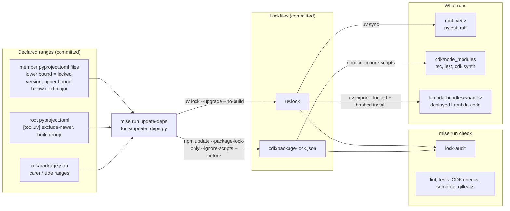
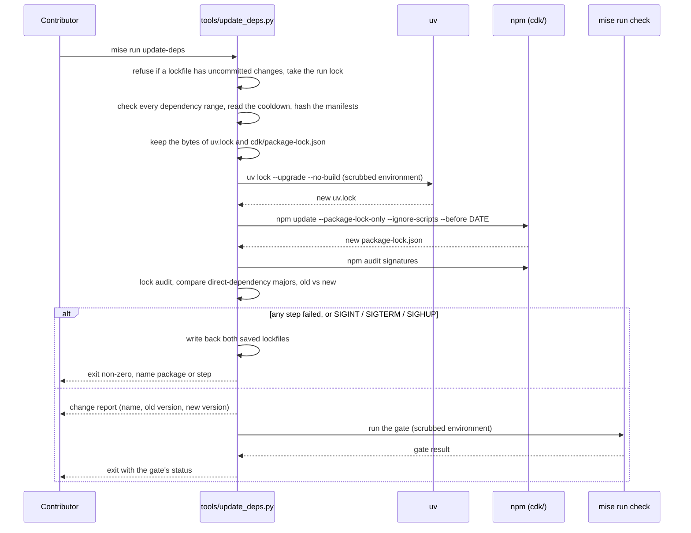

## Context

The [proposal](proposal.md#why) states the problem. This section records what was measured during planning, on 2026-11-04, with uv 0.12.22 and npm 11.19.1.

1. `uv.lock` resolves 12 Python members (`cli`, 5 Lambdas, 6 libraries) plus the root `dev` group. `cdk/package-lock.json` resolves the CDK app. Both were last written in the initial public release commit. The repository has no CI workflow today.
2. `cdk/scripts/build-lambdas.sh` runs `uv pip install ... "${src}"` per Lambda. The `uv pip` interface does not read `uv.lock`. The built `lambda-bundles/validate_bundle/` holds 28 versions that differ from `uv.lock`, among them protobuf 7.36.2 (lock 6.33.6), opentelemetry-api 1.45.2 (lock 1.42.1) and pydantic 2.14.2 (lock 2.13.4).
3. Every third-party Python range has a lower bound and no upper bound. `uv lock --upgrade --dry-run` moves no direct dependency across a major version today. It moves two transitive packages across one: protobuf 6 to 7 (through OpenTelemetry) and cryptography 48 to 50 (through moto, dev only).
4. `uv lock` has no constraint-file option. A temporary `uv.toml` passed with `--config-file`, and the `UV_CONSTRAINT` environment variable, both had no effect on `uv lock`. A committed `[tool.uv] constraint-dependencies` entry did take effect.
5. `npm update --package-lock-only` in a copy of `cdk/` changes 60 lockfile entries and leaves `package.json` unchanged. The only major move is the transitive `@aws-cdk/cloud-assembly-schema` 53 to 55, which `aws-cdk-lib` pins exactly.
6. Two `uv export` calls per Lambda produce an installable lock-exact closure: `--no-emit-workspace` for third-party packages (with hashes) and `--only-emit-workspace --no-hashes` for workspace members. `uv pip install --no-deps --target ... --python-platform aarch64-manylinux_2_17` installed both into one directory. The third-party install passed `--require-hashes`. The result held the locked versions and the arm64 `pydantic_core` shared object. A single export with `--require-hashes` fails, because workspace paths carry no hash.
7. Node 26 entered Active LTS on 2026-10-28 ([Node.js 26.13.0 release notes](https://nodejs.org/en/blog/release/v26.13.0)). The [AWS CDK Node.js support page](https://docs.aws.amazon.com/cdk/v2/guide/node-versions.html) states that CDK supports Node LTS versions; its table does not list 26 yet. `npm run build` and `npm test` (202 tests) in `cdk/` pass under Node 26.12.0. `@types/node` 26 does not compile under TypeScript 5.4 or 5.5 (`BuiltinIteratorReturn` and `AsyncIterator` type errors) and compiles under 5.6 to 5.9. With `typescript ~5.9` (5.9.3) and `@types/node` 26.6.6, `npm run build` passes and all 202 jest tests pass. `@types/node` 22, 24 and 25 compile under TypeScript 5.4.
8. Cooldown, uv. `uv lock --exclude-newer "7 days"` writes `exclude-newer-span = "P7D"` into the `[options]` table of `uv.lock`. After that, `uv lock --check` and `uv export --locked` fail unless the same option is on their command line. The same value as `exclude-newer = "7 days"` under `[tool.uv]` in the root `pyproject.toml` makes lock, check and `export --locked` agree. An `exclude-newer-package` entry in that table, set through the file, also passes all three. The same entry set only on the command line does not.
9. Cooldown, npm. `npm update --package-lock-only --before DATE` is accepted. `.npmrc` takes an absolute date, not a day count.
10. No package code. `uv lock --upgrade --no-build` is accepted. `npm ci --ignore-scripts` installs `cdk/` and `tsc` passes. One lock entry, the optional `fsevents`, has an install script.
11. Build backend. A `build` dependency group with `hatchling==1.33.0` locks with hashes. `uv export --only-group build --no-emit-workspace --frozen` writes 12 hashed requirement lines. `uv pip install --build-constraints FILE --no-deps libs/oci` builds a member with them. With every hash in the file broken, the build fails with a hash mismatch.
12. Lockfile content. `uv.lock` has 79 registry packages. All use `https://pypi.org/simple`, carry a `sha256` hash, and use `files.pythonhosted.org` URLs. 13 entries are workspace members with an `editable` or `virtual` source. `cdk/package-lock.json` has 339 package entries. 37 lack `resolved` and `integrity`, and all 37 are `inBundle` entries under `aws-cdk-lib` and `@aws-cdk/cloud-assembly-schema`. `npm audit signatures` verified 339 registry signatures.
13. `.env.example` holds no AWS credential variables.

## Goals / Non-Goals

**Goals:**

1. One command refreshes both lockfiles ([TOOLS-014](specs/toolchain/spec.md#requirement-tools-014-single-dependency-update-command)).
2. A routine refresh never moves a direct dependency across a major version ([TOOLS-015](specs/toolchain/spec.md#requirement-tools-015-direct-dependencies-stay-within-their-major-version)).
3. A failed refresh leaves no partial lockfile state ([TOOLS-016](specs/toolchain/spec.md#requirement-tools-016-dependency-update-is-all-or-nothing)).
4. A refresh is attributable: the change list comes before the gate result ([TOOLS-017](specs/toolchain/spec.md#requirement-tools-017-dependency-update-reports-changes-and-runs-the-gate)).
5. Deployed Lambdas run the locked versions ([TOOLS-018](specs/toolchain/spec.md#requirement-tools-018-lambda-bundles-install-the-locked-versions)).
6. A refresh selects only releases that are at least 7 days old ([TOOLS-019](specs/toolchain/spec.md#requirement-tools-019-release-cooldown-for-dependency-updates)).
7. Resolution runs no package code ([TOOLS-020](specs/toolchain/spec.md#requirement-tools-020-dependency-resolution-runs-no-package-code)).
8. The lockfiles are audited for source and integrity ([TOOLS-021](specs/toolchain/spec.md#requirement-tools-021-lockfiles-are-audited-for-source-and-integrity)).
9. The bundle build ignores ambient configuration ([TOOLS-022](specs/toolchain/spec.md#requirement-tools-022-lambda-bundle-build-is-isolated-from-ambient-configuration)).
10. CI builds and deploys use committed content ([TOOLS-023](specs/toolchain/spec.md#requirement-tools-023-ci-builds-and-deploys-use-committed-content)).
11. CDK dependencies install without lifecycle scripts ([TOOLS-024](specs/toolchain/spec.md#requirement-tools-024-cdk-dependencies-install-without-lifecycle-scripts)).

**Non-Goals:**

1. Constraining transitive dependencies. Their dependents' declared ranges govern them. The project does not add rules that those packages did not declare.
2. Raising lower bounds on each refresh. A lower bound states the oldest tested version for a consumer that installs a library outside the lock. The lock, not the lower bound, decides what the tests and the bundles use.
3. Major-version catch-up of jest and @types/jest, and a known-vulnerability scan. GitHub issues track them (proposal What Changes item 13).
4. Updating mise-managed tools other than Node, the pre-commit ruff revision, and the `oscal-bindings` pin.

## Architecture

Today the `uv.lock` to `lambda-bundles` edge does not exist. `build-lambdas.sh` resolves each bundle from the manifest ranges, so the bundles and the test venv can hold different versions. No `lock-audit` task and no cooldown exist today.

## Sequence

No dependency update command exists today. Contributors run `uv lock --upgrade-package` or `npm update` by hand, one package at a time.

## Decisions

1. **Lambda bundles install from two lock exports.** `build-lambdas.sh` runs `uv export --package <lambda> --locked --no-dev --no-editable` twice: once with `--no-emit-workspace` (third-party, hashed), once with `--only-emit-workspace --no-hashes` (workspace members). It installs the first with `uv pip install --no-deps --require-hashes` and the second with `uv pip install --no-deps`, both with the existing platform, Python-version and `--target` options. The runtime-provided strip, the collector-config copy and the `flock` gate stay as they are. `--locked` makes the export fail when `uv.lock` is out of date with the manifests ([TOOLS-018.02](specs/toolchain/spec.md#requirement-tools-018-lambda-bundles-install-the-locked-versions)). On any failure the script removes the partly built bundle directory. Context item 6 records the test of this approach.
   - Rejected: one export with `--require-hashes`. It fails, because workspace paths carry no hash.
   - Rejected: one export without hashes. It pins versions but drops the integrity check that the lock already holds.
   - Rejected: keep `uv pip install "${src}"` and pass the export as a `-c` constraints file. It pins versions but does not verify hashes, and the dependency closure still comes from the manifests instead of the lock.
2. **Major-version bounds live in the manifests.** Each third-party direct dependency in a member `pyproject.toml` and in the root `dev` group gets `<N+1`, where N is the first number of its locked version. The lower bound becomes the locked version, so the manifest claims only what was tested. Example: `textual>=0.70.0` becomes `textual>=8.2.7,<9`. A 0.x package gets `<1` ([TOOLS-015.03](specs/toolchain/spec.md#requirement-tools-015-direct-dependencies-stay-within-their-major-version)). `==` pins stay as they are. Workspace members (`cairn-*`) carry no version range and are not direct dependencies under [TOOLS-015](specs/toolchain/spec.md#requirement-tools-015-direct-dependencies-stay-within-their-major-version). The CDK `package.json` ranges already satisfy the rule.
   - Rejected: a lock-derived `[tool.uv] constraint-dependencies` list that the update task regenerates. It would also bound transitive packages, which Non-Goal 1 excludes, and npm has no equivalent that does not stop `aws-cdk-lib` updates (Context item 5).
   - Rejected: temporary constraint overrides at update time. Context item 4 shows that uv ignores them for `uv lock`.
3. **The update task is a stdlib Python script, `tools/update_deps.py`, run with `python3`.** The `spec-ids` task already runs this way. The script needs backup and restore, TOML and JSON lockfile parsing, and a report. Those are hard to test as inline shell in `mise.toml`. The script reads `pyproject.toml` and `uv.lock` with `tomllib` and `package-lock.json` with `json`. It runs `uv` and `npm` through one injectable runner function, so unit tests replace the tools with fakes. The runner passes arguments as a list, never through a shell, builds no argument from manifest or environment text, and stops a child after 900 seconds.
4. **The range check runs first and needs no network.** It reads every dependency table that uv reads: `project.dependencies`, `project.optional-dependencies`, `dependency-groups`, `tool.uv.sources`, `override-dependencies`, `constraint-dependencies` and `build-constraint-dependencies`. A Python range passes when it contains `==V`, `~=V` with two or more release parts, or `<X` where X is no higher than the next major version. An npm range passes when it is an exact version, a tilde range, or a caret range. Any other form fails closed: `>=` alone, `*`, `latest`, `x`-ranges, a direct URL, a table that the check does not parse, or a `tool.uv.sources` entry other than `workspace = true`. Each member's `build-system.requires` must equal `["hatchling"]`. The script hashes all manifests before the check and again before the lock step, and fails if a hash changed. The check runs before either lockfile changes, so [TOOLS-015.02](specs/toolchain/spec.md#requirement-tools-015-direct-dependencies-stay-within-their-major-version) fails without touching state.
5. **The major-version comparison after resolution is a backstop.** With Decision 4 in force, a direct dependency cannot cross a major version. The script still compares the locked major of each direct dependency before and after, because the lockfiles are the observable result that [TOOLS-015](specs/toolchain/spec.md#requirement-tools-015-direct-dependencies-stay-within-their-major-version) constrains. A package that `uv.lock` records at more than one version (resolver forks) is compared as the set of its majors.
6. **Restore covers every failure before the gate, interrupts included.** The script refuses to start when `git status --porcelain` reports a change to either lockfile, so the saved bytes equal `HEAD`. The error prints `git restore uv.lock cdk/package-lock.json`. It takes an exclusive `flock` on a per-user lock file, in the directory pattern that `build-lambdas.sh` uses, so only one run exists at a time. It keeps both lockfiles in memory and writes them back in a `try`/`finally` block when any step before the gate raises or exits non-zero. It maps SIGTERM and SIGHUP to `KeyboardInterrupt`, stops the running child and waits for it, and only then restores. Each restore writes a temporary file in the same directory, calls `fsync`, and replaces the target with `os.replace`. A failed restore of one file does not skip the other, and the error names the file. The script writes nothing else. `npm update --package-lock-only` does not touch `cdk/node_modules`, so a restore needs no reinstall. The `cdk-install` task re-runs `npm ci` because its `sources` include the lockfile. A SIGKILL cannot run the restore. The next start then refuses to run and prints the recovery command.
7. **A gate failure keeps the update.** [TOOLS-017.02](specs/toolchain/spec.md#requirement-tools-017-dependency-update-reports-changes-and-runs-the-gate) leaves the new lockfiles in place, so the contributor can read the change report next to the failing subtask. `git restore uv.lock cdk/package-lock.json` undoes the update.
   - Rejected: restore on gate failure. This removes the state that the contributor needs to find the package that caused the failure.
8. **The change report lists every package in each ecosystem, transitive ones included.** One line per package: `name old -> new`, or `name added new` or `name removed old`, grouped by ecosystem. Each package is keyed on name, source and version, so a changed source, hash or integrity value at an equal version appears in the report, and duplicate names appear. The script escapes control characters in names and versions. The report ends with the line `Review git diff uv.lock cdk/package-lock.json before you commit.` The script also writes the report, the lock-audit result, the SHA-256 of both lockfiles before and after, and the restore result to `.update-deps-report.txt`, which `.gitignore` lists. A failed print of the report (a closed pipe, for example) does not skip the gate, and the script returns the exit status of `mise run check` unchanged. The report makes a transitive major move visible ([TOOLS-015.04](specs/toolchain/spec.md#requirement-tools-015-direct-dependencies-stay-within-their-major-version)) without blocking it.
9. **Node 26.** `mise.toml` pins `node = "26"`, and `cdk/package.json` declares `@types/node: ^26` and `typescript: ~5.9`. The TypeScript range moves because `@types/node` 26 needs TypeScript 5.6 or newer (Context item 7). The range stays a tilde range, and TypeScript 5.9 is a minor-version move inside TypeScript 5. The `engines` field (`>=18.0.0`) stays as it is, because it states a minimum, not the tested version. Context item 7 records the support status and the local test run.
10. **The release cooldown has one source, the root `pyproject.toml`.** `[tool.uv] exclude-newer = "7 days"` applies to every `uv lock` run, so `uv lock --check` and `uv export --locked` agree with the lock (Context item 8). A security fix for one Python package uses `exclude-newer-package` in the same table. The script reads the day count from this entry and computes the absolute date for `npm update --before`, so the two ecosystems cannot drift apart (Context item 9). It fails when the entry is missing or not of the form `N days`. npm has no per-package exemption. A security fix for an npm package uses a direct `npm install NAME@VERSION` outside `update-deps`. The change report prints the cutoff date.
    - Rejected: pass `--exclude-newer` only inside `update-deps`. The lock then records a cooldown span that the other uv commands do not know, and `uv lock --check` and `uv export --locked` fail (Context item 8).
    - Rejected: a cooldown only for npm. Python dependencies reach the deployed Lambdas, so they need it at least as much.
11. **Resolution runs no package code.** The script runs `uv lock --upgrade --no-build` and `npm update --package-lock-only --ignore-scripts`. A dependency that has only a source distribution then fails the update. The error names the package, and both lockfiles are restored. The script starts every child process, `mise run check` included, with an allowlist environment: PATH, HOME, TMPDIR, LANG, TERM, `XDG_*` and `MISE_*`. mise reloads the root `.env` for the gate, and `.env.example` holds no AWS credential variables (Context item 13). The script fails before any change when `uv.toml`, `.npmrc`, `pip.conf` or `[tool.uv]` sets an index or registry, and it passes the default registries explicitly. Test code in the gate still runs as the contributor, so this decision limits what the child processes receive and does not isolate them.
    - Rejected: a denylist of variables. A new variable name would pass it.
    - Rejected: `uv lock --no-config`. It ignores the `[tool.uv]` table, which holds the cooldown (Decision 10).
12. **The lockfile audit is one function with two entry points.** `tools/update_deps.py --audit-locks` reads both lockfiles and needs no network. The `lock-audit` mise task runs it and sits in `check.depends`. The update task runs it after resolution and restores on failure. For `uv.lock` the audit requires a registry source of `https://pypi.org/simple` for every non-workspace package, a `sha256` hash on every sdist and wheel, `https://files.pythonhosted.org/` URLs, and an `editable` or `virtual` source for every `cairn-*` package. For `cdk/package-lock.json` it requires a `resolved` value that starts with `https://registry.npmjs.org/` and a `sha512` integrity value for every entry, and no git, file or link entry. It exempts `inBundle` entries, because the parent tarball's integrity value covers them (Context item 12). The update task also runs `npm audit signatures` and restores on failure. That command needs the network, so it does not belong in `check`.
13. **The bundle build ignores ambient configuration and verifies its build backend.** `build-lambdas.sh` runs the `uv pip install` calls with `env -i` and an allowlist of PATH, HOME, TMPDIR and LANG, `--no-config`, and `--default-index https://pypi.org/simple`. It installs third-party packages with `--only-binary :all:`. The two `uv export` calls keep the repository configuration and take no `--no-config`, because `--locked` needs the `[tool.uv]` cooldown to match the lock (Decision 10). The root `pyproject.toml` gains a `build` dependency group with `hatchling` at an exact version, so `uv.lock` holds it with hashes. The script writes `uv export --only-group build --no-emit-workspace --frozen` to a requirements file and passes it as `--build-constraints` when it installs the workspace members (Context item 11). It writes `BUILD-INFO.json` with the SHA-256 of `uv.lock` into each bundle. The file holds no commit hash and no path, so the CDK asset hash changes only when the lock changes.
14. **CI checks use the `CI` environment variable.** When it is set to a non-empty value, `build-lambdas.sh` runs `git status --porcelain --untracked-files=all -- lambdas libs cli uv.lock pyproject.toml` and fails on any output. `deploy.sh` runs `git diff --quiet HEAD -- uv.lock cdk/package-lock.json cdk/package.json pyproject.toml` and fails on a difference. A developer machine does not run either check. A CI checkout is clean by construction, so the checks catch a CI step that changed files before the build.
15. **CDK dependencies install without lifecycle scripts.** `deploy.sh` and the `cdk-install` task run `npm ci --ignore-scripts`. Context item 10 shows that `cdk/` installs and type-checks. The apply step also runs `npm run build`, `npm test` and `npx cdk synth` after the change.

## Risks / Trade-offs

1. [Risk] A dependency declares a too-wide range for one of its own dependencies, and a transitive major move breaks this project. → The gate runs right after the update ([TOOLS-017](specs/toolchain/spec.md#requirement-tools-017-dependency-update-reports-changes-and-runs-the-gate)), and the change report names the transitive package. The contributor can then add a bound for that package as a deliberate manifest change.
2. [Risk] A direct dependency ships a breaking change in a minor or patch release, or any release on the 0.x line. → Same mitigation as Risk 1. The rule in [TOOLS-015](specs/toolchain/spec.md#requirement-tools-015-direct-dependencies-stay-within-their-major-version) prevents only the breaks that semver announces.
3. [Risk] `uv export --locked` contacts the package index to re-check the lock. → `deploy.sh` already needs network access to fetch wheels. Planning measured no extra delay (the export resolved from the uv cache).
4. [Risk] The AWS CDK support table does not list Node 26 yet. → The CDK policy covers LTS releases, and the CDK typecheck and jest suites pass under Node 26 (Context item 7). Rollback is a pin change in `mise.toml` and `cdk/package.json`: `node`, `@types/node` and `typescript` move back together, to 24, 20 and `~5.4`.
5. [Trade-off] Raising the lower bounds to the locked versions makes the published library metadata (`libs/*`) stricter for consumers outside the lock. → No such consumer exists today, and the old lower bounds claimed compatibility that no test checked.
6. [Risk] The first deploy after this change replaces the bundle versions. → The refreshed lock resolves to versions close to the ones deployed today (Context items 2 and 3), and `mise run check` runs against exactly those versions.
7. [Trade-off] The cooldown delays every Python release by 7 days, security fixes included, and it applies to `uv add` as well as `update-deps`. → `exclude-newer-package` exempts one package, and an npm fix goes through a direct install (Decision 10).
8. [Risk] A source-only dependency stops the update (Decision 11). → The update fails closed, names the package, and restores. Allowing a build for one package is a deliberate change to the task.
9. [Risk] The minimal child environment breaks the gate on a variable that it needs. → The apply step runs `mise run check` through the script before the first commit. The allowlist grows only by a deliberate change.
10. [Trade-off] The exact `hatchling` pin in the `build` group does not move on update (Decision 2 and [TOOLS-014.02](specs/toolchain/spec.md#requirement-tools-014-single-dependency-update-command)). → A contributor bumps it by hand when a new hatchling release is needed.
11. [Risk] `npm audit signatures` can fail for a package that has no registry signature. → All 339 packages verify today (Context item 12). A failure restores the lockfiles and names the package.
12. [Trade-off] Package code still runs in `cdk synth`, `cdk deploy`, `pytest` and `jest`, as the user who runs them. → The controls in this change limit what resolution and installation run and what they receive. They do not sandbox those commands.

## Test Properties

1. The range check accepts each allowed form and rejects each fail-closed form in Decision 4, for both ecosystems. It names the package and the manifest on rejection, and a manifest that changes between the check and the lock step fails the run.
2. With a fake runner, a failure at the uv step, at the npm step, at the audit, at the major-version comparison, a SIGTERM, a SIGHUP, or a `KeyboardInterrupt` at any of these leaves both lockfiles byte-identical to their starting content. A failed restore of one file does not skip the other.
3. With a fake runner whose `uv lock` writes a lockfile that moves a direct dependency across a major version, the run fails and restores both lockfiles.
4. The script refuses to start when a lockfile has uncommitted changes, and a second concurrent run stops without changing a file.
5. The change report for a pair of fixture lockfiles lists exactly the changed, added and removed packages, transitive ones included. It lists a changed source, hash or integrity value at an equal version, and it escapes control characters.
6. A gate failure gives a non-zero exit and leaves the new lockfiles in place. A closed output pipe does not hide the exit status of the gate.
7. The cooldown: a missing or malformed `exclude-newer` fails the run. The npm cutoff date equals the run date minus the day count. With a fake runner, the uv and npm commands carry `--no-build`, `--ignore-scripts` and the cutoff.
8. The child environment holds only the allowlisted names, whatever the caller's environment holds. A repository index setting fails the run before any change.
9. The audit passes for the committed lockfiles. It fails, and names the package, for a fixture with a foreign registry, a missing hash, a git source or a link entry. It accepts an `inBundle` entry that lacks `resolved` and `integrity`.
10. With a stub `uv` first on `PATH`, `build-lambdas.sh` calls `uv export` with `--locked`, calls `uv pip install --require-hashes` for the third-party export, and passes `--build-constraints` for the members. When the stub fails any call, the script exits non-zero and leaves no `lambda-bundles/<name>/` directory. The `uv pip install` calls run with a minimal environment and `--no-config`, and the `uv export` calls do not take `--no-config`.
11. With `CI` set and a fixture repository that has a modified tracked file, an untracked file or a modified lockfile, `build-lambdas.sh` or `deploy.sh` fails. With `CI` unset, neither check runs.
12. After a real `build-lambdas.sh` run, every third-party `*.dist-info` version in each bundle equals its `uv.lock` version, and `BUILD-INFO.json` holds the SHA-256 of `uv.lock`. This is a network-dependent check that runs once during implementation. It is not part of `mise run check`.

## Migration Plan

1. Add the manifest bounds, the `build` dependency group and `[tool.uv] exclude-newer` (Decisions 2, 10 and 13), run `uv lock`, and review the diff. The cooldown can select older versions for packages released in the last 7 days.
2. Land the update task, the lock audit and the bundling change.
3. Bump Node (Decision 9) and switch the CDK install to `--ignore-scripts` (Decision 15).
4. Run `mise run update-deps` once and commit the refreshed lockfiles.
5. Rollback: revert the commit. The previous `build-lambdas.sh` resolves from the manifest ranges again.

## Open Questions

None.
