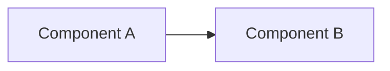
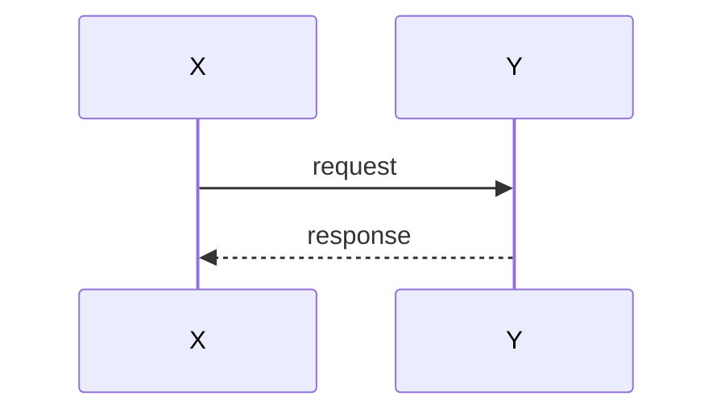

## Context

<!-- Background and current state -->

## Goals / Non-Goals

**Goals:**
<!-- What this design aims to achieve -->

**Non-Goals:**
<!-- What is explicitly out of scope -->

## Architecture

<!--
Component / structure view. Use a mermaid flowchart or graph with subgraph
blocks for layers, accounts, or trust zones. Required when this change adds or
re-wires components, data stores, queues, or IAM boundaries. If this is a pure-library / pure-rename /
pure-config change with no structural change, replace this block with
"Diagrams: N/A — <one-line reason>".
-->

## Sequence

<!--
Runtime-flow view. Use a mermaid sequenceDiagram when this change adds or alters
a flow (event → Lambda → store hops, signing, cross-account calls). Add a
one-line prose contrast with today's flow beneath the diagram. Omit this section
only when the change introduces no new or changed flow.
-->

## Decisions

<!-- Key design decisions and rationale -->

## Risks / Trade-offs

<!-- Known risks and trade-offs -->
